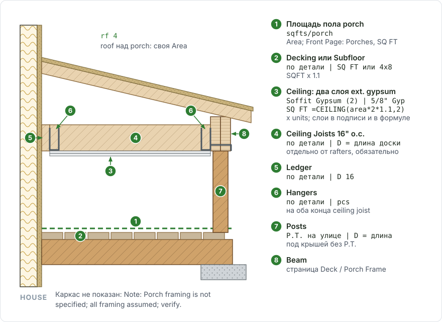

# Porch SQFT

<figure markdown>
  
  <figcaption markdown="span">Porch: a floor on its own frame and a ceiling (soffit) under the roof. The floor area is an Area `porch`; the roof over the porch is its own Area in roof.</figcaption>
</figure>

## What it is

A porch is a covered platform at an entry, on its own frame. Its area gives the floor
(decking or subfloor) and the ceiling (exterior gypsum; two layers are one row,
`Soffit Gypsum (2)`, with x 2 in the formula). The roof over the porch is a separate area per
[Roof SQFT](roof.md); the porch eave is a separate takeoff `eve 12 porch`.
A porch is counted on its own, separately from balconies, even if it looks similar. General
measuring rules: [Floor SQFT, rules section](1st2nd.md#rules).

## Where to find it on the plans

| Sheet | What to take |
| --- | --- |
| Floor plan (`a101 1st`) | Porch outline, posts |
| Framing plan, details (S) | Ceiling joists, ledger, hangers, beams, posts; framing not shown - Note |
| RCP (`rcp`) | Ceiling material: `5/8" Ext Gyp`, DensGlass, beadboard |
| Elevations, sections | Porch roof, pitch, columns |

## How to measure in OurPlanCore

1. Area along the porch floor outline on the plan (W point). Name `porch`. Several
   identical porches are polygons in one takeoff; different types are different takeoffs.
2. Typical porches in a multifamily building are marked as blocks: one Count
   takeoff per type, a point for every instance (see
   [Deck / Porch / Balcony Frame](../deck/deck-porch-balcony-frame.md)).
3. Trace the porch roof in `sqfts` separately (`rf 4` porch or `rf mtl 4`).

## Tree name and DFL row

| Tree name | DFL row (Porch block) | Material | Unit | Formula |
| --- | --- | --- | --- | --- |
| `sqfts/porch` | Front Page, `Porches` | | `SQ FT` | as measured |
| `sqfts/porch` | `Decking` or `Subfloor` | per detail | `SQ FT` / `4x8` | `=CEILING(W*D*units*1.1,10)` or `=CEILING(SQFT/32*1.1,1)` |
| `sqfts/porch` | `Soffit Gypsum (2)` | `5/8" Ext Gyp` or the board type per the assembly | `SQ FT` | `=CEILING(W*D*2*1.1,2)*units`; one layer: `Soffit Gypsum` without x 2 |
| same area | `Ceiling Joists 16" o.c.` + `Ledger` + `Hangers` | per detail, `2x4 P.T.`; not shown: `2x6 P.T.`, `assumed` | board length; hangers `pcs` | number of joists = `CEILING(W*12/16,1)+1` per porch x units; separate from rafters |
| posts | `Posts` | always `P.T.`, under the porch roof too | post length in feet | posts of one porch x units |

Framing not shown: `Note: Porch framing is not specified; all framing
assumed; verify` right under the block header.

## Common mistakes

- Porch SQFT empty on the Front Page (the house total did not add up).
- Porch mirrored from the balconies instead of counted separately.
- Porch ceiling counted as regular interior gypsum, not exterior.
- Two gypsum layers written as two rows, or x 2 in the label and once more in the area.
- Porch roof ended up in the main `rf 6` with the wrong pitch.
- Porch eave counted again inside `eve 24 main`.

All area mistakes: [common-mistakes](../../start/common-mistakes.md#sqft).

## Example

```text
Takeoffs/Main/sqfts/
  porch       Area   96 SF   (12' x 8')
  rf 4        Area  118 SF   (porch roof)
Covered Front Porch Framing List
Note: Porch framing is not specified; all framing assumed; verify.
Ceiling Joists 16" o.c.   2x6 P.T.        10   8       assumed   12 x 12/16 = 9, plus 1; depth 8'
Soffit Gypsum (2)         5/8" Ext Gyp   212   SQ FT             96 x 2 x 1.1 = 211.2, round up to 2
```

## See also

- [Deck / Porch / Balcony Frame](../deck/deck-porch-balcony-frame.md), [Porch / Deck / Balcony trims](../exterior-trims/porch-deck-balcony.md)
- [Eve / Eave](../sheathing-and-misc/eve.md), [Soffit and Fascia](../exterior-trims/soffit-fascia.md), [Roof SQFT](roof.md)
