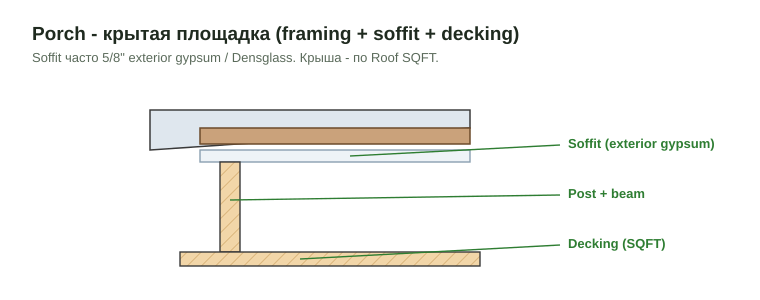

# Porch SQFT (площадь крытого крыльца)

<figure markdown>
  
  <figcaption markdown="span">Porch: пол на своём каркасе и потолок (soffit) под крышей. Площадь пола - Area `porch`; крыша над porch - своя Area в roof.</figcaption>
</figure>

## Что это

Porch - крытая площадка у входа на своём каркасе. Его площадь даёт пол
(decking или subfloor) и потолок (`5/8" Gyp` exterior, две поверхности в
одной строке с x2). Крыша над porch - отдельная площадь по
[Roof SQFT](roof.md), карниз porch - отдельная позиция `eve 12 porch`.
Porch считается независимо от балконов, даже если похож. Общие правила
замера - [Floor SQFT, раздел правил](1st2nd.md#rules).

## Где искать на чертежах

| Лист | Что взять |
| --- | --- |
| Floor plan (`a101 1st`) | Контур porch, posts |
| Framing plan, details (S) | Ceiling joists, ledger, hangers, балки, posts; каркас не показан - Note |
| RCP (`rcp`) | Материал потолка: `5/8" Ext Gyp`, DensGlass, beadboard |
| Elevations, sections | Крыша porch, уклон, колонны |

## Как мерить в OurPlanCore

1. Area по контуру пола porch на плане (точка W). Имя `porch`. Несколько
   одинаковых porch - полигоны в одной позиции; разные типы - разные.
2. Типовые porch в многоквартирном доме размечаются блоками: одна позиция
   Count на тип, точка на каждый экземпляр (см.
   [Deck / Porch / Balcony Frame](../deck/deck-porch-balcony-frame.md)).
3. Крышу porch обводи в `sqfts` отдельно (`rf 4` porch или `rf mtl 4`).

## Как назвать в дереве и строка DFL

| Имя в дереве | Строка DFL (блок Porch) | Материал | Unit | Формула |
| --- | --- | --- | --- | --- |
| `sqfts/porch` | Front Page, `Porches` | | `SQ FT` | как измерено |
| `sqfts/porch` | `Decking` или `Subfloor` | по детали | `SQ FT` / `4x8` | `SQFT x 1.1` или `/32` |
| `sqfts/porch` | `Ceiling` | `5/8" Gyp` exterior | `SQ FT` | `SQFT x 2 x 1.1` |
| та же площадь | `Ceiling Joists 16" o.c.` + `Ledger` + `Hangers` | по детали | `LFT`, `pcs` | отдельно от rafters |
| posts | `Posts` | P.T. на улице; под крышей без P.T. | `pcs` | |

Каркас не показан: `Note: Porch framing is not specified; all framing
assumed; verify` сразу под заголовком блока.

## Частые ошибки

- Porch SQFT на Front Page пустой (итог дома не сошёлся).
- Porch зеркален с балконов вместо отдельного счёта.
- Потолок porch посчитан как обычный interior gypsum, а не exterior.
- Крыша porch попала в main `rf 6` с чужим уклоном.
- Карниз porch посчитан ещё раз внутри `eve 24 main`.

Все ошибки по площадям: [common-mistakes](../../start/common-mistakes.md#sqft).

## Пример

```text
Takeoffs/Main/sqfts/
  porch       Area   96 SF
  rf 4        Area  118 SF   (крыша porch)
Covered Front Porch Framing List
Note: Porch framing is not specified; all framing assumed; verify.
Ceiling Joists 16" o.c.   2x8          ...   LFT
Ceiling                   5/8" Gyp     212   SQ FT   x2
```

## См. также

- [Deck / Porch / Balcony Frame](../deck/deck-porch-balcony-frame.md), [Porch / Deck / Balcony trims](../exterior-trims/porch-deck-balcony.md)
- [Eve / Eave](../sheathing-and-misc/eve.md), [Soffit and Fascia](../exterior-trims/soffit-fascia.md), [Roof SQFT](roof.md)
