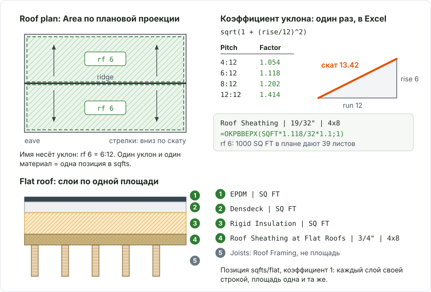
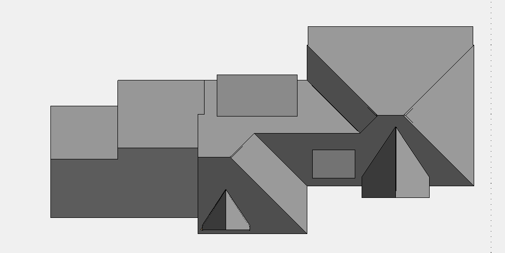

# Roof SQFT

<figure markdown>
  
  <figcaption markdown="span">The Area is drawn along the plan projection of the roof plane; the name carries the pitch: `rf 6`. The pitch factor is applied once in Excel.</figcaption>
</figure>

## What it is

Roof SQFT is the roof area in plan, split by pitch and type: main
planes, overframe, metal, flat areas, garage, porch. It drives the
roof sheathing, clips, flat roof layers and roofing materials in scope. General measuring
rules: [Floor SQFT, rules section](1st2nd.md#rules).

## Where to find it on the plans

| Sheet | What to take |
| --- | --- |
| Arch roof plan (`a105 rf`) | Roof plane outlines, the `6:12` pitch on each, overframe, flat |
| Elevations (`el`) | Pitch, if the plan does not show it; separate porch and garage roofs |
| Sections (`sec`) | Flat vs pitched, canopy, stair lid |
| Roof framing plan (S) | Truss and rafter boundaries, sheathing product |

## How to measure in OurPlanCore

1. Area along the plan projection of every roof plane on the roof plan (W point).
   One pitch and one material = one takeoff; planes of the same pitch can be
   collected as polygons in one takeoff.
2. Name `rf <pitch>`: `rf 6` = 6:12, `rf mtl 4` (under metal), `overframe 4`,
   `flat`, `ply flat`, `flat grge`, `elev rf flat`. The number = rise per 12.
3. Garage, porch, porte cochere, storage get their own outlines and pitches, even
   if the house next to them is 6:12. Do not carry a pitch over from the previous house.
4. The pitch correction `sqrt(1+(rise/12)^2)` (4:12 = 1.054, 6:12 = 1.118,
   8:12 = 1.202, 12:12 = 1.414) is applied once in the Excel formula. The name
   `rf 6` does not change the geometry.
5. Do not add overframe automatically; the lower sheathing under an overframe is per the
   detail.

## Tree name and DFL row

| Tree name | DFL row | Material | Unit | Formula |
| --- | --- | --- | --- | --- |
| `sqfts/rf 6` | Front Page, `Roof` | | `SQ FT` | as measured |
| `sqfts/rf 6` | `Roof Sheathing` | `19/32" Ply or OSB` | `4x8` | `=CEILING(SQFT*1.118/32*1.1,1)` |
| `sqfts/rf 6` | `Clips` | `PSCL 19/32` | `pcs` | [H-clips](../horizontal/roof-framing/h-clips.md) |
| `sqfts/flat` | `Rigid Insulation`, `Densdeck`, `EPDM` | per assembly | `SQ FT` | same area |
| `sqfts/rf mtl 4` | `Roof Sheathing (metal)` | `1/2" Ply` | `4x8` | with 1.054 |

## Common mistakes

- Pitch not from the sheet (6:12 instead of 4:12 on the garage: 53 sheets instead of 50, 212 clips instead of 200).
- Pitch factor applied twice or not at all.
- All roof planes in one polygon with no split by pitch and material.
- Flat roof layers (Densdeck, XPS) missed, piggy sleepers forgotten.
- The soffit underneath taken as the sheathing area.

All area mistakes: [common-mistakes](../../start/common-mistakes.md#sqft).

## Example

```text
Takeoffs/Main/sqfts/
  rf 6            Area   2210 SF
  overframe 4     Area    180 SF
  rf mtl 4        Area    410 SF
  flat            Area    960 SF
Takeoffs/Grge/sqfts/
  rf 4            Area   1420 SF
```

<figure markdown>
  
  <figcaption markdown="span">Roof plan: every roof plane is its own polygon. Gable triangles are not part of the roof area. Archived render.</figcaption>
</figure>

## See also

- [Roof Sheathing](../horizontal/roof-framing/roof-sheathing.md), [H-clips](../horizontal/roof-framing/h-clips.md), [Roof Types](../sheathing-and-misc/rooftype.md)
- [Truss Heel](../vertical/sheathing/truss-heel.md), [Overframes](../horizontal/roof-framing/overframes.md)
