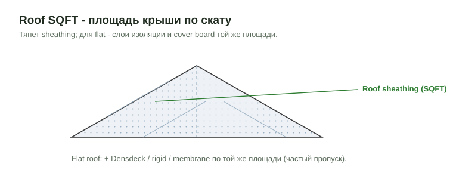
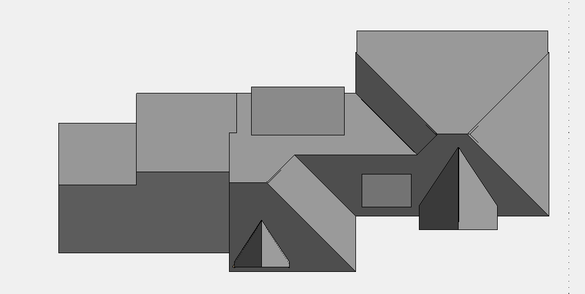

# Roof SQFT (площадь кровли по уклонам)

<figure markdown>
  
  <figcaption markdown="span">Area рисуется по плановой проекции ската, имя несёт уклон: `rf 6`. Коэффициент уклона применяется один раз в Excel.</figcaption>
</figure>

## Что это

Roof SQFT - площадь кровли в плане, разбитая по уклону и типу: главные
скаты, overframe, металл, плоские зоны, гараж, porch. Из неё считаются
настил, clips, слои flat roof и кровельные материалы в scope. Общие правила
замера - [Floor SQFT, раздел правил](1st2nd.md#rules).

## Где искать на чертежах

| Лист | Что взять |
| --- | --- |
| Arch roof plan (`a105 rf`) | Контуры скатов, уклон `6:12` у каждого, overframe, flat |
| Elevations (`el`) | Уклон, если на плане нет; отдельные крыши porch и гаража |
| Sections (`sec`) | Flat против pitched, canopy, stair lid |
| Roof framing plan (S) | Границы ферм и rafters, продукт настила |

## Как мерить в OurPlanCore

1. Area по плановой проекции каждого ската на плане кровли (точка W).
   Один уклон и один материал = одна позиция; скаты одного уклона можно
   собрать полигонами в одной позиции.
2. Имя `rf <уклон>`: `rf 6` = 6:12, `rf mtl 4` (под металл), `overframe 4`,
   `flat`, `ply flat`, `flat grge`, `elev rf flat`. Число = подъём на 12.
3. Гараж, porch, porte cochere, storage - свои контуры и свои уклоны, даже
   если дом рядом 6:12. Из прошлого дома уклон не переносится.
4. Коррекция уклона `sqrt(1+(rise/12)^2)` (4:12 = 1.054, 6:12 = 1.118,
   8:12 = 1.202, 12:12 = 1.414) применяется один раз в формуле Excel. Имя
   `rf 6` геометрию не меняет.
5. Overframe не добавляй автоматически; нижний настил под overframe - по
   детали.

## Как назвать в дереве и строка DFL

| Имя в дереве | Строка DFL | Материал | Unit | Формула |
| --- | --- | --- | --- | --- |
| `sqfts/rf 6` | Front Page, `Roof` | | `SQ FT` | как измерено |
| `sqfts/rf 6` | `Roof Sheathing` | `19/32" Ply or OSB` | `4x8` | `=ОКРВВЕРХ(SQFT*1.118/32*1.1;1)` |
| `sqfts/rf 6` | `Clips` | `PSCL 19/32` | `pcs` | [H-clips](../horizontal/roof-framing/h-clips.md) |
| `sqfts/flat` | `Rigid Insulation`, `Densdeck`, `EPDM` | по assembly | `SQ FT` | та же площадь |
| `sqfts/rf mtl 4` | `Roof Sheathing (metal)` | `1/2" Ply` | `4x8` | с 1.054 |

## Частые ошибки

- Уклон не с листа (6:12 вместо 4:12 на гараже: 53 листа вместо 50, 212 clips вместо 200).
- Коэффициент уклона применён дважды или не применён.
- Все скаты одним полигоном без разделения по уклону и материалу.
- Flat roof слои (Densdeck, XPS) пропущены, piggy sleepers забыты.
- Soffit снизу принят за площадь настила.

Все ошибки по площадям: [common-mistakes](../../start/common-mistakes.md#sqft).

## Пример

```text
Takeoffs/Main/sqfts/
  rf 6            Area   2210 SF
  overframe 4     Area    180 SF
  rf mtl 4        Area    410 SF
  flat            Area    960 SF
Takeoffs/Grge/sqfts/
  rf 4            Area   1420 SF
```

<figure markdown>
  
  <figcaption markdown="span">План кровли: каждый скат - свой полигон. Треугольники фронтонов не входят в площадь кровли. Архивный рендер.</figcaption>
</figure>

## См. также

- [Roof Sheathing](../horizontal/roof-framing/roof-sheathing.md), [H-clips](../horizontal/roof-framing/h-clips.md), [Roof Types](../sheathing-and-misc/rooftype.md)
- [Truss Heel](../vertical/sheathing/truss-heel.md), [Overframes](../horizontal/roof-framing/overframes.md)
