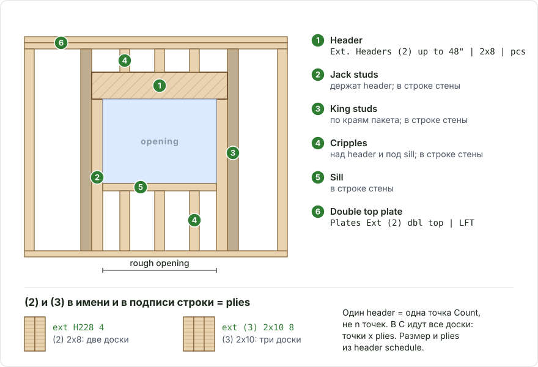
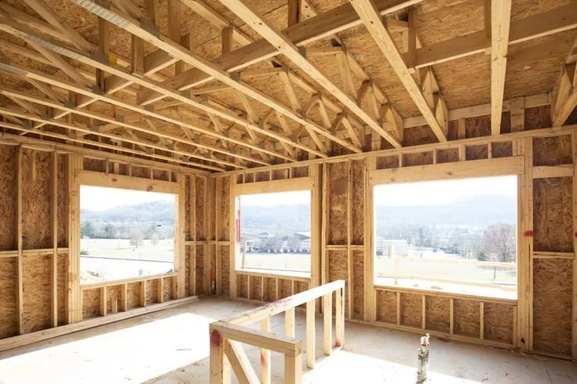

# Headers

<figure markdown>
  
  <figcaption markdown="span">The header sits on jack studs, king studs hold the pack at the sides. `(2)` and `(3)` in the name are the number of plies.</figcaption>
</figure>

<figure markdown>
  
  <figcaption markdown="span">Exterior wall from the inside: over each window a doubled header sits on jack studs, king studs at the sides, a sill with cripples under the window. Each opening gives one header on the `ext` row at the size from the header schedule; cripples and jacks are not part of the header. Photo: thespruce.com, [source](https://www.thespruce.com/what-size-header-is-needed-for-a-window-5092377), found via Pinterest.</figcaption>
</figure>

## What it is

A header is a beam over an opening in a wall; it carries the load down to the jack studs.
Exterior (`ext`) and interior (`int`) headers are counted separately, the size and number of
plies come from the header schedule, not from the window width. On a panel job headers inside
panels are not counted, only flush and loose. A roof header is a different
topic: [Roof Framing: Header](../../horizontal/roof-framing/header.md).

## Where to find it on the plans

| Sheet | What to take |
| --- | --- |
| Header schedule (S), typical wall details | Mark and size by span and floor: `H228`, `HPA`, `(3) 2x10` |
| Tagged plans (`s102`) | Marks over openings, where the engineer showed them |
| Window and door schedule, elevations | Opening width, combined openings |
| Panel drawings, scope | What is inside the panel, what is flush or loose |
| Code summary | FRT on headers in the plane of the exterior wall on Type III |

## Size when there is no header schedule { #default-sizes }

The size from the header schedule and from the plans always wins. When there is no schedule (usually residential), use the E-Wood defaults by span, that is, by opening width:

| Where the header is | up to 4' | up to 6' | 6'-9' | 9'-12' | 12'-14' | 14'-16' | 16'-18' |
| --- | --- | --- | --- | --- | --- | --- | --- |
| Exterior bearing wall 2x6 (Exterior brg wall) | `(2) 2x10` | `(3) 2x10` | `(2) 9-1/2" LVL` | `(2) 11-7/8" LVL` | `(2) 14" LVL` | `(2) 16" LVL` | `(3) 16" LVL` |
| Interior bearing wall 2x4 (Interior brg wall) | `(2) 2x10` | `(2) 2x12` | `(2) 9-1/2" LVL` | `(2) 11-7/8" LVL` | `(2) 14" LVL` | `(2) 14" LVL` | `(2) 16" LVL` |
| Flush header or beam under floor framing | `(2) 2x` at joist depth with 2x joists, `(2) LVL` with I-joists | same as up to 4' | `(2) LVL` at joist depth | `(2) LVL` at joist depth | `(3) LVL` at joist depth | `(3) LVL` at joist depth | `(3) 14" LVL` |
| Flush header or beam under floor framing and roof (under an exterior wall) | | | `(3) 9-1/2" LVL` | `(3) 11-7/8" LVL` | `(3) 14" LVL` | `(3) 16" LVL` | `(3) 18" LVL` |

Garage center beam, by span:

| Load | 22' | 24' | 26' |
| --- | --- | --- | --- |
| Floor above | `(3) 16" LVL` | `(3) 18" LVL` | `(3) 24" LVL` |
| Ceiling load only | `(3) 14" LVL` | `(3) 16" LVL` | `(3) 18" LVL` |

Write the size taken from the table as a note at the header or beam row (see [DFL notes](../../../reference/standard-notes.md)), so it is clear it did not come from a schedule.

## How to measure in OurPlanCore

**Count** tool (point), one per physical header, or **Beam** along the
span between supports: Beam measures the length itself and rounds it in the name (up to 8',
up to the next whole foot; longer, to an even number).

1. Branch `framing/<floor> framing/headers/ext/` and `.../headers/int/`. The F dot
   on an S sheet puts the Count into `framing/<floor> framing`; then move it into `headers/ext`
   or select the folder before New Item.
2. Name: `ext H228 4`, `int H228 4`, `HPA 4`, `ext (3) 2x10 8`: side,
   mark or size with plies, order length in feet.
3. The folder floor is the real bearing scope, not the number of the architectural elevation.
4. One built-up header = one point with `(n)`; do not place n points.
5. A storefront of several windows does not necessarily give as many headers;
   a combined opening can have one common header.
6. Keep a wood header separate from a steel member and its nailer.

## Takeoff name and DFL row

The `HD` button on the XL strip puts headers into the wall block of the floor **below**; the side
`ext` / `int` is taken from the name. In the `LG` legend the row `HP2 - (2) 2x10`
gives the size by code, otherwise the code itself lands in B.

| Takeoff name | DFL row | Unit | Formula / factor |
| --- | --- | --- | --- |
| `ext H228 4` | `Ext. Headers (2) up to 48"` `2x8` | pcs | count x plies, length from the name |
| `ext H228 7` | `Ext. Headers (2) up to 72"` | pcs | |
| `ext (3) 2x10 8` | `Ext. Headers (3) over 72"` `2x10` | pcs | three boards per header |
| `int H228 4` | `Int. Headers (2)` | pcs | |
| `9.0x6.8 gd` garage door | `Garage headers (3)` | pcs | per schedule |
| not on the plan | note `The headers indicated on the plan...` | | black bold text, no fill |

If the exterior wall is FRT, the headers in its plane are FRT too; LVL/PSL are not used
in the plane of the exterior wall on Type III. Note samples:
[DFL notes](../../../reference/standard-notes.md).

## Common mistakes

- Header derived from the window width: different bearing conditions give different marks.
- `(3)` entered as one board.
- Headers inside panels counted on a panel job.
- Floor taken from the elevation, not from the bearing scope; the upper floors have different sizes.
- Exterior headers without FRT on Type III (on one check: the whole 4th floor).
- One combined opening written as two headers.

Walkthrough with examples: [all opening mistakes](../../../start/common-mistakes.md#openings).

## Example

```text
framing/2nd floor framing/headers/
  ext/
    ext H228 4        Count, 14 ea
    ext (3) 2x10 8    Count, 2 ea     Notes: 4/S501, FRT per A001
  int/
    int H228 4        Count, 9 ea
```

## See also

- [Windows and Doors](windows-doors.md), [Exterior Walls](../walls/exterior.md), [Wall Panels](../walls/wall-panels.md)
- [Beam](../../horizontal/floor-framing/beam.md): the Beam tool and rounding
- [DFL row labels](../../../reference/takeoff-items.md)
