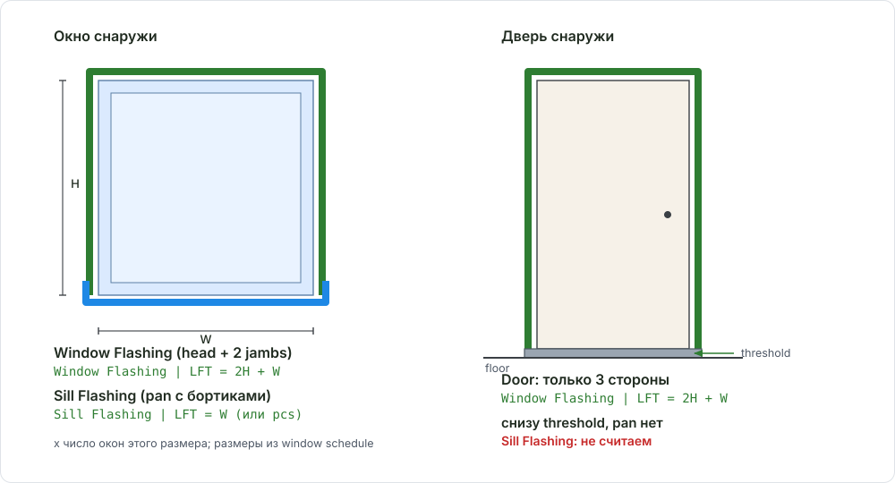
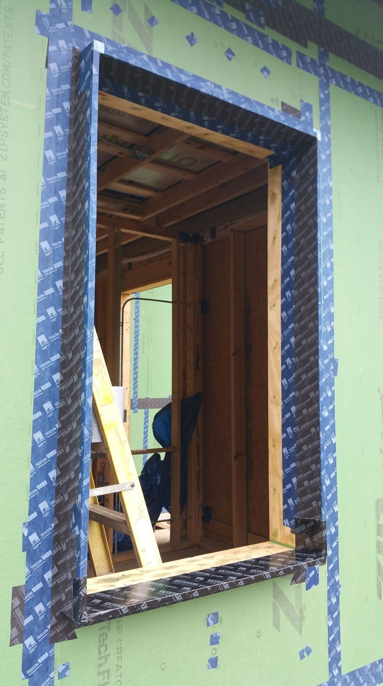

# Window Flashing & Sill

<figure markdown>
  
  <figcaption markdown="span">Window Flashing covers three sides (head and two jambs), Sill Flashing is the pan at the bottom. A door has only three sides: at the bottom there is a threshold, not a pan.</figcaption>
</figure>

<figure markdown>
  { width="420" }
  <figcaption markdown="span">Window rough opening before install: the tape on the two jambs and the head goes on the `Window Flashing` row, the pan tape along the bottom of the opening, turned up onto the wall, goes on `Sill Flashing`. Lengths come from the W and H of the opening. Photo: terrylove.com, [source](https://terrylove.com/forums/index.php?threads/add-2-or-3-foam-to-raised-ranch.85703/), found via Pinterest.</figcaption>
</figure>

## What it is

Flashing around windows and doors is our scope, even when the wall framing is by
others. Two different rows: **Window Flashing** (tape on the head and both jambs)
and **Sill Flashing** (the pan under the window). Doors have no sill flashing. Roof,
wall and deck flashing are on another page: [Flashing](../../sheathing-and-misc/flashing.md).

## Where to find it on the plans

| Sheet | What to take |
| --- | --- |
| Window and door schedule | W and H for the flashing length |
| Wall type schedule | Wall type at the opening: wood, metal stud, CMU or concrete |
| Window head, jamb, sill details | Flashing tape, sill pan, wood jamb on CMU |
| Specs, WRB notes | Flashing tape product, compatibility with the WRB |

## How to measure in OurPlanCore

Flashing is not drawn separately. It is figured from [Openings](windows-doors.md):
the `OP` button on the XL ribbon moves the openings into the workbook, and the `F_Openings` macro outputs
`Window Flashing` and `Sill Flashing` per the rules below. Your job on the sheet:
the right type (window with no suffix, door ` d`, garage door ` gd`) and the size from the
schedule. Do not type lengths in by hand.

## Takeoff name and DFL row

| DFL row | Material | Unit | Formula |
| --- | --- | --- | --- |
| `Window Flashing` | `Flashing Tape` | LFT | `(2 x H + W) x qty` |
| `Sill Flashing` | `Sill Flashing` | LFT | `W x qty` |
| `Door Flashing` (3 sides) | `Flashing Tape` | LFT | `(2 x H + W) x qty`; no sill |
| `Window Flashing at Mtl Walls`, `Sill Flashing at Mtl Walls` | same | LFT | separate rows for metal walls |
| `Window Flashing at CMU Walls`, `Sill Flashing at CMU Walls` | same | LFT | separate rows for CMU and concrete |
| `Window Jamb at CMU/Concrete` | `1x4 P.T.` or `2x4 P.T.` | LFT | per detail; flashing is counted even without a jamb |

- Wood walls: the base row is always there. Mtl and CMU walls are added on separate
  rows, even if the detail geometry is the same: for the client these are different
  subcontractors and different WRBs.
- Sides + head = Window Flashing, bottom = Sill Flashing: two rows, do not combine them.
- On CMU and concrete the flashing has no nailing plane: the detail often shows a
  wood jamb `1x4 P.T.` or `2x4 P.T.` around the perimeter, and the tape
  and casing attach to it. Jamb logic: [Furring & Window Jambs](../../exterior-trims/furring-and-jambs.md).

## Common mistakes

- A door got `Sill Flashing`: the ` d` or ` gd` tag is missing.
- Wood, Mtl and CMU walls merged into one row.
- Size taken from the elevation instead of the schedule.
- P.T. wood jamb on CMU not checked.
- Flashing on metal walls missed "because the wall is by others".

Walkthrough with examples: [all opening mistakes](../../../start/common-mistakes.md#openings).

## Example

```text
Window Flashing            Flashing Tape     LFT   =(2*5.0+3.0)*12
Sill Flashing              Sill Flashing     LFT   =3.0*12
Window Flashing at Mtl Walls   Flashing Tape   LFT   =(2*7.8+4.3)*6
Window Jamb at CMU         2x4 P.T.          LFT   =(2*4.0+2.9)*4
```

## See also

- [Windows and Doors](windows-doors.md): types, ` d` / ` gd` suffixes, the OP button
- [Exterior Wall Materials](../sheathing/exterior-materials.md), [Metal Tracks](../walls/metal-tracks.md)
- [Furring & Window Jambs](../../exterior-trims/furring-and-jambs.md)
- [Flashing (roof / wall / deck)](../../sheathing-and-misc/flashing.md): a different flashing
- Outside sources on the detail: [BASC / PNNL: Windows and Doors are Fully Flashed](https://basc.pnnl.gov/resource-guides/windows-and-doors-are-fully-flashed),
  [Building Science Corp: Pan Flashing](https://buildingscience.com/documents/information-sheets/pan-flashing-for-exterior-wall-openings)
