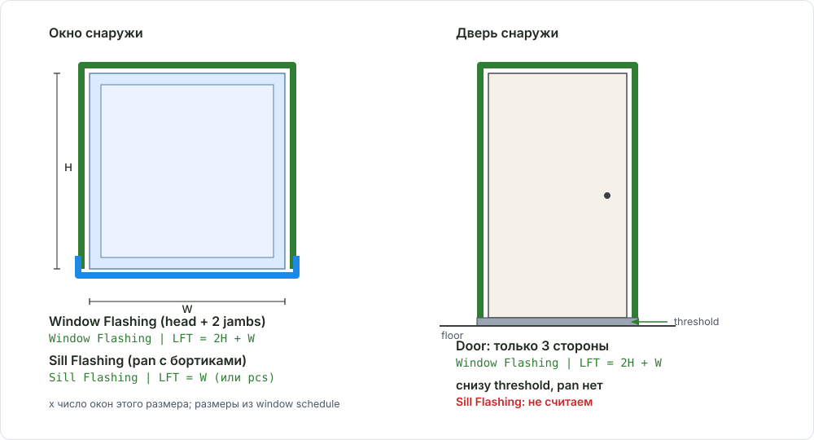
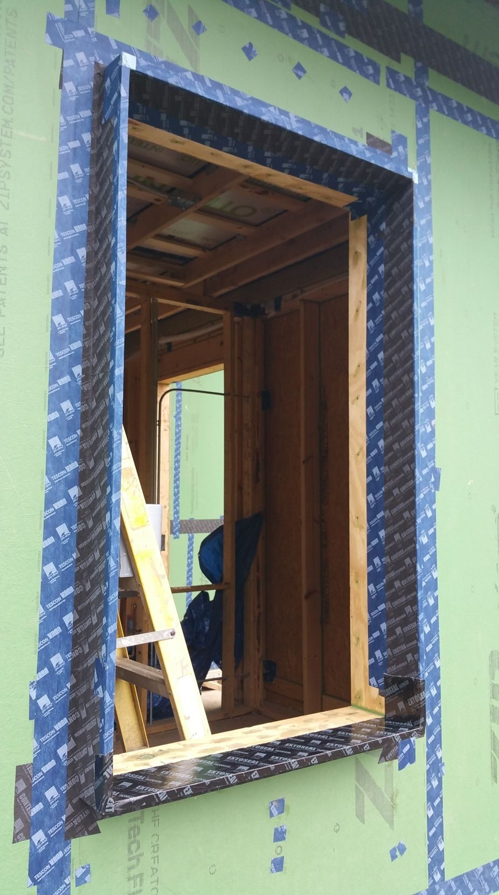

# Window Flashing & Sill (гидроизоляция проёмов)

<figure markdown>
  
  <figcaption markdown="span">Window Flashing - три стороны (head и два jamb), Sill Flashing - корытце по низу. У двери только три стороны: снизу threshold, не pan.</figcaption>
</figure>

<figure markdown>
  { width="420" }
  <figcaption markdown="span">Rough opening окна до установки: лента по двум jambs и head идёт в строку `Window Flashing`, лента-корытце по низу проёма с заходом на стену - в `Sill Flashing`. Длины берём из размеров W и H проёма. Фото: terrylove.com, [источник](https://terrylove.com/forums/index.php?threads/add-2-or-3-foam-to-raised-ranch.85703/), найдено через Pinterest.</figcaption>
</figure>

## Что это

Flashing вокруг окон и дверей - наш scope, даже когда каркас стены by
others. Две разные строки: **Window Flashing** (лента по head и двум jambs)
и **Sill Flashing** (pan по низу окна). У дверей sill flashing нет. Roof,
wall и deck flashing - другая страница: [Flashing](../../sheathing-and-misc/flashing.md).

## Где искать на чертежах

| Лист | Что взять |
| --- | --- |
| Window и door schedule | Размеры W и H для длины flashing |
| Wall type schedule | Тип стены у проёма: wood, metal stud, CMU или concrete |
| Window head, jamb, sill details | Flashing tape, sill pan, wood jamb на CMU |
| Specs, WRB notes | Продукт flashing tape, совместимость с WRB |

## Как мерить в OurPlanCore

Отдельно flashing не рисуется. Он считается от [Openings](windows-doors.md):
кнопка `OP` полосы XL переносит проёмы в книгу, макрос `F_Openings` выдаёт
`Window Flashing` и `Sill Flashing` по правилам ниже. Задача на листе:
правильный тип (окно без суффикса, дверь ` d`, ворота ` gd`) и размер из
schedule. Длины руками не набивай.

## Как назвать в дереве и строка DFL

| Строка DFL | Материал | Unit | Формула |
| --- | --- | --- | --- |
| `Window Flashing` | `Flashing Tape` | LFT | `(2 x H + W) x qty` |
| `Sill Flashing` | `Sill Flashing` | LFT | `W x qty` |
| `Door Flashing` (3 стороны) | `Flashing Tape` | LFT | `(2 x H + W) x qty`; sill не считаем |
| `Window Flashing at Mtl Walls`, `Sill Flashing at Mtl Walls` | то же | LFT | отдельные строки по metal стенам |
| `Window Flashing at CMU Walls`, `Sill Flashing at CMU Walls` | то же | LFT | отдельные строки по CMU и concrete |
| `Window Jamb at CMU/Concrete` | `1x4 P.T.` или `2x4 P.T.` | LFT | по детали; flashing считается и без jamb |

- Wood walls - базовая строка всегда. Mtl и CMU стены добавляются отдельными
  строками, даже если геометрия детали та же: у клиента это разные
  подрядчики и разные WRB.
- Sides + head = Window Flashing, bottom = Sill Flashing: две строки, не объединяй.
- На CMU и бетоне у flashing нет плоскости крепления: деталь часто даёт
  деревянный jamb `1x4 P.T.` или `2x4 P.T.` по периметру, к нему крепится tape
  и casing. Jamb-логика: [Furring & Window Jambs](../../exterior-trims/furring-and-jambs.md).

## Частые ошибки

- У двери появился `Sill Flashing`: не поставлена пометка ` d` или ` gd`.
- Wood, Mtl и CMU стены слиты в одну строку.
- Размер взят с фасада, а не из schedule.
- На CMU не проверен wood jamb P.T.
- Flashing на metal стенах пропущен "потому что стена by others".

Разбор с примерами: [все ошибки по проёмам](../../../start/common-mistakes.md#openings).

## Пример

```text
Window Flashing            Flashing Tape     LFT   =(2*5.0+3.0)*12
Sill Flashing              Sill Flashing     LFT   =3.0*12
Window Flashing at Mtl Walls   Flashing Tape   LFT   =(2*7.8+4.3)*6
Window Jamb at CMU         2x4 P.T.          LFT   =(2*4.0+2.9)*4
```

## См. также

- [Windows and Doors](windows-doors.md): типы, суффиксы ` d` / ` gd`, кнопка OP
- [Exterior Wall Materials](../sheathing/exterior-materials.md), [Metal Tracks](../walls/metal-tracks.md)
- [Furring & Window Jambs](../../exterior-trims/furring-and-jambs.md)
- [Flashing (roof / wall / deck)](../../sheathing-and-misc/flashing.md): другой flashing
- Внешние источники по узлу: [BASC / PNNL: Windows and Doors are Fully Flashed](https://basc.pnnl.gov/resource-guides/windows-and-doors-are-fully-flashed),
  [Building Science Corp: Pan Flashing](https://buildingscience.com/documents/information-sheets/pan-flashing-for-exterior-wall-openings)
