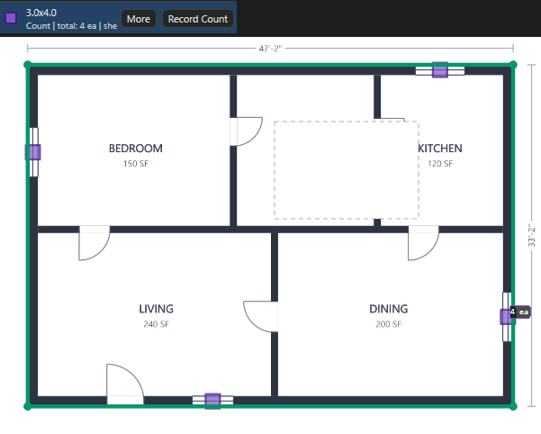

# Windows and Doors

<figure markdown>
  
  <figcaption markdown="span">The Openings tool on an elevation: a box around the opening, the app writes the size name `3.0x5.0` itself and places a point in the center. One point is one physical opening.</figcaption>
</figure>

## What it is

Openings are all the holes in the exterior wall: windows, exterior and patio doors,
garage doors, storefront, exterior louvers. They give a header,
jamb studs, flashing and a deduction from the sheathing. Interior doors are a separate
scope (doors, jambs, casing), not openings. Headers are counted on their own
page, [Headers](headers.md).

## Where to find it on the plans

| Sheet | What to take |
| --- | --- |
| Elevations `a201 el` | Window and door marks (diamonds), floor by the elevations on that view |
| Window schedule, window types (`win sch`) | Unit size; the general notes say whether it is the R.O. or the unit size |
| Door schedule (`dr sch`) | Size, material, fire label: `3070 HM C-lbl` |
| Floor plans | Door tags, storefront, garage doors; windows with no marks on the elevation |
| Sheets of another building | A type width that is missing on your own sheet (write it in Notes) |

## How to measure in OurPlanCore

**Openings** tool (O key), the result is a Count/point with the size.

1. Drag a box around the opening on the `... el` elevation: the app measures `WxH` in
   feet and creates a takeoff named with the size. If the marks are on the plans,
   draw on the plans.
2. Floor folders sit directly under `openings`: `0` (below the 1st), `1`, `2`, `roof`.
   No windows and doors subfolders. The point's floor is between the floor elevations
   of that view; stair windows half a level lower go to the lower floor.
3. Name `W.WxH.H` in decimal feet, one digit after the point: `5.8x5.9`.
   Doors ` d` (`3.3x6.5 d`), garage doors ` gd` (`9.0x6.8 gd`), louvers ` lv`.
   Different marks of the same size are one takeoff. Write the mark, sheet and R.O. in
   Notes: `Note: A601 type W1, RO 3'-0" x 5'-0"`.
4. Size comes from the schedule, not from the line length on the elevation. Window height = unit
   height, not the top elevation (`7'-2"` on the drawing is often the head elevation).
5. One point per opening, the point inside the opening. One color per size, the same on
   all floors.
6. Do not count twice: a window on a matchline is taken in the view where it is whole; a faded
   background with no marks is not counted; a sash of a combined window is not a window.
7. Storefront, multi-slide, garage doors, HM doors with no type: separately, each from its own
   size source. A full storefront once; its door is not a second hole.

The size name is needed by the `OP` button on the XL strip: it reads `WxH` from the name and
moves the openings into the workbook, where the `F_Openings` macro figures the flashing.

## Takeoff name and DFL row

| Takeoff name | DFL row | Unit | Formula / factor |
| --- | --- | --- | --- |
| `openings/1/3.0x5.0` | `Window Flashing` + `Sill Flashing` | LFT | `(2H + W) x qty`, `W x qty` |
| `openings/1/3.3x6.5 d` | `Ext. Doors` `3070 1 unit MARK FIRE LABEL`; flashing on 3 sides | ea, LFT | no sill flashing |
| `openings/1/9.0x6.8 gd` | `Garage headers (3)`, flashing on 3 sides | ea, LFT | no sill |
| `openings/1/2.0x2.0 lv` | louver, deduction from the sheathing | ea | |
| interior doors | `Int. Doors` `2670 ...`, jambs by the size of the adjacent wall | ea | a door wider than 4' is a double `(2)2670` |

- Door casing on 3 sides in LFT; interior door jambs are counted
  as points per unit and grouped by wall size (a point at `2x6` = 2x6 jamb).
- Hardware numbers are not needed in the DFL; material and fire rating are.
- Openings are subtracted from the sheathing, WRB, insulation and foundation line **once**
  and on their own floor. Windows smaller than 4' are not subtracted from the sheathing:
  [Wall Sheathing](../sheathing/wall-sheathing.md).

## Common mistakes

- Window height taken as the top elevation, not the unit height.
- Opening counted twice: on the plan and the elevation, from two views, the storefront door separately.
- The ` d` tag missing: the door got Sill Flashing.
- Openings not subtracted from the sheathing and WRB (garage doors) or subtracted twice.
- A door wider than 4' written as a single leaf.
- Size eyeballed from the elevation instead of taken from the schedule; R.O. confused with the unit size.

Walkthrough with examples: [all opening mistakes](../../../start/common-mistakes.md#openings).

## Example

```text
openings/
  0/
    2.9x4.0          Count, 4 ea
    3.2x6.9 d        Count, 1 ea     Notes: A601 type D2, RO 3'-4" x 7'-0"
  1/
    4.3x7.8          Count, 12 ea    Notes: A601 type W1
    5.1x7.1 d        Count, 6 ea
  roof/
    2.0x2.0 lv       Count, 2 ea
Grge/openings/
  9.0x6.8 gd         Count, 2 ea
```

## See also

- [Headers](headers.md), [Window Flashing](window-flashing.md)
- [Furring & Window Jambs](../../exterior-trims/furring-and-jambs.md), [Interior door trim](../../interior-trims/door-window-trim.md)
- [Tips: Doors](../../../reference/boss-feedback-rules.md#doors)
- [Takeoff names](../../../reference/takeoff-naming.md)
