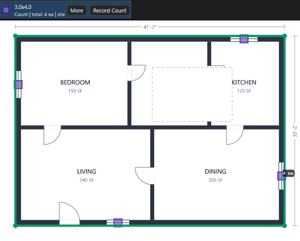

# Windows and Doors (проёмы)

<figure markdown>
  
  <figcaption markdown="span">Count-позиция окон `3.0x4.0` на плане демо-проекта: одна точка на окно, итог 4 ea. Инструмент Openings ставит такую позицию по рамке проёма на фасаде: имя-размер (ширина x высота) пишет сам, точка в центре. Одна точка - один физический проём.</figcaption>
</figure>

## Что это

Openings - все дыры в наружной стене: окна, наружные и patio двери,
гаражные ворота, storefront, наружные решётки (louvers). Они дают header,
jamb-стойки, flashing и вычет из обшивки. Межкомнатные двери - отдельный
scope (двери, jambs, casing), а не openings. Перемычки считаются на своей
странице [Headers](headers.md).

## Где искать на чертежах

| Лист | Что взять |
| --- | --- |
| Фасады `a201 el` | Марки окон и дверей (ромбы), этаж по отметкам своего вида |
| Window schedule, window types (`win sch`) | Размер изделия; в general notes - это R.O. или размер блока |
| Door schedule (`dr sch`) | Размер, материал, fire label: `3070 HM C-lbl` |
| Планы этажей | Теги дверей, storefront, ворота; окна без марок на фасаде |
| Листы другого корпуса | Ширина типа, которой нет на своём листе (записать в Notes) |

## Как мерить в OurPlanCore

Инструмент **Openings** (клавиша O), результат - Count/point с размером.

1. Растяни рамку по проёму на фасаде `... el`: программа меряет `ШxВ` в
   футах и создаёт позицию с именем-размером. Если марки стоят на планах,
   рисуй на планах.
2. Папки этажей прямо под `openings`: `0` (ниже 1-го), `1`, `2`, `roof`.
   Без подпапок windows и doors. Этаж точки - между отметками этажей
   своего вида; окна лестницы на полэтажа ниже уходят в нижний.
3. Имя `W.WxH.H` в десятичных футах, одна цифра после точки: `5.8x5.9`.
   Двери ` d` (`3.3x6.5 d`), ворота ` gd` (`9.0x6.8 gd`), решётки ` lv`.
   Разные марки одного размера - одна позиция. Марку, лист и R.O. пиши в
   Notes: `Note: A601 type W1, RO 3'-0" x 5'-0"`.
4. Размер - из schedule, не с длины линии на фасаде. Высота окна = высота
   изделия, не отметка верха (`7'-2"` на рисунке часто отметка head).
5. Одна точка на проём, точка внутри проёма. Свой цвет на размер, один на
   всех этажах.
6. Не считать дважды: окно на matchline берётся в том виде, где целое; бледный
   задний план без марок не считается; створка составного окна - не окно.
7. Storefront, multi-slide, ворота, HM-двери без типа - отдельно по своему
   источнику размеров. Полный storefront один раз, его дверь не вторая дыра.

Имя с размером нужно кнопке `OP` полосы XL: она читает `ШxВ` из имени и
переносит проёмы в книгу, где макрос `F_Openings` считает flashing.

## Как назвать в дереве и строка DFL

| Имя в дереве | Строка DFL | Unit | Формула / фактор |
| --- | --- | --- | --- |
| `openings/1/3.0x5.0` | `Window Flashing` + `Sill Flashing` | LFT | `(2H + W) x qty x 1.1`, `W x qty x 1.1` |
| `openings/1/3.3x6.5 d` | `Ext. Doors` `3070 1 unit MARK FIRE LABEL`; flashing трёх сторон в строке `Window Flashing` | unit, LFT | без sill flashing; строки `Door Flashing` нет |
| `openings/1/9.0x6.8 gd` | `Ext. Grge Headers (3)`; flashing трёх сторон в строке `Window Flashing` | штуки, LFT | без sill |
| `openings/1/2.0x2.0 lv` | решётка, вычет из обшивки | | |
| межкомнатные двери | `Int. Doors` `2670 ...`, группа по сечению стены, в которой стоит дверь | unit | дверь шире 3'-6" пишется парой: `5070` = `(2)2670`, `4070` = `(2)2070` |

- **Jambs межкомнатных дверей** отдельной LFT-строкой не считаются. Двери
  ставятся точками по юнитам и группируются по сечению стены, в которой
  стоят: точка у стены `2x6` = дверь с jamb 2x6, точка у `2x4` = jamb 2x4.
  Так у каждой двери сразу известен и размер, и глубина коробки.
- Casing межкомнатной двери - в LFT по трём сторонам:
  `=ОКРВВЕРХ(2*сумма периметров/12*1.1;10)`, периметр двери = W + 2H в дюймах,
  `2` = обе стороны стены. Подробно: [Casing](../../interior-trims/casing.md).
- Номера фурнитуры в DFL не нужны; материал и fire rating - нужны.
- Из обшивки, WRB, insulation и линии фундамента проёмы вычитаются **один раз**
  и по своему этажу. Окна меньше 4' из обшивки не вычитаются:
  [Wall Sheathing](../sheathing/wall-sheathing.md).

## Частые ошибки

- Высота окна взята как отметка верха, а не высота изделия.
- Проём посчитан дважды: на плане и фасаде, с двух видов, дверь storefront отдельно.
- Пометка ` d` не поставлена: у двери появился Sill Flashing.
- Проёмы не вычтены из обшивки и WRB (ворота гаража) или вычтены дважды.
- Дверь шире 3'-6" записана одной створкой, а не парой (`4070` вместо `(2)2070`).
- Jambs межкомнатных дверей записаны LFT-строкой, а двери не разнесены по сечению стены.
- Размер взят с фасада "на глаз", а не из schedule; R.O. перепутан с размером блока.

Разбор с примерами: [все ошибки по проёмам](../../../start/common-mistakes.md#openings).

## Пример

```text
openings/
  0/
    2.9x4.0          Count, 4 ea
    3.2x6.9 d        Count, 1 ea     Notes: A601 type D2, RO 3'-4" x 7'-0"
  1/
    4.3x7.8          Count, 12 ea    Notes: A601 type W1
    5.1x7.1 d        Count, 6 ea
  roof/
    2.0x2.0 lv       Count, 2 ea
Grge/openings/
  9.0x6.8 gd         Count, 2 ea
```

## См. также

- [Headers](headers.md), [Window Flashing](window-flashing.md)
- [Furring & Window Jambs](../../exterior-trims/furring-and-jambs.md), [Interior door trim](../../interior-trims/door-window-trim.md)
- [Советы: Doors](../../../reference/boss-feedback-rules.md#doors)
- [Имена takeoffs](../../../reference/takeoff-naming.md)
