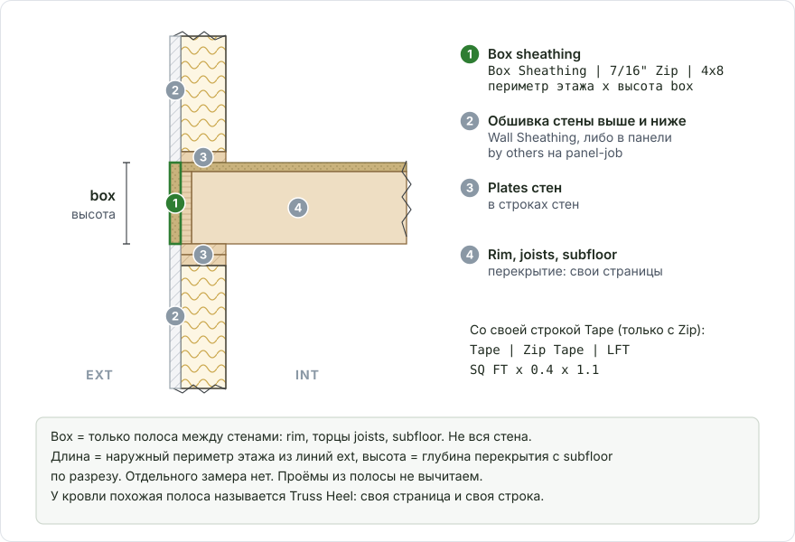

# Box Sheathing

<figure markdown>
  
  <figcaption markdown="span">Box sheathing covers the floor framing "box" between the wall below and the wall above: rim, joist ends, subfloor. A narrow strip, not the whole wall.</figcaption>
</figure>

## What it is

Box sheathing is a narrow horizontal strip of sheathing around the exterior perimeter
at the floor framing level: it covers the rim board, the joist ends and the subfloor
between the top plate of the wall below and the bottom plate of the wall above. On a panel job
the walls arrive sheathed, but this strip stays loose material, so it
lives on its own row. Do not confuse it with [Truss Heel](truss-heel.md) (the strip at the
roof) or with full wall sheathing ([Wall Sheathing](wall-sheathing.md)).

## Where to find it on the plans

| Sheet | What to take |
| --- | --- |
| Wall section (`sec`), floor framing detail | Strip height: joist depth + subfloor + plates per section; material |
| Floor type schedule (`ft`) | Floor framing depth (TJI 11 7/8", 2x10, 14" open web) |
| Panel notes, scope | Whether the box is in the panel or stays loose |
| Attic / roof sections | Attic box: `extra plate + box = subfloor` on the top floor |

## How to measure in OurPlanCore

There is no separate takeoff: length = the floor's exterior perimeter from the `walls/<floor>
floor walls/ext ...` lines, strip height = floor framing depth with subfloor per the section of
this building. Area = perimeter x height. The Excel export (XL strip) puts
Box Sheathing at the end of each floor's wall section with its own Tape row.

- Each floor has its own strip: 1st, 2nd, 3rd. For the top floor under a
  parapet the box is written into the parapet block with a Note.
- The material is the same as the wall's (`$O$3` OSB or `$O$5` Zip) unless the detail
  calls for something else.
- Openings are not subtracted from the strip.

## Takeoff name and DFL row

| Source in the tree | DFL row | Material | Unit | Formula |
| --- | --- | --- | --- | --- |
| perimeter `walls/1st floor walls/ext ...` | `Box Sheathing` | `7/16" Zip` / `1/2" OSB` | `4x8` | `=CEILING(SQFT/32*1.1,1)` |
| same area | `Tape` | `Zip Tape` (only with Zip) | `LFT` | `=CEILING(SQFT*0.4*1.1,10)` |
| same area | `Vapor Barrier` (WRB) | per spec | `SQ FT` | as part of the wall |

## Common mistakes

- Box called truss heel or the other way around; they have different geometry and different rows.
- Strip height taken from the previous building, not from this one's section.
- Box forgotten on the top floor under the parapet, or counted twice there.
- On a panel job the box thrown out together with the panels, although it stayed loose.
- Copied detail labels not corrected for this floor.

All mistakes: [common-mistakes](../../../start/common-mistakes.md#sheathing).

## Example

```text
2nd Floor Walls
...
Tape                Zip Tape        1980   LFT
Box Sheathing       7/16" Zip         18   4x8    4/A501
Tape                Zip Tape         230   LFT
Holdowns (2) btm top  HDU5           20   pcs    SW-3
```

## See also

- [Wall Sheathing](wall-sheathing.md), [Truss Heel](truss-heel.md), [Floor Sheathing](floor.md)
- [Parapet](../walls/parapet.md), [Rim Board](../../horizontal/floor-framing/details/rim.md)
- [Wall Panels](../walls/wall-panels.md) - what is in the panel, what is loose
