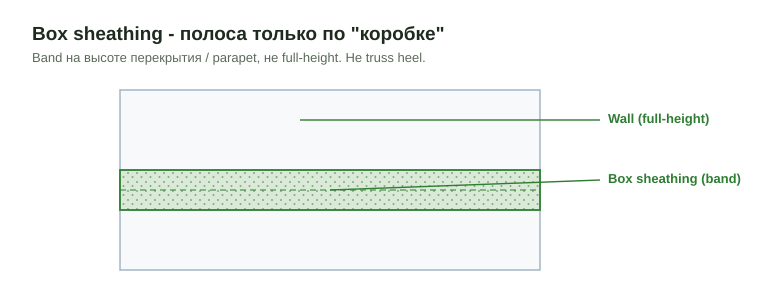

# Box Sheathing (полоса на уровне перекрытия)

<figure markdown>
  
  <figcaption markdown="span">Box sheathing закрывает "коробку" перекрытия между стеной ниже и стеной выше: rim, торцы joists, subfloor. Узкая полоса, не вся стена.</figcaption>
</figure>

## Что это

Box sheathing - узкая горизонтальная полоса обшивки по наружному периметру
на высоте перекрытия: она перекрывает rim board, торцы joists и subfloor
между верхней доской нижней стены и нижней доской верхней стены. На panel-job
стены приходят обшитыми, а эта полоса остаётся loose-материалом, поэтому она
живёт отдельной строкой. Не путать с [Truss Heel](truss-heel.md) (полоса у
кровли) и с полной обшивкой стены ([Wall Sheathing](wall-sheathing.md)).

## Где искать на чертежах

| Лист | Что взять |
| --- | --- |
| Wall section (`sec`), деталь перекрытия | Высота полосы: глубина joist + subfloor + plates по разрезу; материал |
| Floor type schedule (`ft`) | Глубина перекрытия (TJI 11 7/8", 2x10, 14" open web) |
| Panel notes, scope | Входит ли box в панель или остаётся loose |
| Attic / roof sections | Attic box: `extra plate + box = subfloor` на последнем этаже |

## Как мерить в OurPlanCore

Отдельного замера нет: длина = наружный периметр этажа из линий `walls/<этаж>
floor walls/ext ...`, высота полосы = глубина перекрытия с subfloor по разрезу
этого дома. Площадь = периметр x высота. Экспорт в Excel (полоса XL) ставит
Box Sheathing в конец секции стен каждого этажа со своей строкой Tape.

- На каждом этаже своя полоса: 1st, 2nd, 3rd. Для верхнего этажа под
  парапетом box пишется в блок парапета с Note.
- Материал тот же, что у стены (`$O$3` OSB или `$O$5` Zip), если деталь не
  даёт другого.
- Проёмы из полосы не вычитаются.

## Как назвать в дереве и строка DFL

| Источник в дереве | Строка DFL | Материал | Unit | Формула |
| --- | --- | --- | --- | --- |
| периметр `walls/1st floor walls/ext ...` | `Box Sheathing` | `7/16" Zip` / `1/2" OSB` | `4x8` | `=ОКРВВЕРХ(SQFT/32*1.1;1)` |
| та же площадь | `Tape` | `Zip Tape` (только с Zip) | `LFT` | `=ОКРВВЕРХ(SQFT*0.4*1.1;10)` |
| та же площадь | `Vapor Barrier` (WRB) | по спецификации | `SQ FT` | в составе стены |

## Частые ошибки

- Box назван truss heel или наоборот; у них разная геометрия и разная строка.
- Высота полосы из прошлого дома, а не по разрезу этого.
- Box забыт на верхнем этаже под парапетом или посчитан там дважды.
- На panel-job box выброшен вместе с панелями, хотя остался loose.
- Скопированные подписи деталей не поправлены под этот этаж.

Все ошибки: [common-mistakes](../../../start/common-mistakes.md#sheathing).

## Пример

```text
2nd Floor Walls
...
Tape                Zip Tape        1980   LFT
Box Sheathing       7/16" Zip         18   4x8    4/A501
Tape                Zip Tape         230   LFT
Holdowns (2) btm top  HDU5           20   pcs    SW-3
```

## См. также

- [Wall Sheathing](wall-sheathing.md), [Truss Heel](truss-heel.md), [Floor Sheathing](floor.md)
- [Parapet](../walls/parapet.md), [Rim Board](../../horizontal/floor-framing/details/rim.md)
- [Wall Panels](../walls/wall-panels.md) - что в панели, что loose
