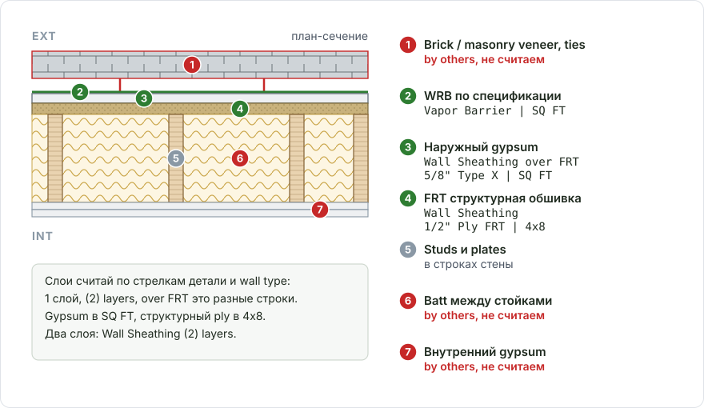
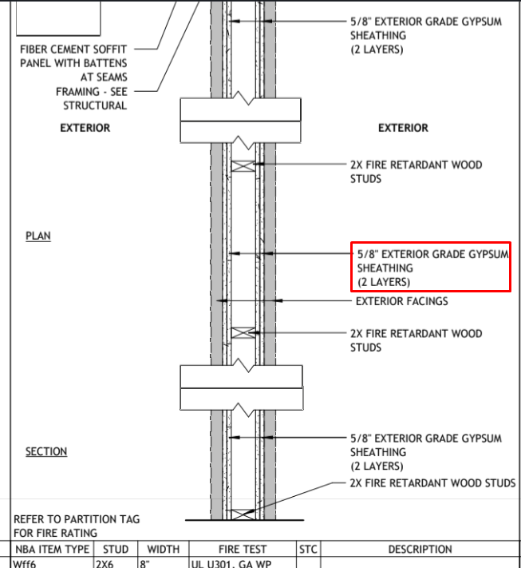
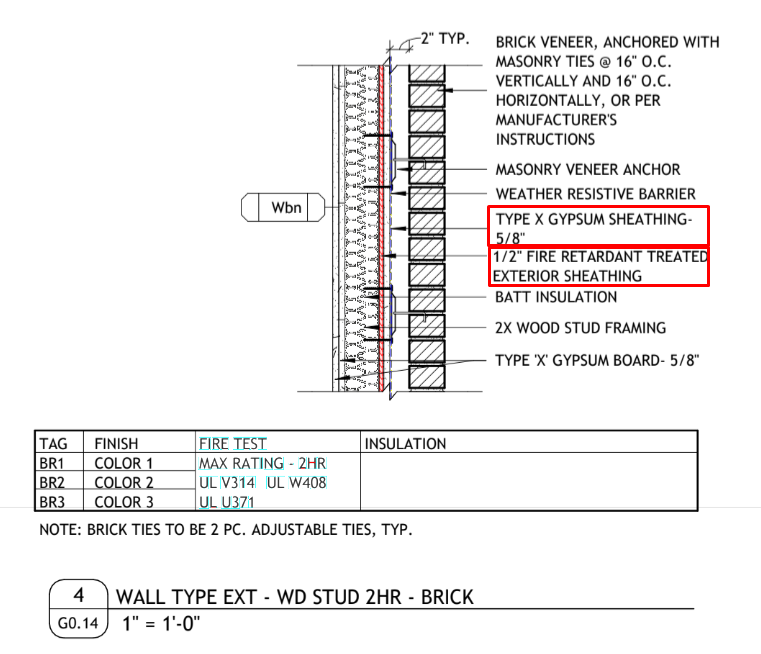
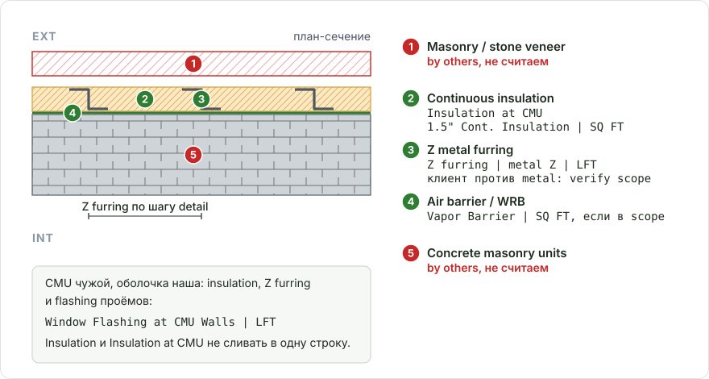

# Exterior Wall Materials

<figure markdown>
  
  <figcaption markdown="span">The wall layer by layer from outside in: veneer, WRB, exterior gypsum, structural sheathing, framing. Each exterior layer is a separate row; interior gypsum and insulation between the studs are not counted in the frame scope.</figcaption>
</figure>

## What it is

The exterior envelope is everything that sits on the framing on the outside: structural sheathing
([Wall Sheathing](wall-sheathing.md)), exterior gypsum (`Type X`, `Densglass`),
continuous insulation, WRB, opening flashing, bracing, window jambs and furring.
These items hide in the wall sections and the wall type schedule, not on the elevations.
The wall framing can be someone else's (metal studs, CMU), and the envelope still stays
ours. Interior drywall, interior insulation and sound batts are not counted.

## Where to find it on the plans

| Sheet | What to take |
| --- | --- |
| Wall type schedule (`wt`), UL assemblies | Gypsum layers (1 or 2), `over FRT`, Densglass by zone |
| Wall sections (`sec`), details | Layer order by the arrows, Z furring, jambs at openings, furring under siding |
| Energy / envelope sheets | Continuous insulation, Zip R, WRB (product per spec) |
| Elevations (`el`) | Densglass zones and material changes, facade build-out |
| Job scope and notes | Metal studs by others, CMU by others, furring "not utilized" |

## Exterior gypsum sheathing

<div class="kb-split" markdown>

- `5/8" Type X` exterior grade is the standard exterior gypsum. `19/32"` is not used
  for gypsum: that is a plywood/OSB designation.
- **(2) layers**: when the wall type or UL assembly calls for two layers.
- **over FRT**: gypsum over structural `1/2" Ply FRT`, a separate row.
- Split `Densglass` by level and elevation if the schedule splits it that way.
  `5/8" Densglass over Zip` = two products, two rows.
- Gypsum in `SQ FT`, structural ply in `4x8`.

<figure markdown>
  
  <figcaption markdown="span">Wall type with a UL assembly: (2) layers of 5/8" exterior gypsum on the outside face. Two layers = two rows or one "(2) layers" row.</figcaption>
</figure>

</div>

<figure markdown>
  
  <figcaption markdown="span">2HR wall behind brick: 5/8" Type X gypsum over 1/2" FRT sheathing. Both exterior layers are our rows; the batts between the studs and the gypsum inside are not.</figcaption>
</figure>

## Insulation (continuous)

<div class="kb-split" markdown>

- `Insulation`: continuous insulation on the outside face of framed walls,
  only outside, over the sheathing.
- `Insulation at CMU`: continuous insulation on CMU walls, a separate
  row, the area is usually larger. Z metal furring goes under it.
- Zip R is written together with the insulation (`Zip R-3` = sheathing plus insulation).
- Unit `SQ FT`, opening deductions are the same as for the sheathing.

<figure markdown>
  
  <figcaption markdown="span">CMU: veneer, continuous insulation (the Insulation at CMU row), Z metal furring, air barrier, block. The block is someone else's; insulation, furring and flashing are ours.</figcaption>
</figure>

</div>

## Metal stud and CMU walls: what stays ours

| Row | Material | Unit | When |
| --- | --- | --- | --- |
| `Wall Sheathing` | `5/8" Type X` | `SQ FT` | Gypsum on metal walls, even if the studs are by others |
| `Bracing Ext Walls` / `Bracing Corridor` / `Bracing Demising` | `2x4` | `LFT` | Bracing on metal walls |
| `Window Flashing at Mtl Walls`, `Sill Flashing at Mtl Walls` | Flashing Tape / Sill Flashing | `LFT` | By wall type, see [Window Flashing](../openings/window-flashing.md) |
| `Window Flashing at CMU Walls` | Flashing Tape | `LFT` | The same for CMU |
| Window jambs | `2x4` / `2x8` by wall depth | `LFT` | If openings in metal walls are packed out with lumber; otherwise the Note `Assumed window jambs 2x4 are not used per A8.53; verify` |
| `Z furring` | metal Z | `LFT` | Under insulation on CMU |
| `Furring` under siding | `1x4` or `2x4 P.T.` | `LFT` | Rainscreen per detail; P.T. and non-P.T. on different rows |

Do not add furring at CMU as optional without a detail. Details: [Furring](../walls/furring.md),
[Furring and Window Jambs](../../exterior-trims/furring-and-jambs.md).

## Common mistakes

- The whole wall block thrown out because of "metal by others": gypsum, insulation, flashing, bracing stayed ours.
- Gypsum layers not split: 1 layer, (2) layers, over FRT.
- `Insulation` and `Insulation at CMU` merged into one row.
- Interior gypsum, insulation between the studs or sound batts counted.
- "Vapor Barrier / Tyvek" written although the spec calls for a fluid-applied WRB.
- Assembly not read to the end: a third `5/8"` layer, Z-girt, overbuild missed.

All sheathing mistakes: [common-mistakes](../../../start/common-mistakes.md#sheathing).

## Example (job A, FRT wood + CMU + metal openings)

```text
Wall Sheathing               5/8" Type X            6670   SQ FT
Wall Sheathing (2) layers    5/8" Type X            2530   SQ FT
Wall Sheathing over FRT      5/8" Type X            4190   SQ FT
Wall Sheathing               1/2" Ply FRT            298   4x8
Box Sheathing                1/2" Ply FRT             75   4x8
Insulation                   1.5" Cont. Insulation  6670   SQ FT
Insulation at CMU            1.5" Cont. Insulation 13350   SQ FT
Bracing Ext Walls            2x4                     ...   LFT
Window Flashing at Mtl Walls Flashing Tape          1650   LFT
Sill Flashing at Mtl Walls   Sill Flashing           670   LFT
Note: Assumed window jambs 2x4 are not used per A8.53; verify.
Note: Furring strips under the siding are not utilized per A8.53; verify.
```

## See also

- [Wall Sheathing](wall-sheathing.md), [Box Sheathing](box-sheathing.md), [Exterior Walls](../walls/exterior.md)
- [Window Flashing](../openings/window-flashing.md), [Flashing (roof / wall / deck)](../../sheathing-and-misc/flashing.md)
- [Furring (walls)](../walls/furring.md), [Metal Tracks](../walls/metal-tracks.md)
