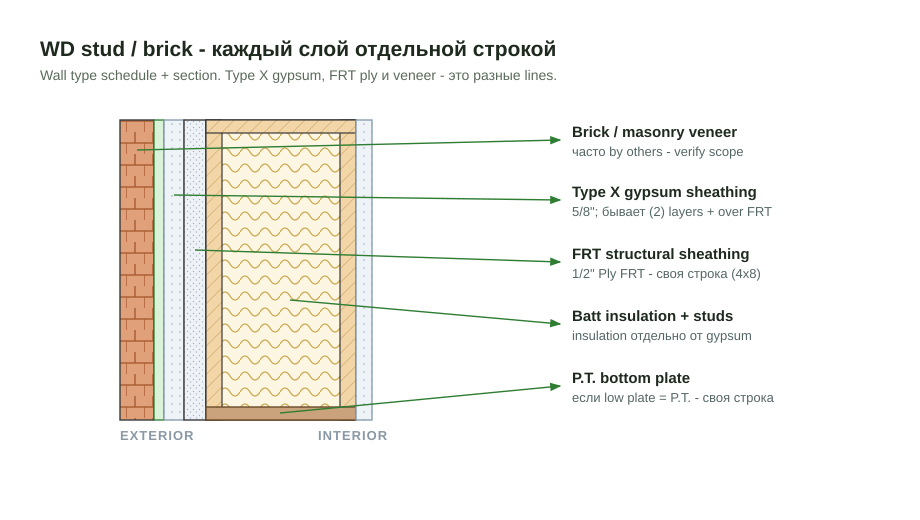
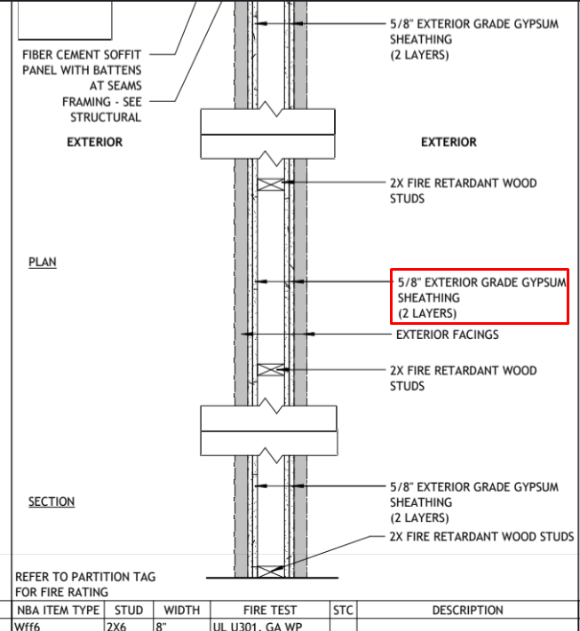
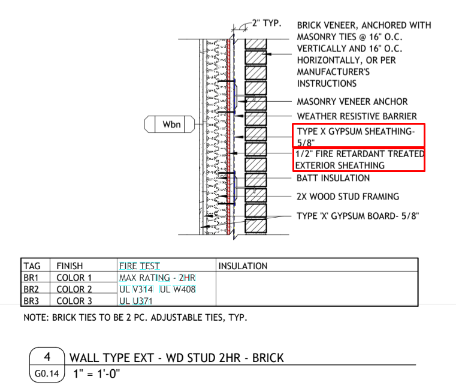
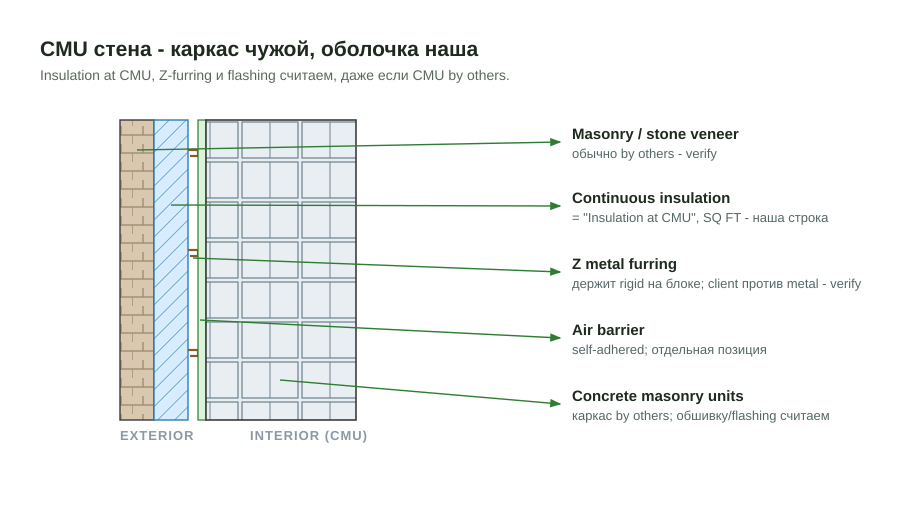

# Exterior Wall Materials (наружная оболочка стены)

<figure markdown>
  
  <figcaption markdown="span">Стена по слоям снаружи внутрь: veneer, WRB, наружный gypsum, структурная обшивка, каркас. Каждый наружный слой - отдельная строка; внутренний гипс и утеплитель между стойками во frame-scope не считаем.</figcaption>
</figure>

## Что это

Наружная оболочка - всё, что лежит на каркасе снаружи: структурная обшивка
([Wall Sheathing](wall-sheathing.md)), наружный gypsum (`Type X`, `Densglass`),
continuous insulation, WRB, flashing проёмов, bracing, window jambs и furring.
Эти позиции прячутся в wall sections и wall type schedule, а не на фасадах.
Каркас стены может быть чужим (metal studs, CMU), оболочка при этом остаётся
нашей. Внутренний гипсокартон, внутренний утеплитель и sound batt не считаем.

## Где искать на чертежах

| Лист | Что взять |
| --- | --- |
| Wall type schedule (`wt`), UL assemblies | Слои gypsum (1 или 2), `over FRT`, Densglass по зонам |
| Wall sections (`sec`), details | Порядок слоёв по стрелкам, Z furring, jambs в проёмах, furring под siding |
| Energy / envelope sheets | Continuous insulation, Zip R, WRB (продукт по спецификации) |
| Elevations (`el`) | Зоны Densglass и смены материала, build-out фасада |
| Scope и notes проекта | Metal studs by others, CMU by others, furring "not utilized" |

## Exterior gypsum sheathing

<div class="kb-split" markdown>

- `5/8" Type X` exterior grade - стандартный наружный gypsum. Для гипса
  `19/32"` не используется: это обозначение plywood/OSB.
- **(2) layers** - когда wall type или UL-assembly требует два слоя.
- **over FRT** - gypsum поверх структурной `1/2" Ply FRT`: отдельная строка.
- `Densglass` разносим по уровням и фасадам, если schedule так делит.
  `5/8" Densglass over Zip` = два продукта, две строки.
- Gypsum в `SQ FT`, структурный ply в `4x8`.

<figure markdown>
  
  <figcaption markdown="span">Wall type с UL-сборкой: (2) layers 5/8" exterior gypsum на наружной грани. Два слоя = две строки или строка "(2) layers".</figcaption>
</figure>

</div>

<figure markdown>
  
  <figcaption markdown="span">2HR стена под кирпич: 5/8" Type X gypsum поверх 1/2" FRT sheathing. Оба наружных слоя - наши строки; batt между стойками и гипс внутри - нет.</figcaption>
</figure>

## Insulation (continuous)

<div class="kb-split" markdown>

- `Insulation` - continuous insulation на наружной грани каркасных стен,
  только снаружи после обшивки.
- `Insulation at CMU` - continuous insulation на CMU стенах: отдельная
  строка, площадь обычно больше. Под ней Z metal furring.
- Zip R пишется вместе с insulation (`Zip R-3` = обшивка плюс утеплитель).
- Единица `SQ FT`, вычеты проёмов те же, что у обшивки.

<figure markdown>
  
  <figcaption markdown="span">CMU: veneer, continuous insulation (строка Insulation at CMU), Z metal furring, air barrier, блок. Блок чужой, insulation, furring и flashing наши.</figcaption>
</figure>

</div>

## Metal stud и CMU walls: что остаётся нашим

| Строка | Материал | Unit | Когда |
| --- | --- | --- | --- |
| `Wall Sheathing` | `5/8" Type X` | `SQ FT` | Gypsum на metal стенах, даже если studs by others |
| `Bracing Ext Walls` / `Bracing Corridor` / `Bracing Demising` | `2x4` | `LFT` | Bracing на metal стенах |
| `Window Flashing at Mtl Walls`, `Sill Flashing at Mtl Walls` | Flashing Tape / Sill Flashing | `LFT` | По типу стены, см. [Window Flashing](../openings/window-flashing.md) |
| `Window Flashing at CMU Walls` | Flashing Tape | `LFT` | То же для CMU |
| Window jambs | `2x4` / `2x8` по глубине стены | `LFT` | Если в metal стенах проём добирают доской; иначе Note `Assumed window jambs 2x4 are not used per A8.53; verify` |
| `Z furring` | metal Z | `LFT` | Под insulation на CMU |
| `Furring` под siding | `1x4` или `2x4 P.T.` | `LFT` | Rainscreen по детали; P.T. и не-P.T. разные строки |

Furring у CMU не добавляем как optional без детали. Подробно: [Furring](../walls/furring.md),
[Furring and Window Jambs](../../exterior-trims/furring-and-jambs.md).

## Частые ошибки

- Выброшен весь блок стены из-за "metal by others": gypsum, insulation, flashing, bracing остались нашими.
- Слои gypsum не разделены: 1 слой, (2) layers, over FRT.
- `Insulation` и `Insulation at CMU` слиты в одну строку.
- Посчитан внутренний гипс, утеплитель между стойками или sound batt.
- Написано "Vapor Barrier / Tyvek", хотя в спецификации fluid-applied WRB.
- Сборка дочитана не до конца: пропущен третий слой `5/8"`, Z-girt, overbuild.

Все ошибки по обшивке: [common-mistakes](../../../start/common-mistakes.md#sheathing).

## Пример (проект A, FRT wood + CMU + metal проёмы)

```text
Wall Sheathing               5/8" Type X            6670   SQ FT
Wall Sheathing (2) layers    5/8" Type X            2530   SQ FT
Wall Sheathing over FRT      5/8" Type X            4190   SQ FT
Wall Sheathing               1/2" Ply FRT            298   4x8
Box Sheathing                1/2" Ply FRT             75   4x8
Insulation                   1.5" Cont. Insulation  6670   SQ FT
Insulation at CMU            1.5" Cont. Insulation 13350   SQ FT
Bracing Ext Walls            2x4                     ...   LFT
Window Flashing at Mtl Walls Flashing Tape          1650   LFT
Sill Flashing at Mtl Walls   Sill Flashing           670   LFT
Note: Assumed window jambs 2x4 are not used per A8.53; verify.
Note: Furring strips under the siding are not utilized per A8.53; verify.
```

## См. также

- [Wall Sheathing](wall-sheathing.md), [Box Sheathing](box-sheathing.md), [Exterior Walls](../walls/exterior.md)
- [Window Flashing](../openings/window-flashing.md), [Flashing (roof / wall / deck)](../../sheathing-and-misc/flashing.md)
- [Furring (walls)](../walls/furring.md), [Metal Tracks](../walls/metal-tracks.md)
