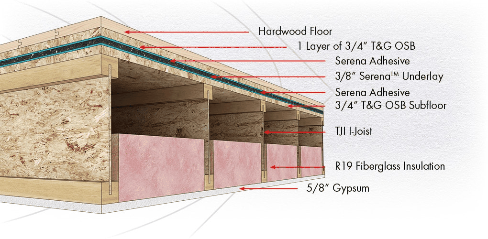
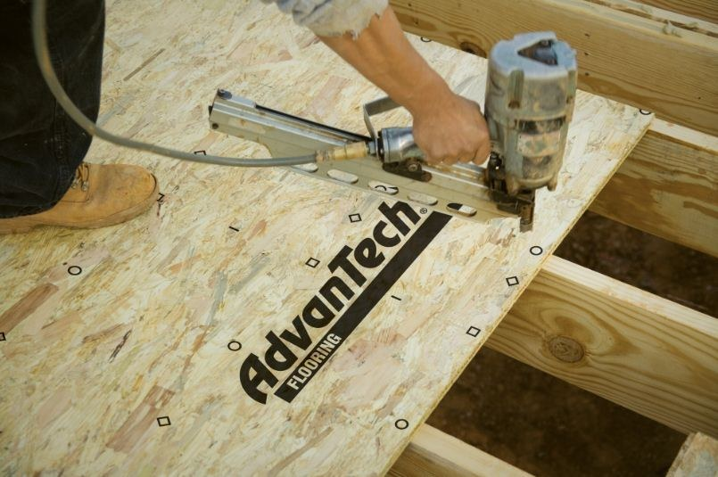

# Floor Sheathing

<figure markdown>
  
  <figcaption markdown="span">Floor assembly by the arrows: 3/4" T&G subfloor, underlay, second 3/4" T&G layer, adhesive. Each sheet is its own row. Insulation between the joists and the ceiling gypsum are not counted in the frame scope. Archive illustration.</figcaption>
</figure>

## What it is

Floor sheathing is everything that lies on the joists over the floor area: subfloor,
underlayment, a second layer under tile or tubs, FRT strips around the perimeter,
sound mat. The base `3/4" T&G` subfloor is covered in [Subfloor](../../horizontal/floor-framing/subfloor.md);
this page covers the extra layers from the floor assembly that get lost most often.
The exterior strip at the floor framing level is [Box Sheathing](box-sheathing.md),
not this page.

## Where to find it on the plans

| Sheet | What to take |
| --- | --- |
| Floor type schedule (`ft`), assemblies | All layers by the arrows: subfloor, underlayment, sound mat, gypcrete (by others) |
| Structural notes, framing plan | Subfloor thickness, FRT perimeter `2'` or `4'` at the exterior wall |
| Details (tubs, tile, existing floor) | `3/4" Ply` under tubs (not under showers), new subfloor over the existing one |
| Sections (`sec`) | Underlayment and sleepers over a slab (over slab) |

## How to measure in OurPlanCore

The area comes from `sqfts/1st`, `sqfts/2nd` ([Floor SQFT](../../sqfts/1st2nd.md));
there is no separate takeoff for the sheathing. FRT strip: the floor's exterior wall perimeter
(`walls/<floor> floor walls/ext ...`) x the strip width from the S sheet. Zones under
tubs and tile, when needed, as separate polygons in `sqfts` with a
clear name (`tubs`, `tile`).

- Each layer is counted once and on its own floor.
- `1/2"` underlayment from the assembly can be a very large quantity: read the
  assembly, not just the framing plan.
- Include new subfloor over an existing floor if the detail shows it.

## Takeoff name and DFL row

| Source | DFL row | Material | Unit | Formula |
| --- | --- | --- | --- | --- |
| `sqfts/1st` | `Subfloor` | `3/4" T&G` | `4x8` | `=CEILING(SQFT/32*1.1,1)` |
| same area | `Panel Adheasive` | `29OZ` | `pcs` | per template |
| same area | `Underlayment` | `1/2" Ply` per assembly | `4x8` | `=CEILING(SQFT/32*1.1,1)` |
| ext perimeter x `2'` or `4'` | `Subfloor FRT` | `3/4" T&G FRT` | `4x8` | `=CEILING(LFT*4/32*1.1,1)` |
| `sqfts/tubs` | `Plywood` | `3/4" Ply` (under tubs) | `4x8` | `=CEILING(SQFT/32*1.1,1)` |

## Common mistakes

- FRT strip not figured from the full perimeter of its floor (10 sheets instead of 54).
- Underlayment from the assembly missed because it is not on the framing plan.
- `3/4" Ply` put under showers although the detail says "at tub locations".
- New subfloor over an existing floor left out on a reconstruction.
- Ceiling gypsum and insulation between the joists ended up in the frame scope.

All mistakes: [common-mistakes](../../../start/common-mistakes.md#floor).

## Example

```text
2nd Floor Framing List
Subfloor            3/4" T&G            128   4x8    S201
Subfloor FRT        3/4" T&G FRT         54   4x8    4' perimeter per S001
Panel Adheasive     29OZ                 16   pcs
Underlayment        1/2" Ply            128   4x8    A6-01 floor type F2
```

<figure markdown>
  
  <figcaption markdown="span">T&G subfloor on joists. Sheets = SQFT / 32 x 1.1, rounded up to a whole number. Archive photo.</figcaption>
</figure>

## See also

- [Subfloor](../../horizontal/floor-framing/subfloor.md), [Floor SQFT](../../sqfts/1st2nd.md), [Box Sheathing](box-sheathing.md)
- [Reconstruction](../../../work-types/reconstruction.md) - new floor over an existing one
