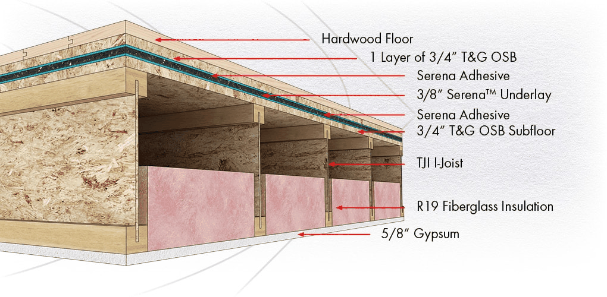
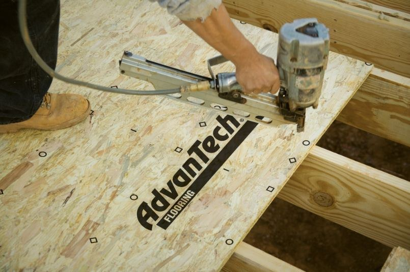

# Floor Sheathing (настил и слои перекрытия)

<figure markdown>
  
  <figcaption markdown="span">Сборка перекрытия по стрелкам: subfloor 3/4" T&G, underlay, второй слой 3/4" T&G, клей. Каждый лист своя строка. Утеплитель между joists и гипс потолка во frame-scope не считаем. Архивная иллюстрация.</figcaption>
</figure>

## Что это

Floor sheathing - **горизонтальные** листы, которые лежат на joists по площади
этажа: subfloor, underlayment, второй слой под плитку или ванны, FRT-полосы
по периметру, sound mat. Как делится материал между страницами:

- базовый subfloor `3/4" T&G` и клей - [Subfloor](../../horizontal/floor-framing/subfloor.md);
- здесь - дополнительные слои по floor assembly, которые чаще всего теряют;
- вертикальная полоса обшивки на высоте перекрытия (по торцу rim) - это
  [Box Sheathing](box-sheathing.md), не эта страница.

## Где искать на чертежах

| Лист | Что взять |
| --- | --- |
| Floor type schedule (`ft`), assemblies | Все слои по стрелкам: subfloor, underlayment, sound mat, gypcrete (by others) |
| Structural notes, framing plan | Толщина subfloor, FRT perimeter `2'` или `4'` у наружной стены |
| Details (ванны, плитка, существующий пол) | `3/4" Ply` под ваннами (не под душем), новый subfloor поверх существующего |
| Sections (`sec`) | Над плитой (over slab) underlayment и sleepers |

## Как мерить в OurPlanCore

Площадь берётся из `sqfts/1st`, `sqfts/2nd` ([Floor SQFT](../../sqfts/1st2nd.md)),
отдельного замера настила нет. FRT-полоса: периметр наружных стен этажа
(`walls/<этаж> floor walls/ext ...`) x ширина полосы с S-листа. Зоны под
ваннами и плиткой при необходимости отдельными полигонами в `sqfts` с
понятным именем (`tubs`, `tile`).

- Каждый слой считается один раз и по своему этажу.
- Underlayment `1/2"` по сборке может быть очень большим количеством: читай
  assembly, а не только framing plan.
- Над существующим полом новый subfloor включаем, если так на детали.

## Как назвать в дереве и строка DFL

| Источник | Строка DFL | Материал | Unit | Формула |
| --- | --- | --- | --- | --- |
| `sqfts/1st` | `Subfloor` | `3/4" T&G` | `4x8` | `=ОКРВВЕРХ(SQFT/32*1.1;1)` |
| строка `Subfloor` | `Panel Adheasive` | `29OZ` | `tubes` | `=ОКРВВЕРХ(C<subfloor>/3;1)`: одна туба на 3 листа subfloor |
| та же площадь | `Underlayment` | `1/2" Ply` по assembly | `4x8` | `=ОКРВВЕРХ(SQFT/32*1.1;1)` |
| периметр ext x `2'` или `4'` | `Subfloor FRT` | `3/4" T&G FRT` | `4x8` | `=ОКРВВЕРХ(LFT*4/32*1.1;1)` для полосы 4' (для 2' множитель `2`) |
| `sqfts/tubs` | `Plywood` | `3/4" Ply` (под ваннами) | `4x8` | `=ОКРВВЕРХ(SQFT/32*1.1;1)` |

## Частые ошибки

- FRT-полоса посчитана не от всего периметра своего этажа (10 листов вместо 54).
- Underlayment по сборке пропущен, потому что на framing plan его нет.
- `3/4" Ply` положен под душевые, хотя деталь говорит "at tub locations".
- Новый subfloor поверх существующего пола не включён при реконструкции.
- Гипс потолка и утеплитель между joists попали в frame-scope.

Все ошибки: [common-mistakes](../../../start/common-mistakes.md#floor).

## Пример

```text
2nd Floor Framing List
Subfloor            3/4" T&G            128   4x8    S201
Panel Adheasive     29OZ                 43   tubes
Subfloor FRT        3/4" T&G FRT         54   4x8    4' perimeter per S001
Underlayment        1/2" Ply            128   4x8    A6-01 floor type F2
```

`Panel Adheasive` стоит сразу под `Subfloor` и считается от его листов:
`128 / 3 = 42.7`, в книге 43 тубы.

<figure markdown>
  
  <figcaption markdown="span">Subfloor T&G на joists. Листы = SQFT / 32 x 1.1, вверх до целого. Архивное фото.</figcaption>
</figure>

## См. также

- [Subfloor](../../horizontal/floor-framing/subfloor.md), [Floor SQFT](../../sqfts/1st2nd.md), [Box Sheathing](box-sheathing.md)
- [Reconstruction](../../../work-types/reconstruction.md) - новый пол поверх существующего
