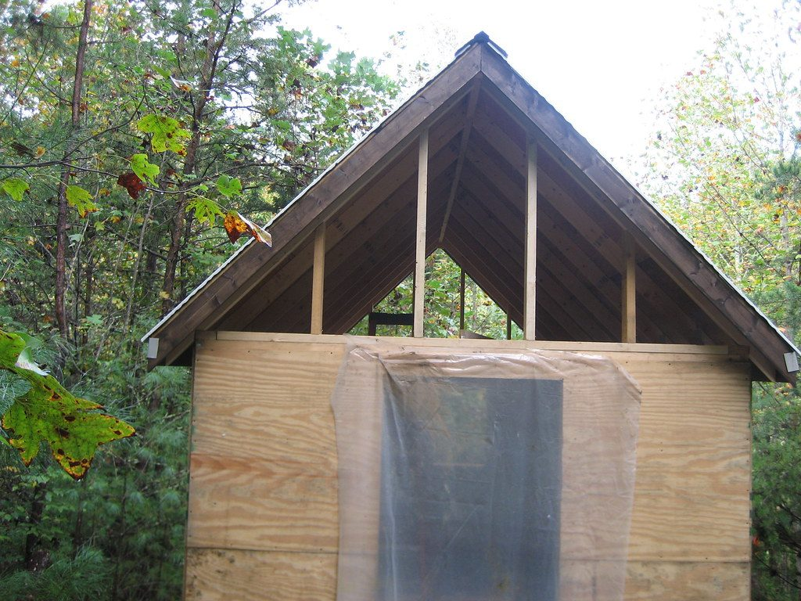
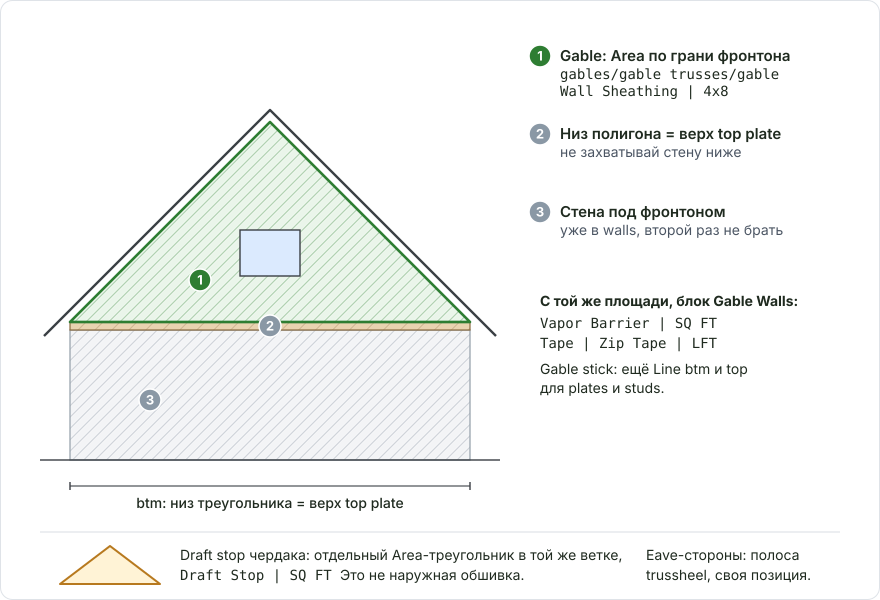

# Gable Sheathing

<figure markdown>
  
  <figcaption markdown="span">Gable stick: the framed triangle above the wall's top plate. Gable sheathing is counted from the top of the top plate up to the slope; the wall below is already in walls. Photo: wheezinggirl, CC BY 2.0, <a href="https://www.flickr.com/photos/13073825@N07/3962422200">source</a>.</figcaption>
</figure>

## What it is

Gable sheathing covers the gable triangle under a gable roof, from the
wall's top plate up to the slope. Two types: gable trusses (truss by others,
we count only the sheathing and WRB) and gable stick (we count the framing and the sheathing, see
[Gable Wall](../walls/gable.md)). The heel strip on the eave sides is
[Truss Heel](truss-heel.md). The attic draft stop lives in the same branch, but it is
an interior attic partition, not exterior sheathing.

## Where to find it on the plans

| Sheet | What to take |
| --- | --- |
| Roof plan notes | `Trusses` = gable trusses; `2x10`, `TJI`, `stick` = gable stick |
| Elevations (`el`) | Triangle outline, dormer gables, where the wall ends and the gable starts |
| Sections (`sec`) | Top plate height, pitch, heel |
| Draftstops plan (for example A1-00) and section A4 | Draft stop lines and the attic profile (span x rise) |
| Roof plan legend, wall sections, fire rating | Draft stop material (`1/2" WR Gyp`, `7/16" OSB`, `5/8" Type X`), gable material |

## How to measure in OurPlanCore

1. Area tool along the real face of the gable on the elevation (`a201 el`), including
   steps and dormers. Bottom of the polygon = top of the top plate. Several gables of one
   type can be collected as polygons in one takeoff.
2. For gable stick add a Line `btm` (bottom of the triangle) and `top` (both sloped
   edges): the export figures plates and studs from them.
3. Draft stop: location from the Draftstops Plan sheet, attic profile from the section,
   one Area triangle per line (base = span across the building, apex under
   the ridge). Place it on the architectural roof plan, not on an S sheet. Its own color,
   source sheets in Notes. At hips the triangle is smaller: mark it "check".
4. Do not collect one gable twice from two elevations, and do not put it both in
   gable and in the wall area. Existing gables go in a separate takeoff
   (`existing gable`).

## Takeoff name and DFL row

G is the area from the tree in SQ FT.

| Takeoff name | DFL row (Gable Walls block) | Material | Unit | Formula |
| --- | --- | --- | --- | --- |
| `gables/gable trusses/gable` (Area) | `Wall Sheathing` | `7/16" Zip` / `1/2" OSB` | `4x8` | `=CEILING(G/32*1.1,1)` |
| same area, no Zip | `Vapor Barrier` | WRB per spec | `SQ FT` | `G x 1.1` |
| same area, Zip | `Tape` | `Zip Tape` | `LFT` | `=CEILING(G*0.4*1.1,10)` |
| `gables/gable stick/gable stick` (Area) + `btm`, `top` (Line) | `Plates Ext (3) btm and dbl top`, `Studs for Gables`, `Blocking`, `Bracing Ext Walls` | per [Gable Wall](../walls/gable.md) | | |
| `gables/gable trusses/draft stop` (Area) | `Draft Stop` | from the roof plan legend or the section; default `1/2" WR Gyp` | `SQ FT` | `G x 1.1` |

- Rounding of SQ FT rows: a result under 50 goes to 2, otherwise to 10.
- With Zip there is no `Vapor Barrier` row: the barrier is built into the sheet, only `Tape` is needed.
  `Insulation` appears only with continuous insulation outside the sheathing.
- `Draft Stop` is counted in `SQ FT`, not in `4x8` sheets. Material: `1/2" WR Gyp`
  by default; `7/16" OSB`, `1/2" Gyp`, `5/8" Type X` when the drawing says so;
  no sheet means `TBD`. Both sides: `Draft Stop 2 sides`, G x 2. The full
  rule is on [Gable Wall](../walls/gable.md).

The GB button on the XL strip moves the `gables` branch into the Gable Walls block.

## Common mistakes

- Draft stop not counted or copied from the shear wall total (the most frequent miss).
- Area measured, but the old number stayed in Excel.
- Gable counted twice (two elevations, or gable plus wall).
- Truss heel included both in gable and in trussheel.
- Draft stop material and thickness not checked against the legend (`7/16" OSB` vs `1/2" WR Gyp`), or the row written in `4x8` sheets.
- Plates and studs counted for gable trusses although they are already in the truss.

All mistakes: [common-mistakes](../../../start/common-mistakes.md#sheathing).

## Example

```text
Takeoffs/Main/gables/gable trusses/
  gable            Area   412 SQ FT   (4 polygons, north and south elevations)
  draft stop       Area   318 SQ FT   (3 lines from A1-00, profile from A4-01)
Takeoffs/Main/gables/gable stick/
  gable stick      Area   96 SQ FT
  btm              Line   24 LFT
  top              Line   27 LFT

Gable Walls
Wall Sheathing      1/2" OSB          15   4x8     412 / 32 x 1.1 = 14.2
Vapor Barrier       WRB per spec     460   SQ FT   412 x 1.1 = 453.2

Draft Stop          1/2" WR Gyp      350   SQ FT   318 x 1.1 = 349.8
```

<figure markdown>
  
  <figcaption markdown="span">Gable area is counted from the top of the wall's top plate; the truss heel on the eave sides is a separate trussheel strip.</figcaption>
</figure>

## See also

- [Gable Wall](../walls/gable.md) - stick gable framing and the row table
- [Truss Heel](truss-heel.md), [Wall Sheathing](wall-sheathing.md), [Demising Walls](../walls/demising.md) (draft stop on walls)
