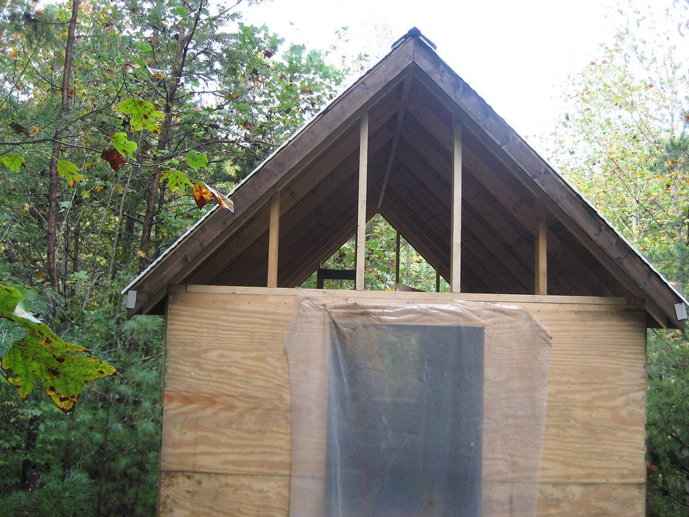
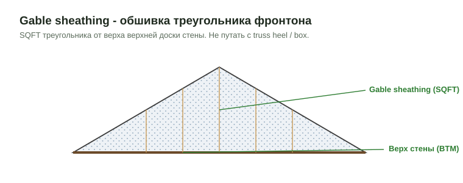

# Gable Sheathing (обшивка фронтона)

<figure markdown>
  
  <figcaption markdown="span">Gable stick: треугольник каркаса над верхней доской стены. Обшивка фронтона считается от верха top plate до ската; стена ниже уже в walls. Фото: wheezinggirl, CC BY 2.0, <a href="https://www.flickr.com/photos/13073825@N07/3962422200">источник</a>.</figcaption>
</figure>

## Что это

Gable sheathing - обшивка треугольника фронтона под двускатной крышей, от
верхней доски стены до ската. Два типа: gable trusses (ферма by others,
считаем только обшивку и WRB) и gable stick (считаем каркас и обшивку, см.
[Gable Wall](../walls/gable.md)). Полоса пятки на eave-сторонах - это
[Truss Heel](truss-heel.md). Draft stop чердака живёт в той же ветке, но это
внутренняя перегородка чердака, а не наружная обшивка.

## Где искать на чертежах

| Лист | Что взять |
| --- | --- |
| Roof plan notes | `Trusses` = gable trusses; `2x10`, `TJI`, `stick` = gable stick |
| Elevations (`el`) | Контур треугольника, dormer gables, где кончается стена и начинается gable |
| Sections (`sec`) | Высота top plate, уклон, пятка |
| Draftstops plan (например A1-00) и разрез A4 | Линии draft stop и профиль чердака (пролёт x подъём) |
| Wall notes / fire rating | Толщина draft stop (`1/2" Ply`, `5/8" Type X`), материал фронтона |

## Как мерить в OurPlanCore

1. Инструмент Area по реальной грани фронтона на фасаде (`a201 el`), включая
   ступени и dormer. Низ полигона = верх top plate. Несколько фронтонов одного
   типа можно собрать полигонами в одной позиции.
2. Для gable stick добавь Line `btm` (низ треугольника) и `top` (две наклонные
   грани): по ним экспорт считает plates и studs.
3. Draft stop: место с листа Draftstops Plan, профиль чердака с разреза,
   Area-треугольник на каждую линию (низ = пролёт поперёк здания, вершина под
   коньком). Ставить на архитектурном плане кровли, не на S-листе. Свой цвет,
   в Notes листы-источники. У вальм треугольник меньше: пометь "проверь".
4. Один фронтон не собирать дважды с двух фасадов и не класть одновременно в
   gable и в площадь стены. Существующие фронтоны отдельной позицией
   (`existing gable`).

## Как назвать в дереве и строка DFL

| Имя в дереве | Строка DFL (блок Gable Walls) | Материал | Unit | Формула |
| --- | --- | --- | --- | --- |
| `gables/gable trusses/gable` (Area) | `Wall Sheathing` | `7/16" Zip` / `1/2" OSB` | `4x8` | `=ОКРВВЕРХ(SQFT/32*1.1;1)` |
| та же площадь | `Vapor Barrier` (WRB), `Tape` при Zip | по спецификации | `SQ FT` / `LFT` | как у стены |
| `gables/gable stick/gable stick` (Area) + `btm`, `top` (Line) | `Studs for Gables`, `Plates Ext (3)`, `Blocking` | по [Gable Wall](../walls/gable.md) | | |
| `gables/gable trusses/draft stop` (Area) | `Draft Stop` | `1/2" Ply` или `5/8" Type X` по детали | `4x8` | `=ОКРВВЕРХ(SQFT/32*1.1;1)` |

Полоса XL, кнопка GB, переносит ветку `gables` в блок Gable Walls.

## Частые ошибки

- Draft stop не посчитан или скопирован из суммы shear walls (самый частый пропуск).
- Площадь измерена, а в Excel осталось старое число.
- Фронтон посчитан дважды (два фасада, или gable плюс стена).
- Пятка фермы включена и в gable, и в trussheel.
- Толщина draft stop не сверена (`7/16"` против `1/2"`).
- Для gable trusses посчитаны plates и studs, которые уже в ферме.

Все ошибки: [common-mistakes](../../../start/common-mistakes.md#sheathing).

## Пример

```text
Takeoffs/Main/gables/gable trusses/
  gable            Area   412 SF   (4 полигона, фасады север и юг)
  draft stop       Area   318 SF   (3 линии с A1-00, профиль с A4-01)
Takeoffs/Main/gables/gable stick/
  gable stick      Area   96 SF
  btm              Line   24 LFT
  top              Line   27 LFT
```

<figure markdown>
  
  <figcaption markdown="span">Площадь фронтона считается от верха верхней доски стены; пятка фермы на eave-сторонах - отдельная полоса trussheel.</figcaption>
</figure>

## См. также

- [Gable Wall](../walls/gable.md) - каркас stick gable и таблица строк
- [Truss Heel](truss-heel.md), [Wall Sheathing](wall-sheathing.md), [Demising Walls](../walls/demising.md) (draft stop на стенах)
