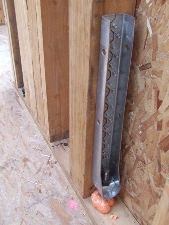
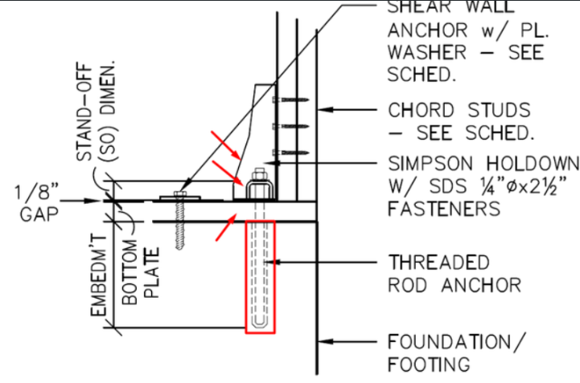

# Holdowns

<figure markdown>
  { width="360" }
  <figcaption markdown="span">Holdown at the end stud of a shear wall, anchored into concrete. One Count point per such connection; the model comes from the table for your building and floor. Photo: Thester11, CC BY-SA 3.0, <a href="https://commons.wikimedia.org/wiki/File:HoldDown.JPG">source</a>.</figcaption>
</figure>

## What it is

A holdown is the hardware at the end of a shear wall that keeps the stud from uplifting:
`HDU`, `HDUE` (embedded, cast into concrete), `HTT`, `DTT` (light), plus
`MSTC`, `CS16`, `LSTA` straps between floors. Holdowns sit at points, anchor
bolts are spaced along the slab: these are different rows ([Anchor Bolts](../../deck/anchor-bolts.md)).
Post caps, bases and hangers do not belong here: they go in `framing/.../details`.

## Where to find it on the plans

| Sheet | What to take |
| --- | --- |
| Shear wall schedule | Holdown model by SW mark, straps, anchor |
| Framing plans with SW marks | Symbols at the SW ends, double symbols, the `?` sign |
| Details (`S2.2`, `4/S5.5`) | Connection configuration: to concrete, through the floor framing, over a beam |
| Sections / elevations | Connection level: the bottom of the wall may not be on the framing sheet's floor |

<figure markdown>
  
  <figcaption markdown="span">Detail: holdown with SDS on the chord studs, threaded rod anchor into concrete, an anchor with a plate washer next to it. Do not delete what the engineer shows explicitly. Archive excerpt.</figcaption>
</figure>

## How to measure in OurPlanCore

1. Count tool: one point at the real connection (end stud), not on the
   callout text. One takeoff per model and configuration, its own color and
   CountSymbol.
2. Take the model from the table for your building and your floor. Do not add
   rods, anchors or Zmax if they are not in the detail.
3. `(2) DTT2Z` = two pieces at one connection: as many points as there are locations;
   show the number of pieces separately (in the name or in Excel), do not multiply twice.
4. A shared end of two SW, a connection on the plan and on a detail, top and bottom on different
   sheets: check whether it is one location or two levels.
5. Holdowns not marked on the plan: takeoff `TBD HD` and the Note
   `Holdown locations are assumed; verify`. Keep a `?` sign as an
   undefined connection with its source.

## Counting rule (1 to concrete, 2 through the floor framing)

| Connection | How many pieces | DFL row |
| --- | --- | --- |
| SW stud sits on concrete | 1, as drawn | `Holdowns (1) btm`, C `=G` |
| SW over wood floor framing | 2: below and above the floor framing | `Holdowns (2) btm top`, C `=G*2` |
| Holdown sits over a beam | do not add a transfer holdown under the beam (client instruction, 09/22) | as shown |
| Threaded rod | only if shown | its own row |

Count straps (`MSTC40`, `CS16`) as separate takeoffs, do not mix them with anchors.

## Takeoff name and DFL row

| Takeoff name | DFL row | B (model) | Unit | E |
| --- | --- | --- | --- | --- |
| `shear walls/1st floor/holdowns/HDU11 SB1x30 S2.2` | `Holdowns (1) btm` | `HDU11` | `pcs` | `SW-2` |
| `shear walls/2nd floor/holdowns/HD1 (2) DTT2Z` | `Holdowns (2) btm top` | `DTT2Z` | `pcs` | SW mark |
| `shear walls/1st floor/holdowns/DTT2Z at WSW-B` | `Holdowns (1) btm` | `DTT2Z` | `pcs` | `WSW-B` |
| `shear walls/2nd floor/holdowns/MSTC40 type C S2.3` | `Straps` | `MSTC40` | `pcs` | `S2.3` |

Place in the DFL: the wall section of the floor whose SW the holdown restrains, a block at the end
of the section after the last `Tape` (under Box Sheathing). G = number of points from
OurPlanCore, one row per model.

## Common mistakes

- Model taken from the table of another building or floor (`HDUE13` instead of `HDUE17`).
- One holdown through wood floor framing instead of two.
- Straps mixed with anchors on one row.
- A shared end of two SW counted twice, or top/bottom on two sheets counted as two locations.
- A threaded rod or Zmax added that is not in the detail.
- Anchor bolts at one spacing for the whole building instead of the spacing from the SW schedule.

All mistakes: [common-mistakes](../../../start/common-mistakes.md#holdowns).

## Example

```text
Takeoffs/Main/shear walls/1st floor/holdowns/
  HDU11 SB1x30 S2.2     Count 14     (to concrete)
  HD1 (2) DTT2Z         Count  6     (two pieces per connection)
Takeoffs/Main/shear walls/2nd floor/holdowns/
  HDU5 S2.2             Count 10     (through the floor framing)

1st Floor Walls ... Tape
Holdowns (1) btm        HDU11     14    pcs   SW-2
Holdowns (1) btm        DTT2Z     12    pcs   HD1
2nd Floor Walls ... Tape
Holdowns (2) btm top    HDU5      20    pcs   SW-3
```

## See also

- [Shear Wall](shear-wall.md), [Anchor Bolts](../../deck/anchor-bolts.md)
- [Hardware catalog, Holdowns](../../../reference/hardware-catalog.md)
- [Standard notes](../../../reference/standard-notes.md)
