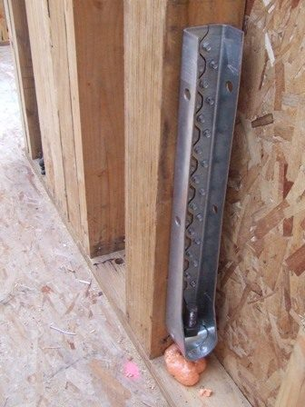
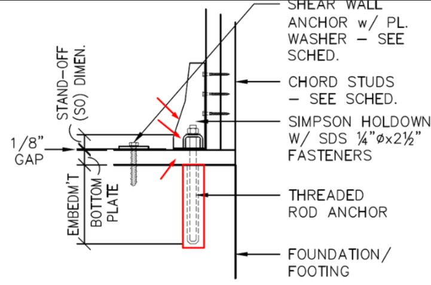

# Holdowns (анкеровка shear walls)

<figure markdown>
  { width="360" }
  <figcaption markdown="span">Holdown на конце стойки shear wall, анкер в бетон. Одна точка Count на такой узел; модель из таблицы своего корпуса и этажа. Фото: Thester11, CC BY-SA 3.0, <a href="https://commons.wikimedia.org/wiki/File:HoldDown.JPG">источник</a>.</figcaption>
</figure>

## Что это

Holdown - крепёж на конце shear wall, который держит стойку от отрыва:
`HDU`, `HDUE` (embedded, залитый в бетон), `HTT`, `DTT` (лёгкий), плюс
страпы `MSTC`, `CS16`, `LSTA` между этажами. Holdowns стоят в точках, анкерные
болты по шагу вдоль плиты - это разные строки ([Anchor Bolts](../../deck/anchor-bolts.md)).
Post caps, bases и hangers сюда не относятся: они в `framing/.../details`.

## Где искать на чертежах

| Лист | Что взять |
| --- | --- |
| Shear wall schedule | Модель holdown по марке SW, страпы, анкер |
| Framing plans с марками SW | Символы на концах SW, двойные символы, знак `?` |
| Details (`S2.2`, `4/S5.5`) | Конфигурация узла: к бетону, через перекрытие, над балкой |
| Sections / elevations | Уровень узла: низ стены может быть не на этаже framing sheet |

<figure markdown>
  
  <figcaption markdown="span">Деталь: holdown с SDS на chord studs, threaded rod anchor в бетон, рядом anchor с plate washer. Что явно показано инженером, не удаляем. Архивный фрагмент.</figcaption>
</figure>

## Как мерить в OurPlanCore

1. Инструмент Count: одна точка в месте реального узла (конец стойки), не на
   тексте выноски. Своя позиция на каждую модель и конфигурацию, свой цвет и
   CountSymbol.
2. Модель берём из таблицы своего корпуса и своего этажа. Не дополняем
   стержнями, анкерами или Zmax, если их нет в детали.
3. `(2) DTT2Z` = два изделия в одном узле: точек столько, сколько мест;
   число изделий показываем отдельно (в имени или в Excel), не умножаем дважды.
4. Общий конец двух SW, узел на плане и на детали, top и bottom на разных
   листах: проверь, одно это место или два уровня.
5. Holdowns не размечены на плане: позиция `TBD HD` и Note
   `Holdown locations are assumed; verify`. Знак `?` оставляем как
   неопределённый узел с источником.

## Правило счёта (1 к бетону, 2 через перекрытие)

| Узел | Сколько изделий | Строка DFL |
| --- | --- | --- |
| Стойка SW стоит на бетоне | 1, как нарисовано | `Holdowns (1) btm`, C `=G` |
| SW над деревянным перекрытием | 2: снизу и сверху перекрытия | `Holdowns (2) btm top`, C `=G*2` |
| Holdown стоит над балкой | transfer holdown под балкой не добавляем (указание клиента, 22.09) | как показано |
| Threaded rod | только если показан | своя строка |

Страпы (`MSTC40`, `CS16`) считаем отдельными позициями, не смешиваем с анкерами.

## Как назвать в дереве и строка DFL

| Имя в дереве | Строка DFL | B (модель) | Unit | E |
| --- | --- | --- | --- | --- |
| `shear walls/1st floor/holdowns/HDU11 SB1x30 S2.2` | `Holdowns (1) btm` | `HDU11` | `pcs` | `SW-2` |
| `shear walls/2nd floor/holdowns/HD1 (2) DTT2Z` | `Holdowns (2) btm top` | `DTT2Z` | `pcs` | марка SW |
| `shear walls/1st floor/holdowns/DTT2Z at WSW-B` | `Holdowns (1) btm` | `DTT2Z` | `pcs` | `WSW-B` |
| `shear walls/2nd floor/holdowns/MSTC40 type C S2.3` | `Straps` | `MSTC40` | `pcs` | `S2.3` |

Место в DFL: секция стен того этажа, чьи SW держит holdown, блок в конце
секции после последней `Tape` (под Box Sheathing). G = число точек из
OurPlanCore, строка на каждую модель.

## Частые ошибки

- Модель из таблицы другого корпуса или этажа (`HDUE13` вместо `HDUE17`).
- Один holdown через деревянное перекрытие вместо двух.
- Страпы смешаны с анкерами в одной строке.
- Общий конец двух SW посчитан дважды, или top/bottom на двух листах как два места.
- Добавлен threaded rod или Zmax, которых нет в детали.
- Анкерные болты одним шагом на всё здание вместо шага по SW schedule.

Все ошибки: [common-mistakes](../../../start/common-mistakes.md#holdowns).

## Пример

```text
Takeoffs/Main/shear walls/1st floor/holdowns/
  HDU11 SB1x30 S2.2     Count 14     (к бетону)
  HD1 (2) DTT2Z         Count  6     (два изделия в узле)
Takeoffs/Main/shear walls/2nd floor/holdowns/
  HDU5 S2.2             Count 10     (через перекрытие)

1st Floor Walls ... Tape
Holdowns (1) btm        HDU11     14    pcs   SW-2
Holdowns (1) btm        DTT2Z     12    pcs   HD1
2nd Floor Walls ... Tape
Holdowns (2) btm top    HDU5      20    pcs   SW-3
```

## См. также

- [Shear Wall](shear-wall.md), [Anchor Bolts](../../deck/anchor-bolts.md)
- [Hardware catalog, Holdowns](../../../reference/hardware-catalog.md)
- [Стандартные notes](../../../reference/standard-notes.md)
