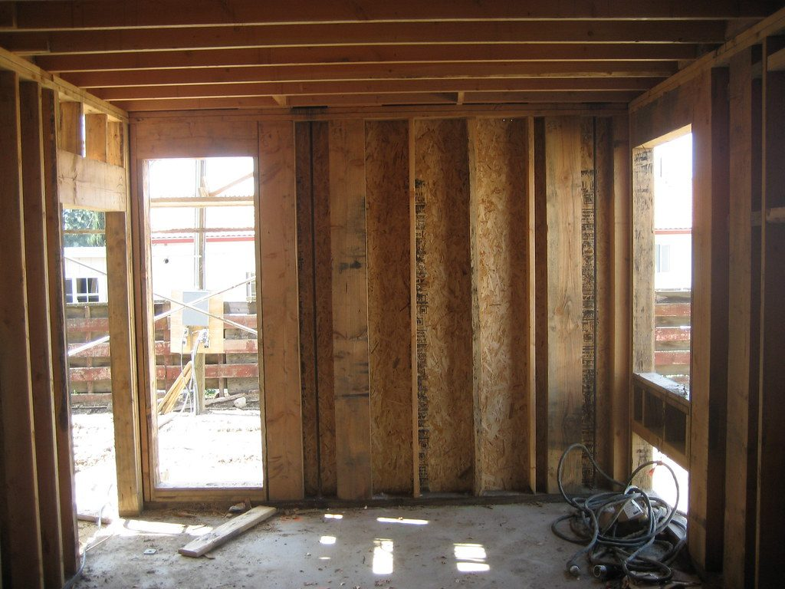
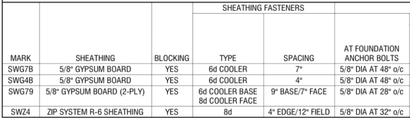

# Shear Wall

<figure markdown>
  
  <figcaption markdown="span">Interior shear wall: OSB on one side only, per the schedule. The run length is a Line in the shear walls branch; the sheathing follows the SW schedule, not the Arch sheets. Photo: bbaunach, CC BY 2.0, <a href="https://www.flickr.com/photos/93734858@N00/5792759950">source</a>.</figcaption>
</figure>

## What it is

A shear wall (SW) is a wall run that resists wind and seismic loads through
structural sheathing, heavier nailing and holdowns at the ends. SW sheathing
is counted strictly per the structural shear wall schedule: type, thickness, side,
layers. A regular wall of the same length is already in `walls`: the SW is not added to it,
it adds only what the regular wall does not have (a second side, a different
material). Anchorage is a separate page: [Holdowns](holdowns.md).

## Where to find it on the plans

| Sheet | What to take |
| --- | --- |
| Shear wall schedule (S) | Mark, sheathing and thickness, one or two sides, blocking, nailing, holdown, anchor spacing |
| Framing plan (`s201 2nd`) | SW marks and their limits; a floor framing plan shows the walls below - take the floor from the "walls below/above" notes |
| Holdown and SW details | What is at the wall ends, what is between floors |
| Wall sections (`sec`) | Which level the wall is on, height |

<figure markdown>
  
  <figcaption markdown="span">Shear wall schedule: mark, sheathing, blocking, fasteners, anchor spacing. The same mark in another building does not mean the same spec. Archive excerpt.</figcaption>
</figure>

## How to measure in OurPlanCore

1. Line tool along the actual SW segment between its limits, not along the
   room outline. LFT unit.
2. A floor framing plan shows the SW of the floor below: a copy of the sheet in `Struct/Shear` with
   the S dot sends new takeoffs into `shear walls/<floor below>`.
3. One takeoff per schedule row: do not merge `SW4-1` and `SW4-2` because
   their lengths match. One takeoff can contain several runs.
4. Read the side: the outside face of an ext SW is already counted in ext walls,
   only the inside face is needed. Label a two-sided SW "both sides"; its G =
   the sum of the two faces, with no extra x2. `P` on the mark = perforated.
5. On a panel job one sheathed side is already in the panel; count only the required
   second side.

## Takeoff name and DFL row

| Takeoff name | DFL row | Material | Unit | Formula |
| --- | --- | --- | --- | --- |
| `shear walls/1st floor/shear/SW1-1` | `Wall Sheathing` in the floor's wall block, E = `SW1-1` | per schedule, for example `15/32" Ply` | `4x8` | `=CEILING(LFT*H/32*1.1,1)` |
| `shear walls/1st floor/shear/WSW-C 7-16 OSB DTT2Z` | same, E = mark | `7/16" OSB` | `4x8` | same |
| `shear walls/2nd floor/shear/ext W4B` | same | per schedule | `4x8` | same |
| separately | `Draft Stop` | per detail | `4x8` | not from the SW total, see [Gable Sheathing](gable.md) |

Name = mark plus confirmed differences (material, thickness, fasteners).
The SW button on the XL ribbon puts the areas into the floor's wall block.

## Common mistakes

- Two sides counted as x2 on top of the sum of two faces, or `P` read as two sides.
- Schedule rows with different specs merged by length.
- SW floor taken from the sheet instead of the "walls below" notes: the SW ended up one floor too high.
- Attic draft stop copied from the shear wall total.
- FRT applied to a demising SW automatically; FRT only per the exterior wall rules.
- A35 and other clips added out of habit, not per detail.

All mistakes: [common-mistakes](../../../start/common-mistakes.md#holdowns).

## Example

```text
Takeoffs/Main/shear walls/1st floor/shear/
  SW1-1                      Line   86 LFT
  WSW-C 7-16 OSB DTT2Z       Line   42 LFT
  ext W4B                    Line  118 LFT
Takeoffs/Main/shear walls/1st floor/holdowns/
  HDU11 SB1x30 S2.2          Count  14
```

## See also

- [Holdowns](holdowns.md) - SW anchorage, the rule of 1 to concrete and 2 through the floor framing
- [Wall Sheathing](wall-sheathing.md), [Demising Walls](../walls/demising.md)
- [Anchor Bolts](../../deck/anchor-bolts.md), [Hardware catalog](../../../reference/hardware-catalog.md)
