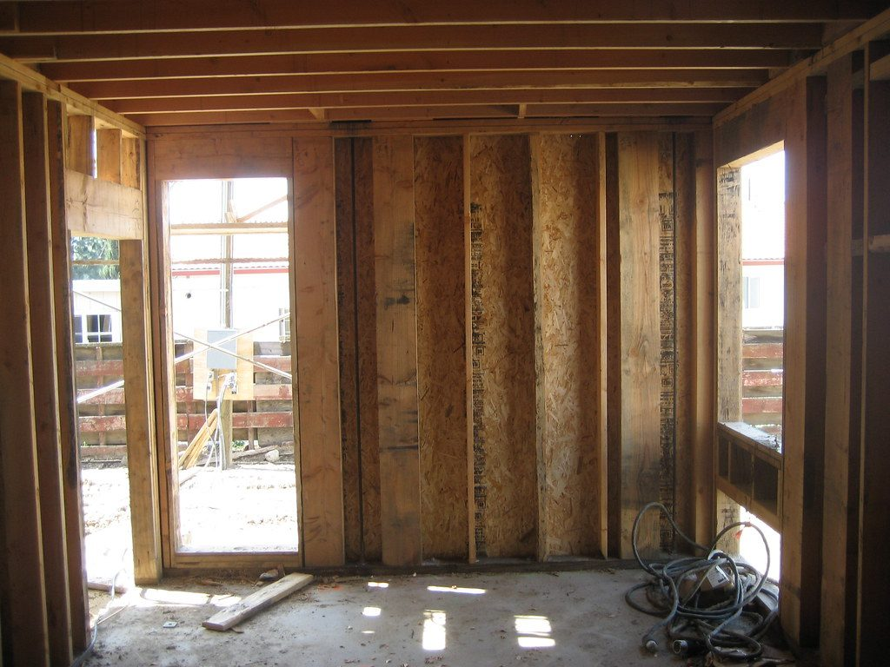
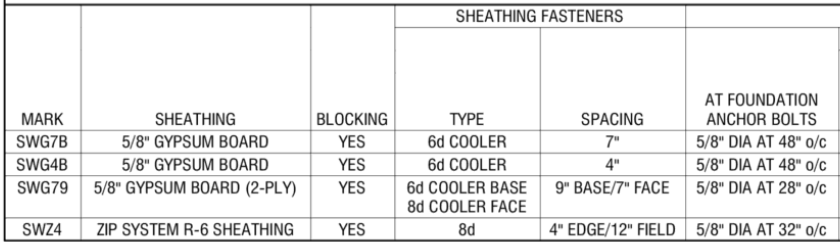

# Shear Wall (стена жёсткости)

<figure markdown>
  
  <figcaption markdown="span">Внутренняя shear wall: OSB только с одной стороны, по таблице. Длина участка - Line в ветке shear walls; обшивка - по SW schedule, не по Arch. Фото: bbaunach, CC BY 2.0, <a href="https://www.flickr.com/photos/93734858@N00/5792759950">источник</a>.</figcaption>
</figure>

## Что это

Shear wall (SW) - участок стены, который держит ветер и сейсмику через
структурную обшивку, усиленную гвоздёвку и holdowns на концах. Обшивка SW
считается строго по structural shear wall schedule: тип, толщина, сторона,
слои. Обычная стена той же длины уже есть в `walls`: SW не складывается с ней,
а добавляет только то, чего в обычной стене нет (вторую сторону, другой
материал). Анкеровка - отдельная страница [Holdowns](holdowns.md).

## Где искать на чертежах

| Лист | Что взять |
| --- | --- |
| Shear wall schedule (S) | Марка, обшивка и толщина, одна или две стороны, blocking, nailing, holdown, шаг анкеров |
| Framing plan (`s201 2nd`) | Марки SW и их границы; план перекрытия показывает стены ниже - этаж из notes "walls below/above" |
| Details holdown и SW | Что у концов стены, что между этажами |
| Wall sections (`sec`) | На каком уровне стена, высота |

<figure markdown>
  
  <figcaption markdown="span">Shear wall schedule: марка, обшивка, blocking, крепёж, шаг анкеров. Одна марка в другом доме не означает ту же спецификацию. Архивный фрагмент.</figcaption>
</figure>

## Как мерить в OurPlanCore

1. Инструмент Line по фактическому сегменту SW между его границами, не по
   контуру комнаты. Единица LFT.
2. План перекрытия показывает SW этажа ниже: копия листа в `Struct/Shear` с
   точкой S направляет новые замеры в `shear walls/<этаж ниже>`.
3. Одна позиция на строку schedule: `SW4-1` и `SW4-2` не объединяй по
   одинаковой длине. Внутри позиции может быть несколько участков.
4. Прочитай сторону: наружная сторона ext SW уже посчитана в ext walls,
   нужна только внутренняя. Двустороннюю SW подпиши "с двух сторон"; её G =
   сумма двух лиц, без ещё одного x2. `P` у марки = perforated.
5. На panel-job одна обшитая сторона уже в панели; считаем только требуемую
   вторую.

## Как назвать в дереве и строка DFL

| Имя в дереве | Строка DFL | Материал | Unit | Формула |
| --- | --- | --- | --- | --- |
| `shear walls/1st floor/shear/SW1-1` | `Wall Sheathing` в блоке стен этажа, E = `SW1-1` | по schedule, например `15/32" Ply` | `4x8` | `=ОКРВВЕРХ(LFT*H/32*1.1;1)` |
| `shear walls/1st floor/shear/WSW-C 7-16 OSB DTT2Z` | то же, E = марка | `7/16" OSB` | `4x8` | то же |
| `shear walls/2nd floor/shear/ext W4B` | то же | по schedule | `4x8` | то же |
| отдельно | `Draft Stop` | по детали | `4x8` | не из суммы SW, см. [Gable Sheathing](gable.md) |

Имя = марка плюс подтверждённые отличия (материал, толщина, крепёж).
Полоса XL, кнопка SW, кладёт площади в блок стен этажа.

## Частые ошибки

- Две стороны посчитаны как x2 поверх суммы двух лиц, или `P` прочитано как две стороны.
- Строки schedule с разной спецификацией слиты по длине.
- Этаж SW взят по листу, а не по notes "walls below": SW ушла на этаж выше.
- Draft stop чердака скопирован из суммы shear walls.
- FRT для demising SW поставлен автоматически; FRT только по правилам наружной стены.
- A35 и прочие клипсы добавлены по привычке, а не по детали.

Все ошибки: [common-mistakes](../../../start/common-mistakes.md#holdowns).

## Пример

```text
Takeoffs/Main/shear walls/1st floor/shear/
  SW1-1                      Line   86 LFT
  WSW-C 7-16 OSB DTT2Z       Line   42 LFT
  ext W4B                    Line  118 LFT
Takeoffs/Main/shear walls/1st floor/holdowns/
  HDU11 SB1x30 S2.2          Count  14
```

## См. также

- [Holdowns](holdowns.md) - анкеровка SW, правило 1 к бетону и 2 через перекрытие
- [Wall Sheathing](wall-sheathing.md), [Demising Walls](../walls/demising.md)
- [Anchor Bolts](../../deck/anchor-bolts.md), [Hardware catalog](../../../reference/hardware-catalog.md)
