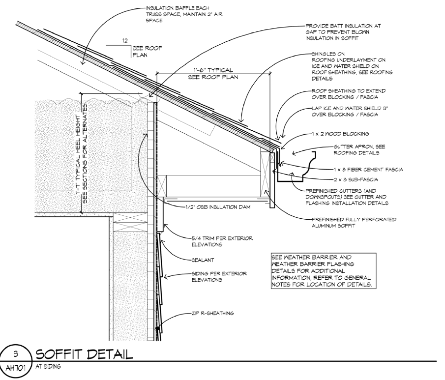
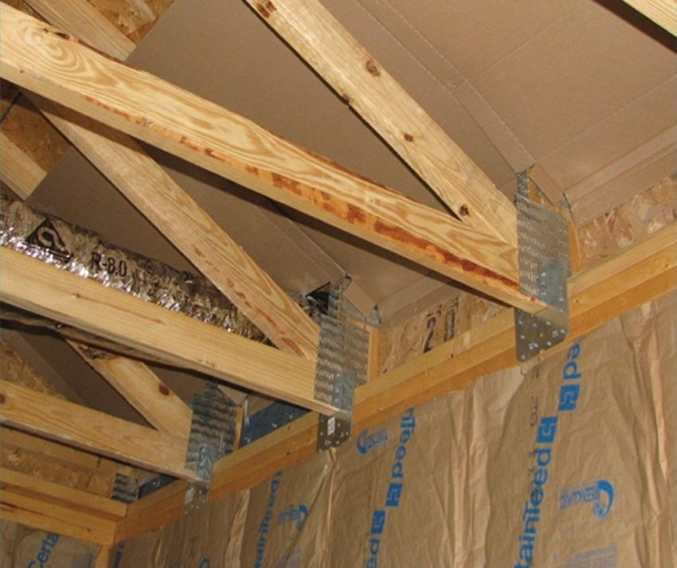
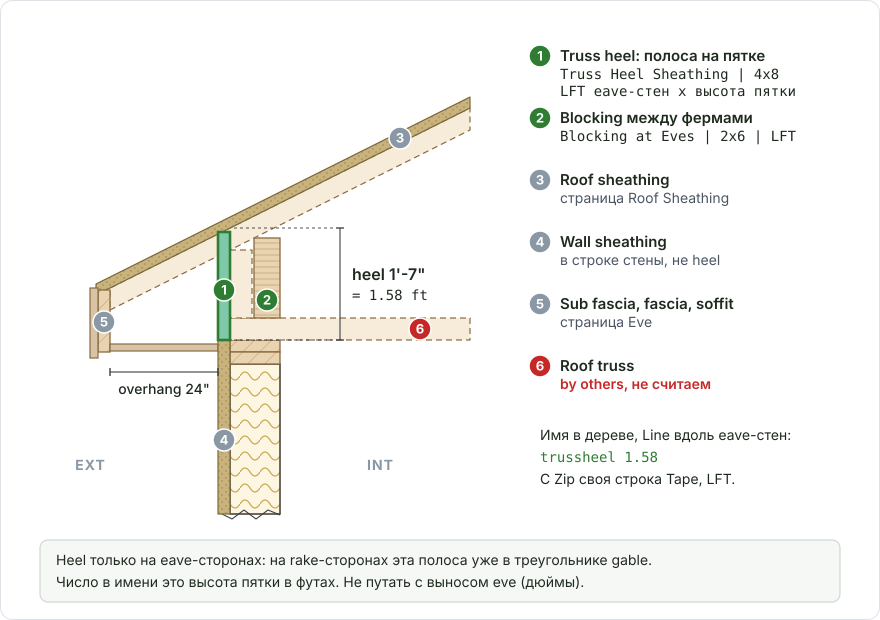

# Truss Heel

<figure markdown>
  
  <figcaption markdown="span">Eave detail: 1'-7" truss heel height between the top of the wall and the underside of the deck, a vertical 1/2" OSB strip on the heel, the wall Zip below, 2x8 sub-fascia and 1x8 fascia outside. Take the height from a detail like this or from the truss package. Archive excerpt.</figcaption>
</figure>

<figure markdown>
  { width="480" }
  <figcaption markdown="span">Raised heel: the vertical heel member of the truss above the top plate, the truss tied down to the wall with straps. The truss heel sheathing strip covers exactly this end along the whole eave side: wall length times heel height. Photo: greenbuildingadvisor.com, [source](https://www.greenbuildingadvisor.com/article/raised-heel-trusses-make-better-enclosures), found via Pinterest.</figcaption>
</figure>

## What it is

Truss heel is the vertical strip of sheathing at the truss ends along the eave
sides of the building: between the wall's top plate and the underside of the roof
deck. Its height is set by the truss heel (heel height), typically 0.66 to
3 feet. On the gable sides this strip is already part of the gable triangle
([Gable Sheathing](gable.md)); on the eave sides it is easy to forget. It is not
[Box Sheathing](box-sheathing.md) and not soffit.

<figure markdown>
  
  <figcaption markdown="span">Raised heel truss on the top plate: a sheathing strip the height of the heel (the name carries the height in feet), the roof starts above it.</figcaption>
</figure>

## Where to find it on the plans

| Sheet | What to take |
| --- | --- |
| Truss profile / truss package | Heel height, heel limits, bearing condition |
| Roof section, soffit detail (`sec`, `d`) | Strip height, material (often the same as the wall), deck offset |
| Roof plan (`rf`) and wall plan (`1st`) | Which walls the trusses bear on: that is where the strip goes |
| Scope / notes | Trusses by others do not cancel the loose heel sheathing; check the scope |

## How to measure in OurPlanCore

1. Line tool along the walls the trusses bear on (eave sides),
   on the top floor plan or the roof plan. LFT unit.
2. The name carries the heel height in decimal feet: `trussheel 0.66`,
   `trussheel 1.25`. Different heights = different takeoffs. The `trussheel` folder sits
   directly under the building; a name with `trussheel` goes there by itself.
3. Do not mix up the numbers: in `eve 24` the number is in inches (overhang), in `prpt 3.4 3 2` they
   are parapet heights, in `trussheel 1.25` it is the strip height in feet.
4. Area = length x height; the export figures it (XL strip, TH button).
   The boundary with gable and wall sheathing must be explicit, with no double layer.

## Takeoff name and DFL row

The strip has its own section in the DFL template: **Truss Heel**. G is the strip area in
SQ FT: the sum of `length x heel height` over all `trussheel` takeoffs of the building.

| Takeoff name | DFL row | Material | Unit | Formula |
| --- | --- | --- | --- | --- |
| `trussheel/trussheel 1.25` | `Truss Heel Sheathing` | same as the wall, for example `7/16" Zip` | `4x8` | `=CEILING(G/32*1.1,1)` |
| same area, Zip | `Tape` | `Zip Tape` | `LFT` | `=CEILING(G*0.4*1.1,10)` |
| same area, no Zip | `Vapor Barrier` | WRB per spec | `SQ FT` | `G x 1.1`; under 50 to 2, otherwise to 10 |
| same area | `Insulation` | product from the wall type | `SQ FT` | `G x 1.1`; a row only with continuous insulation outside the sheathing |
| eave length `eves rakes/eve ...` | `Blocking at Eves` (roof section, only with trusses by others) | `2x6` or per the eave detail | pieces, D = `16` | `=CEILING(G/D*1.1,1)`, see [Roof Sheathing](../../horizontal/roof-framing/roof-sheathing.md) |

- Zip or a plain sheet follows the exterior wall. With Zip the pair is
  `Truss Heel Sheathing` + `Tape`, with no `Vapor Barrier` and no `Insulation` row:
  the barrier is built into the sheet. Without Zip there is a `Vapor Barrier` and no `Tape`.
- `Insulation` is written only if the exterior wall type carries continuous
  insulation outside the sheathing. Insulation between studs and in the attic is by
  others, no row.
- The box strip of the top floor under trusses is counted here, not as a
  `Box Sheathing` row in the top floor walls. The walls keep the note
  `Note: Box sheathing is included in Truss Heel section`.
- Stick roof (rafters): there is no heel, the Truss Heel section is deleted. Flat roof
  with a parapet: the strip moves to Parapet Walls ([Parapet](../walls/parapet.md)).

## Common mistakes

- The strip on the eave sides not counted at all (gable sides are there, eave sides are not).
- The same strip counted both in gable and in trussheel.
- Height taken from another building or read as an overhang in inches.
- B of the `Vapor Barrier` row says Tyvek although the spec calls for a different barrier; or `Vapor Barrier` left in with Zip.
- The `Tape` row forgotten with Zip.
- With top chord bearing, blocking between the trusses forgotten instead of a ribbon.

All mistakes: [common-mistakes](../../../start/common-mistakes.md#sheathing).

## Example

```text
Takeoffs/Main/trussheel/
  trussheel 1.25     Line  236 LFT   (eave sides of main)
Takeoffs/Grge/trussheel/
  trussheel 0.66     Line   84 LFT

Truss Heel (Main, Zip walls): G = 236 x 1.25 = 295 SQ FT
Truss Heel Sheathing   7/16" Zip     11   4x8    295 / 32 x 1.1 = 10.1
Tape                   Zip Tape     130   LFT    295 x 0.4 x 1.1 = 129.8
```

## See also

- [Gable Sheathing](gable.md), [Box Sheathing](box-sheathing.md), [Eve / Eave](../../sheathing-and-misc/eve.md)
- [Roof Sheathing](../../horizontal/roof-framing/roof-sheathing.md), [Parapet](../walls/parapet.md)
