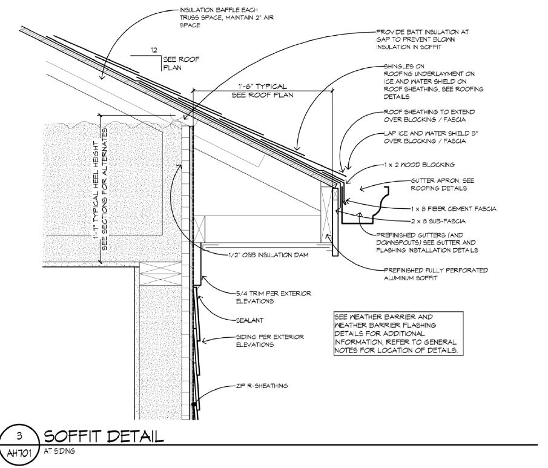

# Truss Heel (полоса обшивки у пятки фермы)

<figure markdown>
  
  <figcaption markdown="span">Деталь карниза: высота пятки фермы 1'-7" между верхом стены и низом настила, вертикальная полоса 1/2" OSB на пятке, ниже Zip стены, снаружи 2x8 sub-fascia и 1x8 fascia. Высоту берём с такой детали или из truss package. Архивный фрагмент.</figcaption>
</figure>

<!-- TODO-PHOTO: raised heel (energy heel) roof truss on wall top plate, eave side, with vertical sheathing strip at the heel -->

## Что это

Truss heel - вертикальная полоса обшивки в торце ферм вдоль карнизных
(eave) сторон здания: между верхней доской стены и низом кровельного
настила. Её высота задаётся пяткой фермы (heel height), типично от 0.66 до
3 футов. На gable-сторонах эта полоса уже входит в треугольник фронтона
([Gable Sheathing](gable.md)); на eave-сторонах её легко забыть. Это не
[Box Sheathing](box-sheathing.md) и не soffit.

## Где искать на чертежах

| Лист | Что взять |
| --- | --- |
| Truss profile / truss package | Heel height, границы пятки, bearing condition |
| Roof section, soffit detail (`sec`, `d`) | Высота полосы, материал (часто тот же, что у стены), offset настила |
| Roof plan (`rf`) и план стен (`1st`) | Вдоль каких стен опираются фермы: там и полоса |
| Scope / notes | Фермы by others не отменяют loose-обшивку пятки; проверь scope |

## Как мерить в OurPlanCore

1. Инструмент Line вдоль стен, на которые опираются фермы (eave-стороны),
   на листе плана верхнего этажа или кровли. Единица LFT.
2. Имя несёт высоту пятки в десятичных футах: `trussheel 0.66`,
   `trussheel 1.25`. Разные высоты = разные позиции. Папка `trussheel`
   прямо под корпусом; имя с `trussheel` уходит туда само.
3. Не путай числа: у `eve 24` число в дюймах (вынос), у `prpt 3.4 3 2` это
   высоты парапета, у `trussheel 1.25` высота полосы в футах.
4. Площадь = длина x высота; её считает экспорт (полоса XL, кнопка TH).
   Граница с gable и wall sheathing должна быть явной, без двойного слоя.

## Как назвать в дереве и строка DFL

| Имя в дереве | Строка DFL | Материал | Unit | Формула |
| --- | --- | --- | --- | --- |
| `trussheel/trussheel 1.25` | `Truss Heel Sheathing` (в блоке Gable Walls или кровли шаблона) | как у стены, например `7/16" Zip` | `4x8` | `=ОКРВВЕРХ(LFT*1.25/32*1.1;1)` |
| та же площадь | `Vapor Barrier` (WRB) | по спецификации | `SQ FT` | `=ОКРВВЕРХ(SQFT*1.1;10)` |
| та же длина | `Blocking at Eves` | `2x6` | `LFT` | по детали, см. [Roof Sheathing](../../horizontal/roof-framing/roof-sheathing.md) |

!!! warning "Уточняется"
    Точный Label строки пятки в текущем TemplateCom (блок и имя) проверить по
    сданной книге; здесь дано описательное имя.

## Частые ошибки

- Полоса на eave-сторонах не посчитана вовсе (gable-стороны есть, eave нет).
- Та же полоса посчитана и в gable, и в trussheel.
- Высота взята из другого дома или прочитана как вынос в дюймах.
- Написано "Vapor Barrier / Tyvek", хотя барьер в спецификации другой.
- При top chord bearing забыто blocking между фермами вместо ribbon.

Все ошибки: [common-mistakes](../../../start/common-mistakes.md#sheathing).

## Пример

```text
Takeoffs/Main/trussheel/
  trussheel 1.25     Line  236 LFT   (eave-стороны main)
Takeoffs/Grge/trussheel/
  trussheel 0.66     Line   84 LFT
```

## См. также

- [Gable Sheathing](gable.md), [Box Sheathing](box-sheathing.md), [Eve / Eave](../../sheathing-and-misc/eve.md)
- [Roof Sheathing](../../horizontal/roof-framing/roof-sheathing.md), [Parapet](../walls/parapet.md)
