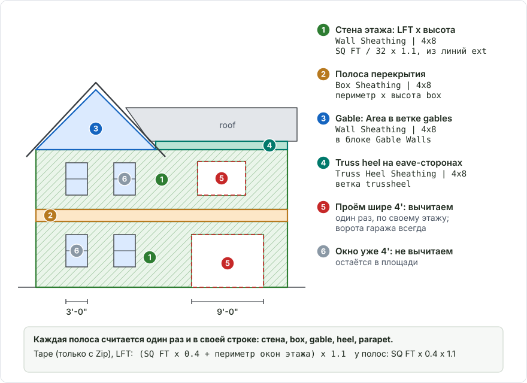
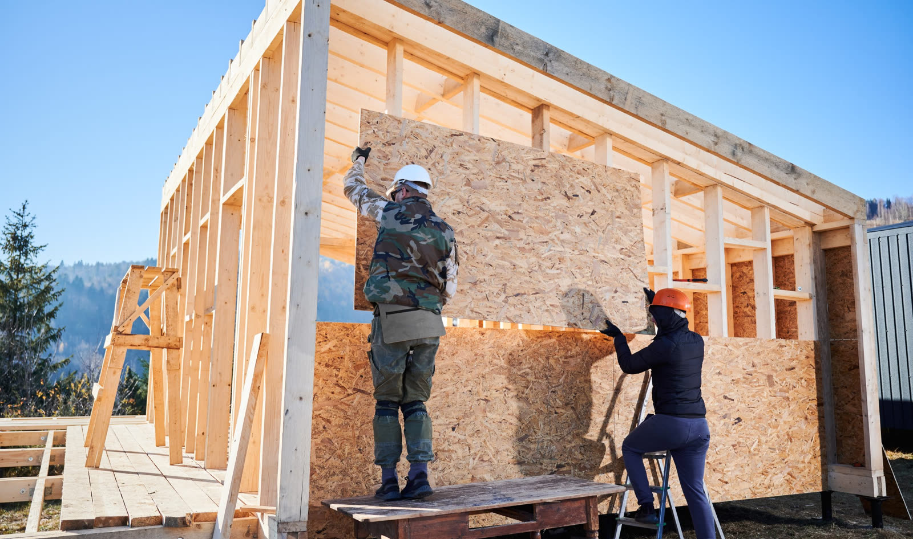
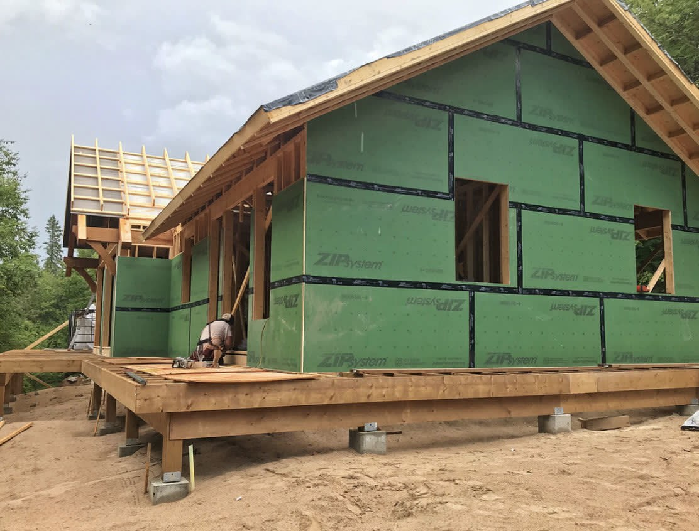

# Wall Sheathing

<figure markdown>
  
  <figcaption markdown="span">Sheathing on an elevation: a floor wall = length x height, the floor band = Box Sheathing, the triangle = gable, the band at the roof = truss heel. An opening wider than 4' is deducted once, a window narrower than 4' is not deducted.</figcaption>
</figure>

<figure markdown>
  
  <figcaption markdown="span">Structural sheathing on an exterior wall: OSB sheets over the studs. Area = wall length x wall height, minus openings wider than 4'. Archive photo.</figcaption>
</figure>

## What it is

Wall Sheathing is the structural panel on the outside face of a framed wall: OSB,
plywood or Zip. It is not the same as Exterior Gypsum (`Type X`,
`Densglass`) and not interior drywall: exterior gypsum goes on a separate
row ([Exterior Wall Materials](exterior-materials.md)); interior gypsum,
interior insulation and sound batts are not counted in the frame scope. Narrow strips
(box, truss heel, gable, parapet) have their own pages and their own rows.

## Where to find it on the plans

| Sheet | What to take |
| --- | --- |
| Wall type schedule (`wt`) and wall sections (`sec`) | Product, thickness, number of layers by the layer arrows; wall side |
| Structural general notes, table WS-1 (for example S3.1) | Structural thickness and nailing; the wall table and the roof table (WRS-1) are different |
| Shear wall schedule | Shear wall sheathing: side, thickness, layers; see [Shear Wall](shear-wall.md) |
| Energy / envelope sheets | Zip, Zip R, WRB, continuous insulation |
| Elevations (`el`) | Densglass zones, material changes, gables |

## Source priority

| Situation | Decision |
| --- | --- |
| Arch says Zip, structural says OSB/ply | Take Zip, the main DFL Note cites both sources |
| No Zip: Arch `1/2"`, Structural `5/8"` | Take `5/8"` (the stronger one), Note with both sheets |
| `19/32"` | This is `5/8"` for plywood/OSB, not `1/2"` |
| `7/16" Zip` on the S sheet and `Zip R-3` in the wall type | One product, a factual Note, no "differ" |
| No thickness anywhere | `assumed 1/2" Ply; verify` in the main Note |

Take the product name from this plan set: `LP FlameBlock 2-sided` is not
`7/16" OSB FRT`, do not turn `5/8" EXT. SHEATHING` into Ply without a reason,
write `CDX` only if the set says so. The exterior barrier row in the DFL is always
labeled `Vapor Barrier` (the template label), and B gets the product from the
spec: a fluid-applied WRB stays fluid-applied, not Tyvek out of habit.

## How to measure in OurPlanCore

There is no separate `sheathing` branch in the tree. The wall area is collected from the wall
lines: the wall name carries the height (`ext 2x6 9.09`), and the Excel export multiplies the length
by the height.

1. Walls are traced with Line in `walls/<floor> floor walls/` on the sheet with the W dot
   (`a101 1st`). A change in height, size or sheathed side = a new takeoff.
2. Before counting, build a table of surfaces: building, floor, side, product,
   thickness, layers, gross or net, deductions. Count the layers by the detail arrows.
3. Deductions: openings are subtracted on their own floor and once (from the sheathing, WRB,
   insulation, Z-girt). Windows narrower than 4' are not subtracted. Garage doors are subtracted.
4. Strips outside the walls come from their own branches: `gables`, `trussheel`, `parapets`,
   box from the floor framing depth. Each strip is counted once.
5. How many sides: on a panel job one side is already in the panel, only the required
   second side is separate. The outside face of a shear wall is already in ext walls, add
   only the inside face. `P` on the mark = perforated, not two sides.

## Takeoff name and DFL row

| Takeoff name | DFL row | Material | Unit | Formula |
| --- | --- | --- | --- | --- |
| `walls/1st floor walls/ext 2x6 9.09` | `Wall Sheathing` | `7/16" Zip` or `1/2" OSB` | `4x8` | `=CEILING(G/32*1.1,1)` |
| same takeoff, Zip only | `Tape` | `Zip Tape` | `LFT` | `=CEILING((G*0.4+window perimeter of the floor)*1.1,10)` |
| same takeoff, no Zip only | `Vapor Barrier` | WRB per spec | `SQ FT` | `=CEILING(G*1.1,10)` |
| same takeoff | `Insulation` | continuous insulation outside the sheathing, for example `2" XPS Insulation` | `SQ FT` | `=CEILING(G*1.1,10)` |
| `walls/1st floor walls/ext ...` | `Wall Sheathing` as a second row | `5/8" Type X` (exterior gypsum) | `SQ FT` | [Exterior Wall Materials](exterior-materials.md) |

G is the exterior wall area of the floor less openings, in SQ FT. What matters in
these rows:

- **One system per section.** Zip: `Wall Sheathing` + `Tape`. A plain sheet
  (OSB, Ply): `Wall Sheathing` + `Vapor Barrier`. Zip has the barrier built into the sheet,
  so Zip walls get no `Vapor Barrier` (WRB) row: only `Tape` and the
  opening flashing.
- **Tape** is counted in `LFT`, not rolls: `0.4` LFT of tape per SQ FT of
  sheathing plus the window perimeter of the floor (the casing line of the openings table),
  all `x 1.1`. Box, Gable and Truss Heel have no window perimeter: `G x 0.4 x 1.1`.
- **Insulation** is only continuous insulation outside the sheathing or on CMU and
  concrete. Insulation between studs (batt, mineral wool, spray foam, sound) is
  by others: no row. Zip R carries the insulation in the sheet itself: the product
  goes into `Wall Sheathing`, with no separate `Insulation` row.
- Rounding of SQ FT and LFT rows: a result under 50 goes to 2, otherwise to 10.

The spec lives in the template cells: O3 sheathing, O4 WRB, O5 Zip, O6 Zip Tape,
and P holds a bare sheet reference (`S3.0`, `8/S3.0`, without the word "per"). It is filled in when
the job is created. The Box Sheathing and Holdowns rows sit at the end of the floor's wall section.

## Common mistakes

- Openings not subtracted (garage doors) or subtracted twice (doors on two floors).
- Thickness and product inherited from the previous building instead of read from this set.
- B of the `Vapor Barrier` row says Tyvek with a fluid-applied barrier in the spec.
- A `Vapor Barrier` row left on Zip walls, or `Tape` counted in rolls and without the window perimeter.
- An `Insulation` row created for insulation between studs or for Zip R.
- Arch vs structural conflict resolved silently, without a Note citing both sheets.
- Interior gypsum, interior insulation or sound batts counted.
- Area measured in the app, but the old number stayed in Excel.
- The same layer counted both in the wall and in the gable or parapet.

All sheathing mistakes: [common-mistakes](../../../start/common-mistakes.md#sheathing).

## Example

Wall area of the floor 6220 SQ FT, window perimeter of the floor 310 LFT, box area
600 SQ FT:

```text
1st Floor Walls
Wall Sheathing      Zip R-3          214   4x8     8/S3.0 A2-00
Tape                Zip Tape        3080   LFT
Note: Wall Sheathing 7/16" Zip R3 per 8/S3.0 A2-00.
Box Sheathing       7/16" Zip         21   4x8
Tape                Zip Tape         270   LFT
```

Check: sheets `6220 / 32 x 1.1 = 213.8`, the book gets 214. Wall Tape
`(6220 x 0.4 + 310) x 1.1 = 3077.8`, to 10 = 3080. Box `600 / 32 x 1.1 = 20.6`,
the book gets 21; its Tape `600 x 0.4 x 1.1 = 264`, to 10 = 270. There are no `Vapor Barrier`
and `Insulation` rows: the walls are Zip R.

<figure markdown>
  
  <figcaption markdown="span">Zip System: panel and WRB in one product, the Tape row is required. The gable triangle is in the gables branch, the wall below is in walls. Archive photo.</figcaption>
</figure>

## See also

- [Exterior Wall Materials](exterior-materials.md) - exterior gypsum, insulation, flashing, bracing
- [Shear Wall](shear-wall.md), [Box Sheathing](box-sheathing.md), [Truss Heel](truss-heel.md), [Gable Sheathing](gable.md)
- [Exterior Walls](../walls/exterior.md), [Parapet](../walls/parapet.md)
- [Tips and key rules, Sheathing](../../../reference/boss-feedback-rules.md#sheathing)
