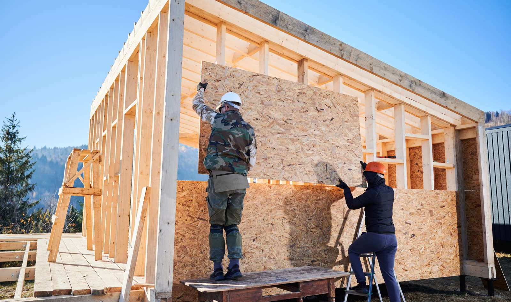
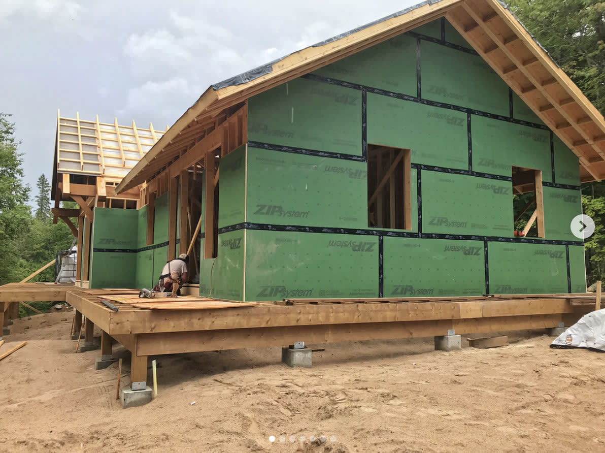

# Wall Sheathing (обшивка стен)

<figure markdown>
  
  <figcaption markdown="span">Структурная обшивка наружной стены: лист OSB по стойкам. Площадь = длина стены x высота стены, минус проёмы шире 4'. Архивное фото.</figcaption>
</figure>

## Что это

Wall Sheathing - структурный лист на наружной грани каркасной стены: OSB,
plywood или Zip. Это не то же самое, что Exterior Gypsum (`Type X`,
`Densglass`) и не внутренний гипсокартон: наружный гипс идёт отдельной
строкой ([Exterior Wall Materials](exterior-materials.md)), внутренний гипс,
внутренний утеплитель и sound batt во frame-scope не считаем. Узкие полосы
(box, truss heel, gable, parapet) имеют свои страницы и свои строки.

## Где искать на чертежах

| Лист | Что взять |
| --- | --- |
| Wall type schedule (`wt`) и wall sections (`sec`) | Продукт, толщина, число слоёв по стрелкам слоёв; сторона стены |
| Structural general notes, таблица WS-1 (например S3.1) | Структурная толщина и nailing; таблица стен и таблица кровли (WRS-1) разные |
| Shear wall schedule | Обшивка shear walls: сторона, толщина, слои; см. [Shear Wall](shear-wall.md) |
| Energy / envelope sheets | Zip, Zip R, WRB, continuous insulation |
| Elevations (`el`) | Зоны Densglass, смена материала, фронтоны |

## Приоритет источников

| Ситуация | Решение |
| --- | --- |
| Арх даёт Zip, структура даёт OSB/ply | Берём Zip, в DFL главная Note с обоими источниками |
| Без Zip: Arch `1/2"`, Structural `5/8"` | Берём `5/8"` (сильнее), Note с обоими листами |
| `19/32"` | Это `5/8"` для plywood/OSB, не `1/2"` |
| `7/16" Zip` на S-листе и `Zip R-3` в wall type | Один продукт, Note фактом, без "differ" |
| Нет толщины нигде | `assumed 1/2" Ply; verify` в главной Note |

Название продукта берём из этого комплекта: `LP FlameBlock 2-sided` не равно
`7/16" OSB FRT`, `5/8" EXT. SHEATHING` не превращаем в Ply без основания,
`CDX` пишем только если так в сете. Наружный барьер называем WRB / Weather
Barrier по спецификации (fluid-applied не Tyvek), не "Vapor Barrier".

## Как мерить в OurPlanCore

Отдельной ветки `sheathing` в дереве нет. Площадь стен собирается из линий
стен: имя стены несёт высоту (`ext 2x6 9.09`), экспорт в Excel умножает длину
на высоту.

1. Стены обведены Line в `walls/<этаж> floor walls/` на листе с точкой W
   (`a101 1st`). Смена высоты, сечения или стороны обшивки = новая позиция.
2. До подсчёта составь таблицу поверхностей: корпус, этаж, сторона, продукт,
   толщина, слои, gross или net, вычеты. Слои считай по стрелкам детали.
3. Вычеты: проёмы вычитаются по своему этажу и один раз (из обшивки, WRB,
   утеплителя, Z-girt). Окна уже 4' не вычитаем. Ворота гаража вычитаем.
4. Полосы вне стен берутся из своих веток: `gables`, `trussheel`, `parapets`,
   box из высоты перекрытия. Каждая полоса считается один раз.
5. Сколько сторон: на panel-job одна сторона уже в панели, отдельно только
   требуемая вторая. Наружная сторона shear wall уже в ext walls, добавляем
   только внутреннюю. `P` у марки = perforated, не две стороны.

## Как назвать в дереве и строка DFL

| Имя в дереве | Строка DFL | Материал | Unit | Формула |
| --- | --- | --- | --- | --- |
| `walls/1st floor walls/ext 2x6 9.09` | `Wall Sheathing` | `7/16" Zip` или `1/2" OSB` | `4x8` | `=ОКРВВЕРХ(SQFT/32*1.1;1)` |
| тот же замер | `Tape` | `Zip Tape` (только с Zip) | `LFT` | `=ОКРВВЕРХ(SQFT*0.4*1.1;10)` |
| тот же замер | `Vapor Barrier` (в шаблоне) | WRB по спецификации | `SQ FT` | `=ОКРВВЕРХ(SQFT*1.1;10)` |
| тот же замер | `Insulation` | наружный `1" Insulation` или Zip R | `SQ FT` | как WRB |
| `walls/1st floor walls/ext ...` | `Wall Sheathing` второй строкой | `5/8" Type X` (наружный гипс) | `SQ FT` | [Exterior Wall Materials](exterior-materials.md) |

Спека живёт в ячейках шаблона: O3 обшивка, O4 WRB, O5 Zip, O6 Zip Tape,
в P голая ссылка на лист (`S3.0`, `8/S3.0`, без слова "per"). Заполняется при
создании job. Строки Box Sheathing и Holdowns стоят в конце секции стен этажа.

## Частые ошибки

- Проёмы не вычтены (ворота гаража) или вычтены дважды (двери на двух этажах).
- Толщина и продукт унаследованы от прошлого дома, а не прочитаны в этом сете.
- `Vapor Barrier` и `Tyvek` при fluid-applied барьере в спецификации.
- Конфликт арх и структуры решён молча, без Note с двумя листами.
- Посчитан внутренний гипс, внутренний утеплитель или sound batt.
- Площадь измерена в программе, но в Excel осталось старое число.
- Один и тот же слой учтён и в стене, и в gable или parapet.

Все ошибки по обшивке: [common-mistakes](../../../start/common-mistakes.md#sheathing).

## Пример

```text
1st Floor Walls
Wall Sheathing      7/16" Zip        214   4x8     8/S3.0
Tape                Zip Tape        2740   LFT
Insulation          Zip R-3         6850   SQ FT   A2-00
Note: Wall Sheathing 7/16" Zip R3 per 8/S3.0 A2-00.
Box Sheathing       7/16" Zip         21   4x8
Tape                Zip Tape         270   LFT
```

<figure markdown>
  
  <figcaption markdown="span">Zip System: лист и WRB в одном продукте, строка Tape обязательна. Треугольник фронтона в ветке gables, стена ниже в walls. Архивное фото.</figcaption>
</figure>

## См. также

- [Exterior Wall Materials](exterior-materials.md) - наружный гипс, insulation, flashing, bracing
- [Shear Wall](shear-wall.md), [Box Sheathing](box-sheathing.md), [Truss Heel](truss-heel.md), [Gable Sheathing](gable.md)
- [Exterior Walls](../walls/exterior.md), [Parapet](../walls/parapet.md)
- [Советы и важные вещи, Sheathing](../../../reference/boss-feedback-rules.md#sheathing)
