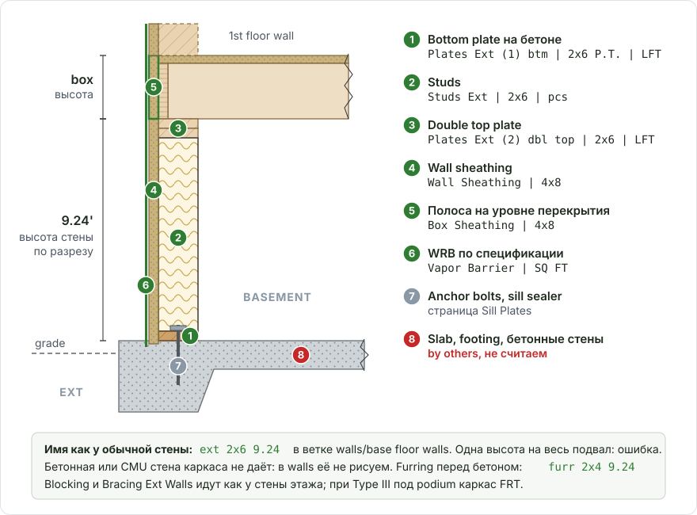

# Basement Walls

<figure markdown>
  
  <figcaption markdown="span">Wood basement wall on a slab: P.T. btm plate with an anchor bolt, studs, double top plate, wall sheathing, box sheathing at the floor band and WRB. A concrete basement wall gives no framing.</figcaption>
</figure>

## What it is

Basement walls are the wood walls on the `base` level: exterior walls on the slab, walls
under the podium, partitions and corridors in the basement. It is a full stick wall
with its own plates, studs and sheathing, even when the building above goes in panels.
The floor area is counted separately in [Basement SQFT](../../sqfts/basement.md);
this page covers only the framing.

## Where to find it on the plans

| Sheet | What to take |
| --- | --- |
| Basement plan `a100 base` | Which walls are wood and which are concrete or CMU |
| Foundation plan `s101 f` | Slab, foundation walls, sill plates |
| Wall section at the slab | Wall height: the basement often has three different heights |
| Wall type schedule | Size, P.T., furring at concrete |
| Code summary | FRT below the podium on Type III |

## How to measure in OurPlanCore

**Line** tool, LFT unit, on the `a100 base` plan (W dot, level B).
Branch `walls/base floor walls`, names as for regular walls:
`ext 2x6 9.24`, `corr 2x6 9.24`, `2x4 9.24`.

1. A concrete or CMU wall gives no framing: do not draw it in `walls`. Furring
   in front of concrete is a separate takeoff `furr 2x4 9.24` ([Furring](furring.md)).
2. Take the height from the section for each run: in the basement the floor framing and beams
   change the height more often than on the upper floors. One height for the whole basement is a mistake.
3. Walls under a concrete slab or podium count as stick even on a panel job
   ([Wall Panels](wall-panels.md)).
4. Basement metal walls: framing is by others, but box sheathing, WRB and flashing
   stay ours ([Metal Tracks](metal-tracks.md)).

## Takeoff name and DFL row

| Takeoff name | DFL row | Material | Unit | Formula / factor |
| --- | --- | --- | --- | --- |
| `ext 2x6 9.24` | `Plates Ext (1) btm` | `2x6 P.T.` (always on concrete) | LFT | `LFT x 1.1` |
| same | `Plates Ext (2) dbl top` | `2x6` | LFT | `LFT x 2 x 1.1` |
| same | `Studs Ext` | size by height | pieces, D = stud length | `LFT x 1.1` (16") |
| same | `Blocking` | `2x6` (by wall size) | LFT | from the template matrix, rounded to even |
| same | `Bracing Ext Walls` | `2x4` | pieces, D = board length: up to 10' = 14, up to 12' = 16, up to 16' = 18, above = 20 | `LFT / 8 x 1.1`: one board per 8 LFT of wall; only walls 7' and taller |
| same | `Wall Sheathing` | as on the building walls (`7/16" Zip`, `1/2" OSB`) | 4x8 | `wall area x 1.1 / 32`, [Wall Sheathing](../sheathing/wall-sheathing.md) |
| same | `Vapor Barrier` | WRB per spec; with Zip there is no row, only `Tape` | SQ FT | `area x 1.1` |
| same | `Insulation` | only continuous insulation outside the sheathing or on concrete | SQ FT | `area x 1.1`; insulation between studs is not counted |
| same | `Box Sheathing` | as on the wall | 4x8 | [Box Sheathing](../sheathing/box-sheathing.md) |
| `corr 2x6 9.24` | `Plates Corr (1) btm` | `2x6 P.T.` or `LSL P.T.` per detail | LFT | `LFT x 1.1` |
| same | `Bracing Corridor` | `2x4` | pieces, D as for `Bracing Ext Walls` | `LFT / 8 x 1.1` |
| basement openings | `Window Flashing`, `Sill Flashing` | | LFT | [Window Flashing](../openings/window-flashing.md) |
| `2x4 9.24` (under podium) | `Studs Interior` FRT on Type III | | pieces, D = stud length | note with the source |

## Common mistakes

- One wall height for the whole basement when the section shows three different heights.
- Height taken as floor-to-floor without subtracting the subfloor and floor framing.
- Walls below the podium thrown out as "panels by others".
- A concrete wall traced as a wood wall.
- Treated basement furring not split out as a separate P.T. assembly.
- `Bracing` written in LFT: it is a count of boards, the board length sits in D.
- The `Vapor Barrier` row says Tyvek although the spec calls for a different WRB.

Walkthrough with examples: [all wall mistakes](../../../start/common-mistakes.md#walls).

## Example

```text
walls/base floor walls/
  ext 2x6 10.3        Line, 21.1 LFT    Notes: W4A, 1/A701, FRT below podium
  ext 2x6 9.24        Line, 15.7 LFT
  furr 2x4 9.24       Line, 36.8 LFT    Notes: 8/A500, P.T. at concrete
```

## See also

- [Sill Plates](sill-plates.md), [Exterior Walls](exterior.md), [Corridor Walls](corridor.md)
- [Box Sheathing](../sheathing/box-sheathing.md), [Furring](furring.md)
- [Basement SQFT](../../sqfts/basement.md)
