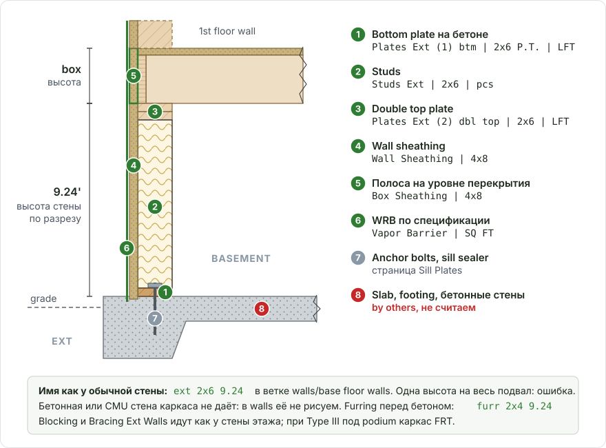

# Basement Walls (стены подвала)

<figure markdown>
  
  <figcaption markdown="span">Деревянная стена подвала на плите: btm plate P.T. с анкером, studs, double top plate, обшивка стены, box sheathing на уровне перекрытия и WRB. Бетонная стена подвала каркаса не даёт.</figcaption>
</figure>

## Что это

Basement walls - деревянные стены уровня `base`: наружные на плите, стены
под подиумом, перегородки и коридоры подвала. Это полноценная stick-стена
со своими plates, studs и обшивкой, даже когда дом выше идёт панелями.
Площадь этажа считается отдельно в [Basement SQFT](../../sqfts/basement.md),
здесь только каркас.

## Где искать на чертежах

| Лист | Что взять |
| --- | --- |
| План подвала `a100 base` | Какие стены деревянные, какие бетон или CMU |
| Foundation plan `s101 f` | Плита, фундаментные стены, sill plates |
| Wall section у плиты | Высота стены: на подвале часто три разные высоты |
| Wall type schedule | Сечение, P.T., furring у бетона |
| Code summary | FRT ниже podium при Type III |

## Как мерить в OurPlanCore

Инструмент **Line**, единица LFT, на плане `a100 base` (точка W, уровень B).
Ветка `walls/base floor walls`, имена как у обычных стен:
`ext 2x6 9.24`, `corr 2x6 9.24`, `2x4 9.24`.

1. Бетонная или CMU стена каркаса не даёт: не рисуй её в `walls`. Furring
   перед бетоном - отдельная позиция `furr 2x4 9.24` ([Furring](furring.md)).
2. Высота по разрезу каждого участка: в подвале перекрытие и балки меняют
   высоту чаще, чем на этажах. Одна высота на весь подвал - ошибка.
3. Стены под concrete slab или podium считаются stick даже на panel-job
   ([Wall Panels](wall-panels.md)).
4. Metal walls подвала: каркас by others, но box sheathing, WRB и flashing
   остаются нашими ([Metal Tracks](metal-tracks.md)).

## Как назвать в дереве и строка DFL

| Имя в дереве | Строка DFL | Материал | Unit | Формула / фактор |
| --- | --- | --- | --- | --- |
| `ext 2x6 9.24` | `Plates Ext (1) btm` | `2x6 P.T.` (на бетоне всегда) | LFT | `LFT x 1.1` |
| то же | `Plates Ext (2) dbl top` | `2x6` | LFT | `LFT x 2 x 1.1` |
| то же | `Studs Ext` | размер по высоте | штуки, в D длина стойки | `LFT x 1.1` (16") |
| то же | `Blocking` | `2x6` (по сечению стены) | LFT | по матрице шаблона, до чётного |
| то же | `Bracing Ext Walls` | `2x4` | штуки, в D длина доски: до 10' = 14, до 12' = 16, до 16' = 18, выше = 20 | `LFT / 8 x 1.1`: одна доска на 8 LFT стены; только стены от 7' |
| то же | `Wall Sheathing` | как у стен дома (`7/16" Zip`, `1/2" OSB`) | 4x8 | `площадь стены x 1.1 / 32`, [Wall Sheathing](../sheathing/wall-sheathing.md) |
| то же | `Vapor Barrier` | WRB по спецификации; при Zip строки нет, только `Tape` | SQ FT | `площадь x 1.1` |
| то же | `Insulation` | только continuous insulation снаружи обшивки или на бетоне | SQ FT | `площадь x 1.1`; утеплитель между стойками не считаем |
| то же | `Box Sheathing` | как у стены | 4x8 | [Box Sheathing](../sheathing/box-sheathing.md) |
| `corr 2x6 9.24` | `Plates Corr (1) btm` | `2x6 P.T.` или `LSL P.T.` по детали | LFT | `LFT x 1.1` |
| то же | `Bracing Corridor` | `2x4` | штуки, D как у `Bracing Ext Walls` | `LFT / 8 x 1.1` |
| проёмы подвала | `Window Flashing`, `Sill Flashing` | | LFT | [Window Flashing](../openings/window-flashing.md) |
| `2x4 9.24` (под podium) | `Studs Interior` FRT при Type III | | штуки, в D длина стойки | нота с источником |

## Частые ошибки

- Одна высота стены на весь подвал при трёх разных высотах по разрезу.
- Высота взята как floor-to-floor без вычета subfloor и перекрытия.
- Стены ниже podium выброшены как "panels by others".
- Бетонная стена обведена как деревянная.
- Treated furring подвала не выделен в отдельную P.T.-сборку.
- `Bracing` записан в LFT: это штуки досок, длина доски стоит в D.
- В строке `Vapor Barrier` записан Tyvek, хотя спецификация даёт другой WRB.

Разбор с примерами: [все ошибки по стенам](../../../start/common-mistakes.md#walls).

## Пример

```text
walls/base floor walls/
  ext 2x6 10.3        Line, 21.1 LFT    Notes: W4A, 1/A701, FRT below podium
  ext 2x6 9.24        Line, 15.7 LFT
  furr 2x4 9.24       Line, 36.8 LFT    Notes: 8/A500, P.T. at concrete
```

## См. также

- [Sill Plates](sill-plates.md), [Exterior Walls](exterior.md), [Corridor Walls](corridor.md)
- [Box Sheathing](../sheathing/box-sheathing.md), [Furring](furring.md)
- [Basement SQFT](../../sqfts/basement.md)
