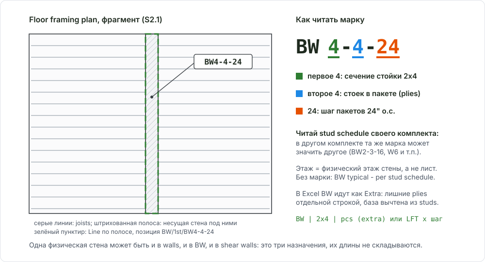

# Bearing Walls, BW

<figure markdown>
  
  <figcaption markdown="span">Bearing wall on a structural plan: hatched band, callout with the mark. Read the mark from the stud schedule of your plan set: size, number of studs in the pack, spacing.</figcaption>
</figure>

## What it is

BW (bearing wall) is a wall that carries floor framing or the roof.
The engineer beefs it up: more plies per stud, different spacing, sometimes MSR. For the
takeoff, BW is a **separate branch** of the tree. You measure the wall itself in `walls`
once, as a regular wall (`ext`, `corr`, `dem`, partition), then trace the bearing wall
band again in `BW` and the SW segment in `shear walls`. One physical wall can be in `walls`,
in `BW` and in `shear walls` at once: these are three different purposes, their lengths are not
added together.

## Where to find it on the plans

| Sheet | What to take |
| --- | --- |
| Structural plans `s102 2nd` | Bearing wall bands (hatch or gray fill per the plan set legend), BW marks |
| Stud schedule (`TYPICAL WOOD STUD WALL DESIGNS`, `s104`) | Size, plies, spacing, grade for each mark, the `interior unit bearing walls` row |
| General notes `s001` | Whether the framing plan shows the walls below or above the floor |
| Floor plans `a101` | Which architectural wall sits under the band: ext, corridor, demising, unit |
| Wall sections | Stud height, double btm plate, FRT below the podium |

## How to measure in OurPlanCore

**Line** tool, LFT unit, along the physical bearing wall band.

1. Set the floor first. A framing sheet often shows the walls **below**
   the floor (on job A sheet S003 confirmed it), but this is not universal:
   check the notes of your plan set. The folder is the physical floor of the wall, not the plan number.
2. Select the `BW/<floor>` folder in Takeoffs and draw in it. The F sheet dot on
   a structural plan would put the Line into `details`, so set the folder yourself
   or move it afterwards.
3. One takeoff per mark: `BW4-4-24`, `BW6-2-24`. With no mark,
   `BW typical - per stud schedule` with the source in Notes is acceptable.
4. Different marks and both frames of a double wall are separate lines. Repeated
   callouts on one continuous run do not make a second line.
5. Do not trace beams, leaders, CMU or deck hatching: the BW band is told apart by the
   legend of this particular plan set.
6. Copy sheets into the `BW` folder only when asked.

A linear BW markup does not count studs by itself: it gives the length, to which
Excel applies the plies and spacing from the schedule.

## Takeoff name and DFL row

| Takeoff name | DFL row | Unit | Formula / factor |
| --- | --- | --- | --- |
| `BW/3rd/BW4-5-24` | `Studs Interior` (base, 24" spacing) | pcs | `LFT x 0.625` |
| same | `Extra Studs Interior 24" o.c.` | pcs | `LFT x 0.5 x (plies - 1)` |
| `BW/3rd/BW6-3-24` | `Studs Demising` (base) + `Extra` | pcs | base + extra by plies |
| `BW/4th/BW typical - per stud schedule` | the same rows, type from the `interior unit bearing walls` row | pcs | per the floor's schedule |

This is how BW are written in delivered workbooks:

- The main stud row uses the regular spacing factor (16" = 1.1, 24" = 0.625).
- Extra plies go on a separate `Extra` or `Double Extra` row with the
  Extra factor (16" = 0.75, 24" = 0.5) times the number of additional studs.
- **Subtract** the BW length from the regular studs of the same size: the base is not doubled.
- B is the single size, D the order length, E the height, the mark and sheet go in F.
- Plies and spacing come from the stud schedule **of your floor**: the same mark can have
  different values on the 3rd and 5th floors.

Full factor table: [Formulas](../../../reference/formulas.md#stud-spacing-factors);
extra and dbl studs on COM: [COM Commercial](../../../work-types/com.md#studs-spacing-extra-studs-dbl-extra).

## Common mistakes

- The BW band drawn in `walls` as a second line over the regular wall and added to it: the length is counted twice.
- Floor taken from the sheet number although the plan shows the walls below the floor.
- Plies and spacing made up: with no mark, write `typical - per stud schedule` and the source.
- Extra24 factor set to 0.625 instead of 0.5.
- Stair and small 2x4 runs declared corridor 2x6 without a confirmed mark.
- Double btm plate added because of the floor name, not because of a detail.

Walkthrough with examples: [all wall mistakes](../../../start/common-mistakes.md#walls).

## Example

```text
BW/
  3rd/
    BW4-5-24                         Line, 52.9 LFT
    BW6-3-24                         Line, 161.7 LFT
    BW6-4-24                         Line, 60.3 LFT
  4th/
    BW typical - per stud schedule   Line, 168.0 LFT   Notes: S104, S003 walls below
```

## See also

- [Exterior Walls](exterior.md): regular walls and the naming canon
- [Demising Walls](demising.md): double studs on the lower floors
- [Shear Wall](../sheathing/shear-wall.md), [Post](../../horizontal/floor-framing/post.md)
- [Takeoff names and sheet dots](../../../reference/takeoff-naming.md#sheet-dots)
