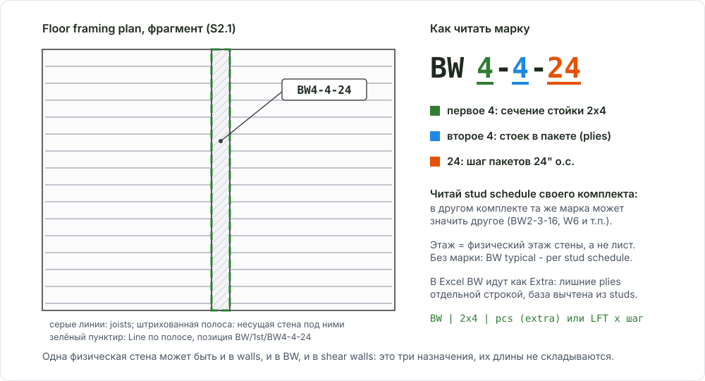

# Bearing Walls, BW (несущие стены)

<figure markdown>
  
  <figcaption markdown="span">Несущая стена на структурном плане: штрихованная полоса, выноска с маркой. Марку читай по stud schedule своего комплекта: сечение, число стоек в пакете, шаг.</figcaption>
</figure>

## Что это

BW (bearing wall) - стена, на которую опирается перекрытие или крыша.
Инженер усиливает её: больше plies в стойке, другой шаг, иногда MSR. Для
takeoff BW - **отдельная ветка** дерева: в `walls` остаются только обычные
стены, в `shear walls` - SW. Одна физическая стена может быть и в `walls`,
и в `BW`, и в `shear walls`: это три разных назначения, их длины не
складываются.

## Где искать на чертежах

| Лист | Что взять |
| --- | --- |
| Структурные планы `s102 2nd` | Полосы несущих стен (штриховка или серая заливка по легенде комплекта), марки BW |
| Stud schedule (`TYPICAL WOOD STUD WALL DESIGNS`, `s104`) | Сечение, plies, шаг, сорт для каждой марки, строка `interior unit bearing walls` |
| General notes `s001` | Показывает ли framing plan стены ниже или выше перекрытия |
| Планы этажей `a101` | Какая архитектурная стена под полосой: ext, corridor, demising, unit |
| Wall sections | Высота стойки, двойная btm plate, FRT ниже podium |

## Как мерить в OurPlanCore

Инструмент **Line**, единица LFT, по физической полосе несущей стены.

1. Сначала установи этаж. Framing sheet часто показывает стены **ниже**
   перекрытия (в проекте A это подтверждал лист S003), но это не универсально:
   проверь notes своего комплекта. Папка - физический этаж стены, не номер плана.
2. Выбери в Takeoffs папку `BW/<этаж>` и рисуй в ней. Точка листа F на
   структурном плане положила бы Line в `details`, поэтому папку задаёшь сам
   или переносишь через move.
3. Одна позиция на марку: `BW4-4-24`, `BW6-2-24`. Без марки допустимо
   `BW typical - per stud schedule` с источником в Notes.
4. Разные марки и оба каркаса двойной стены - отдельные линии. Повторные
   выноски на одном непрерывном участке не дают вторую линию.
5. Не обводи балки, leader, CMU и штриховку настила: полоса BW отличается по
   легенде именно этого комплекта.
6. Копии листов в папку `BW` делай только по просьбе.

Линейная разметка BW сама по себе не считает стойки: она даёт длину, к которой
в Excel применяются plies и шаг из schedule.

## Как назвать в дереве и строка DFL

| Имя в дереве | Строка DFL | Unit | Формула / фактор |
| --- | --- | --- | --- |
| `BW/3rd/BW4-5-24` | `Studs Interior` (база, шаг 24") | pcs | `LFT x 0.625` |
| то же | `Extra Dbl Studs Interior` | pcs | `LFT x 0.5 x (plies - 1)` |
| `BW/3rd/BW6-3-24` | `Studs Demising` (база) + `Extra` | pcs | база + extra по plies |
| `BW/4th/BW typical - per stud schedule` | те же строки, тип из строки `interior unit bearing walls` | pcs | по schedule этажа |

Так BW записаны в сданных книгах:

- Основная строка студов идёт с обычным фактором шага (16" = 1.1, 24" = 0.625).
- Лишние plies - отдельной строкой `Extra` или `Double Extra` с фактором
  Extra (16" = 0.75, 24" = 0.5), умноженным на число дополнительных стоек.
- Длину BW **вычти** из обычных студов того же сечения: база не задваивается.
- B - одиночное сечение, D - заказная длина, E - высота, марка и лист в F.
- Plies и шаг берутся из stud schedule **своего этажа**: у одной марки на
  3-м и 5-м этажах они могут отличаться.

Полная таблица факторов - [Формулы](../../../reference/formulas.md#stud-spacing-factors);
про extra и dbl studs на COM - [COM Commercial](../../../work-types/com.md#studs-spacing-extra-studs-dbl-extra).

## Частые ошибки

- BW нарисованы в `walls` и сложены с обычными стенами: длина посчитана дважды.
- Этаж взят по номеру листа, хотя план показывает стены ниже перекрытия.
- Plies и spacing придуманы: без марки пиши `typical - per stud schedule` и источник.
- Фактор Extra24 поставлен 0.625 вместо 0.5.
- Лестничные и малые 2x4 участки объявлены corridor 2x6 без подтверждения марки.
- Двойная btm plate добавлена по названию этажа, а не по детали.

Разбор с примерами: [все ошибки по стенам](../../../start/common-mistakes.md#walls).

## Пример

```text
BW/
  3rd/
    BW4-5-24                         Line, 52.9 LFT
    BW6-3-24                         Line, 161.7 LFT
    BW6-4-24                         Line, 60.3 LFT
  4th/
    BW typical - per stud schedule   Line, 168.0 LFT   Notes: S104, S003 walls below
```

## См. также

- [Exterior Walls](exterior.md): обычные стены и канон имени
- [Demising Walls](demising.md): double studs на нижних этажах
- [Shear Wall](../sheathing/shear-wall.md), [Post](../../horizontal/floor-framing/post.md)
- [Имена takeoffs и точки листа](../../../reference/takeoff-naming.md#sheet-dots)
