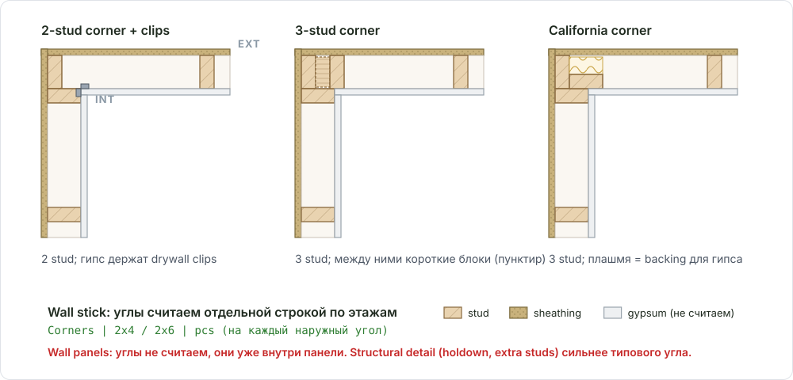

# Corners

<figure markdown>
  
  <figcaption markdown="span">Wall corner in plan: 2-stud L, 3-stud, California corner with backing for gypsum. Stick: a separate row per floor. Panels: not counted.</figcaption>
</figure>

<!-- TODO-PHOTO: three stud corner wood framing photo, EN query "three stud corner framing" -->

## What it is

A corner is the stud pack where two walls meet: 2 or 3 studs, or a California corner.
The stud factor `1.1` (one stud per foot plus waste) covers cutoffs and studs
at openings, but corners and T-intersections on stick framing are counted on a separate
row. On a panel job the corners are already inside the panel.

## Where to find it on the plans

| Sheet | What to take |
| --- | --- |
| Floor plans | Number of exterior corners and T-intersections per floor |
| Typical wall details, corner detail | How many studs per corner, backing for gypsum |
| Structural details | Corner holdowns, extra studs, where called out |
| Scope | Stick or panels: on a panel job corners are not counted |

## How to measure in OurPlanCore

**Count** tool (points), one in each exterior corner and each
T-intersection on the floor plan. Takeoff `corners` in
`walls/<floor> floor walls` (the W dot puts the Count into walls; the word `corners`
itself counts as a wall token). Give it its own CountSymbol so the points look different from holdowns.

## Takeoff name and DFL row

| Takeoff name | DFL row | Unit | Formula / factor |
| --- | --- | --- | --- |
| `corners` (Count, 1st floor) | `Corners` 2x6 (wall size) | pcs | `corners x studs per corner` (2 or 3 per detail), length = stud height |
| `corners` (Count, 2nd floor) | `Corners` on a separate row | pcs | per floor, not one total |

If no corner detail is shown, write a visible note: `Corners assumed 3 studs; verify`.

## Common mistakes

- Corners counted on a panel job: they are already in the panel.
- All floors added into one row.
- T-intersections and backing forgotten although the detail shows them.
- Corner counted as 2 studs when the detail shows 3.

Walkthrough with examples: [all wall mistakes](../../../start/common-mistakes.md#walls).

## Example

```text
walls/1st floor walls/
  corners      Count, 14 ea     Notes: 3-stud per 5/A701
walls/2nd floor walls/
  corners      Count, 14 ea
```

## See also

- [Exterior Walls](exterior.md), [Sill Plates](sill-plates.md)
- [COM Commercial: studs, extra, dbl](../../../work-types/com.md)
- [Hardware catalog](../../../reference/hardware-catalog.md)
