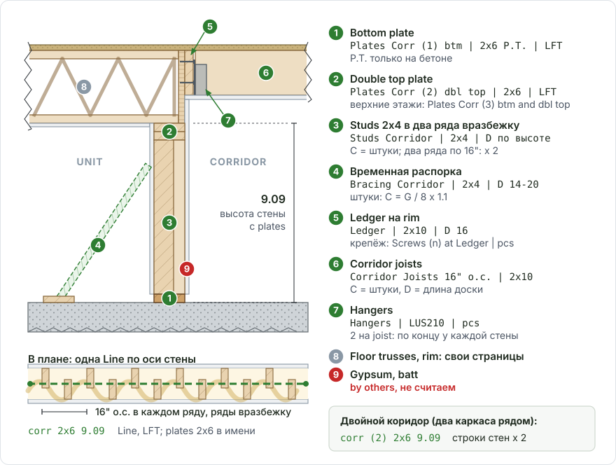

# Corridor Walls

<figure markdown>
  
  <figcaption markdown="span">Corridor wall section: 2x6 plates, two staggered rows of 2x4 studs at 16" o.c., temporary bracing, a ledger and corridor joists on hangers. Numbers match the DFL rows on the right. In plan the wall is one Line along its axis, `corr 2x6 9.09`.</figcaption>
</figure>

<!-- TODO-PHOTO: staggered stud wall framing photo, EN query "staggered stud wall framing" -->

## What it is

A corridor wall separates a unit from a common area: corridor, stair,
garage, lobby. It is fire-rated, often on 2x6 plates with staggered 2x4
studs, and it carries a ledger or `Blocking for Drywall` on top where the floor framing runs
parallel. A wall between two units is a [Demising](demising.md) wall,
and a shaft wall is a [Shaft](shaft.md) wall.

## Where to find it on the plans

| Sheet | What to take |
| --- | --- |
| Floor plans `a101 1st` | Wall type marks along corridors, stairs, garage |
| Wall type schedule (`wt`), UL assembly | Plate and stud size, staggered or not, gypsum layers, rating |
| Section at the corridor, S details | Ledger, `2x10` corridor joists on a ledger, blocking, hangers |
| Door schedule | Fire-rated unit entry doors (`3070 ... C-lbl`) |
| Stud schedule | If the corridor wall is also bearing: mark in [BW](bearing-walls.md) |

## How to measure in OurPlanCore

**Line** tool, LFT unit, on the floor plan (W dot).

1. Category by run: a wall segment at a stair or at the garage is also `corr`,
   even if it continues a demising wall.
2. Name `corr 2x6 11.7`: category, plate size, height. A double corridor wall
   (two frames on the plan) is `corr (2) 2x6 11.7`.
3. A staggered wall is one line: plates by the name `2x6`, the two stud rows
   are handled in the DFL.
4. Start a new takeoff when the height or size changes. Height comes from the section of your
   building, not floor-to-floor ([Exterior: wall height](exterior.md#stud-height)).
5. If the wall type is bearing, trace the same wall again in `BW/<floor>`.

## Takeoff name and DFL row

| Takeoff name | DFL row | Unit | Formula / factor |
| --- | --- | --- | --- |
| `corr 2x6 11.7` | `Plates Corr (1) btm` 2x6 (P.T. only on concrete) | LFT | `LFT x 1.1` |
| same | `Plates Corr (2) dbl top` 2x6 | LFT | `LFT x 2 x 1.1` |
| same | `Studs Corridor` 2x4 staggered | pieces, D = stud length | `LFT x 1.1 x 2` (two rows at 16") |
| same | `Bracing Corridor` 2x4 | pieces, D = board length: up to 10' = 14, up to 12' = 16, up to 16' = 18, above = 20 | `LFT / 8 x 1.1`: one board per 8 LFT of wall; only walls 7' and taller |
| same | `Blocking` | LFT | from the template matrix, rounded to even |
| `corr (2) 2x6 11.7` | the same rows for two frames | | line length `x 2` |

`Bracing Corridor` is temporary wall bracing, counted in **pieces**, not LFT:
a 161 LFT wall 9.09' high gives `161 / 8 x 1.1 = 22.1` (the template formula does not
round), which orders as 23 boards of 14': the wall is under 10'.

Drywall backing where the floor framing runs parallel to the wall is a different row in a
different block: `Blocking for Drywall`, `2x4`, `=CEILING(G/D,1)`, D `16`, in the Floor
Framing List of that floor. There is no `Bracing for Drywall` row in the DFL. Details:
[Wall bracing and Blocking for Drywall](../../horizontal/floor-framing/details/bracingdrywall.md).

Hangers over a corridor wall are regular `ITS` when the gypsum stops
below the floor framing. `DHU` / `DGU` only where the joists bear over a true
fire wall per detail (stair, elevator, shaft): [Hangers](../../../reference/hangers.md).
Corridor joists at the roof without a detail get a note with the reason, not `Optional` with no
explanation ([Standard notes](../../../reference/standard-notes.md)).

## Common mistakes

- Corridor and demising mixed up as a group: on one check 241 LFT of corridor became 161, and demising grew from 577 to 648.
- A piece of corridor wall at a stair written as `ext`.
- `DHU` used only because the wall is a corridor wall.
- A staggered wall counted with one row of studs.
- 2x6 plates forgotten: studs are 2x4, and the plates were written as 2x4.
- Ledger and corridor joist hardware not listed on separate rows per detail.
- `Bracing Corridor` written in LFT, or drywall backing written as a `Bracing for Drywall` row.

Walkthrough with examples: [all wall mistakes](../../../start/common-mistakes.md#walls).

## Example

```text
walls/
  2nd floor walls/
    corr 2x6 9.09        Line, 161.0 LFT
    corr (2) 2x6 9.09    Line, 24.5 LFT   (two walls at the stair)
    dem 2x6 9.09         Line, 648.2 LFT
```

## See also

- [Demising Walls](demising.md), [Unit Walls](unit.md), [Shaft Walls](shaft.md)
- [Wall bracing and Blocking for Drywall](../../horizontal/floor-framing/details/bracingdrywall.md)
- [Hangers](../../../reference/hangers.md): ITS vs DHU
- [Tips and key rules](../../../reference/boss-feedback-rules.md#dhu-dgu-vs-its)
