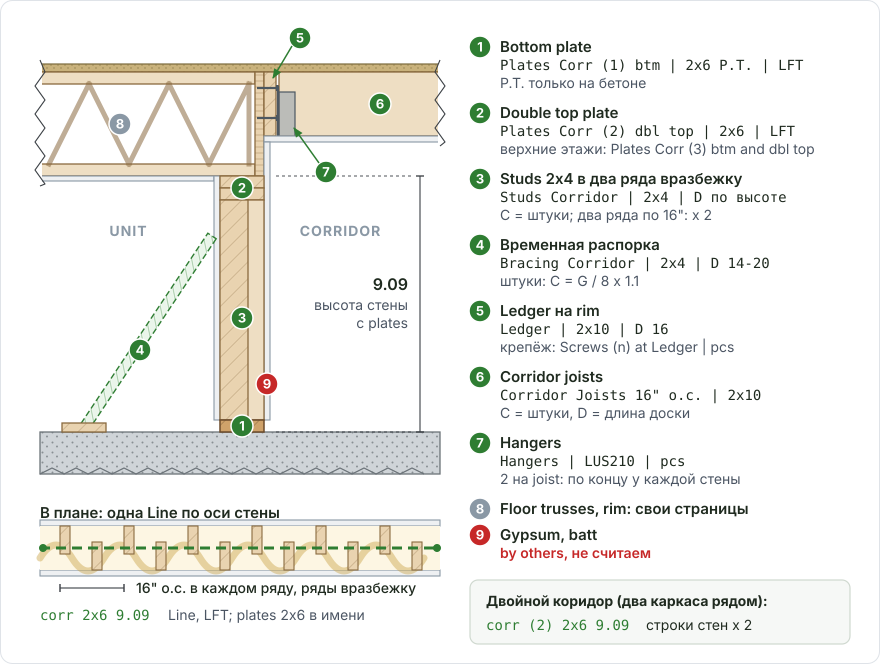

# Corridor Walls (коридорные стены)

<figure markdown>
  
  <figcaption markdown="span">Разрез коридорной стены: plates 2x6, два ряда стоек 2x4 по 16" вразбежку, временная распорка, ledger и corridor joists на hangers. Номера = строки DFL справа. В плане стена - одна Line по оси `corr 2x6 9.09`.</figcaption>
</figure>

<!-- TODO-PHOTO: staggered stud wall framing photo, EN query "staggered stud wall framing" -->

## Что это

Corridor wall - стена между квартирой и общей зоной: коридор, лестница,
гараж, вестибюль. Она fire-rated, часто на 2x6 plates со staggered 2x4
стойками, и над ней идёт ledger или `Blocking for Drywall`, когда перекрытие
параллельно. Стена между двумя квартирами - это уже [Demising](demising.md),
а стена шахты - [Shaft](shaft.md).

## Где искать на чертежах

| Лист | Что взять |
| --- | --- |
| Планы этажей `a101 1st` | Марки типов стен вдоль коридоров, лестниц, гаража |
| Wall type schedule (`wt`), UL assembly | Сечение plates и studs, staggered или нет, слои gypsum, rating |
| Разрез у коридора, детали S | Ledger, corridor joists `2x10` на ledger, blocking, hangers |
| Door schedule | Fire-rated unit entry doors (`3070 ... C-lbl`) |
| Stud schedule | Если коридорная стена ещё и несущая: марка в [BW](bearing-walls.md) |

## Как мерить в OurPlanCore

Инструмент **Line**, единица LFT, на плане этажа (точка W).

1. Категория по участкам: отрезок стены у лестницы и у гаража - тоже `corr`,
   даже если он продолжает demising.
2. Имя `corr 2x6 11.7`: категория, сечение plates, высота. Двойной коридор
   (два каркаса на плане) - `corr (2) 2x6 11.7`.
3. Staggered стена - одна линия: plates по имени `2x6`, два ряда стоек
   учитываются в DFL.
4. Новая позиция при смене высоты или сечения. Высота - по разрезу своего
   дома, не floor-to-floor ([Exterior: высота стены](exterior.md#stud-height)).
5. Если тип стены несущий, та же стена отдельно обводится в `BW/<этаж>`.

## Как назвать в дереве и строка DFL

| Имя в дереве | Строка DFL | Unit | Формула / фактор |
| --- | --- | --- | --- |
| `corr 2x6 11.7` | `Plates Corr (1) btm` 2x6 (P.T. только на бетоне) | LFT | `LFT x 1.1` |
| то же | `Plates Corr (2) dbl top` 2x6 | LFT | `LFT x 2 x 1.1` |
| то же | `Studs Corridor` 2x4 staggered | штуки, в D длина стойки | `LFT x 1.1 x 2` (два ряда по 16") |
| то же | `Bracing Corridor` 2x4 | штуки, в D длина доски: до 10' = 14, до 12' = 16, до 16' = 18, выше = 20 | `LFT / 8 x 1.1`: одна доска на 8 LFT стены; только стены от 7' |
| то же | `Blocking` | LFT | по матрице шаблона, до чётного |
| `corr (2) 2x6 11.7` | те же строки на два каркаса | | длина линии `x 2` |

`Bracing Corridor` - временные раскосы стены, считаются в **штуках**, не в LFT:
стена 161 LFT высотой 9.09' даёт `161 / 8 x 1.1 = 22.1` (формула шаблона не
округляет), к заказу это 23 доски по 14': стена ниже 10'.

Опора гипса там, где перекрытие параллельно стене, - другая строка и другой
блок: `Blocking for Drywall`, `2x4`, `=ОКРВВЕРХ(G/D;1)`, D `16`, в Floor Framing
List этажа. Строки `Bracing for Drywall` в DFL нет. Подробно:
[Bracing стен и Blocking for Drywall](../../horizontal/floor-framing/details/bracingdrywall.md).

Hangers над коридорной стеной - обычные `ITS`, если gypsum заканчивается
ниже перекрытия. `DHU` / `DGU` только там, где joists заходят над настоящей
fire wall по детали (лестница, лифт, шахта): [Hangers](../../../reference/hangers.md).
Corridor joists на кровле без детали - нота с причиной, а не `Optional` без
объяснения ([Standard notes](../../../reference/standard-notes.md)).

## Частые ошибки

- Corridor и demising перепутаны группой: в проверке 241 LFT коридора стали 161, а demising выросла с 577 до 648.
- Кусок коридорной стены у лестницы записан как `ext`.
- `DHU` поставлены только потому, что стена коридорная.
- Staggered стена посчитана одним рядом стоек.
- Plates 2x6 забыты: студы 2x4, и plates записаны 2x4.
- Ledger и крепёж коридорных joists не выписаны отдельными строками по детали.
- `Bracing Corridor` записан в LFT, или опора гипса записана строкой `Bracing for Drywall`.

Разбор с примерами: [все ошибки по стенам](../../../start/common-mistakes.md#walls).

## Пример

```text
walls/
  2nd floor walls/
    corr 2x6 9.09        Line, 161.0 LFT
    corr (2) 2x6 9.09    Line, 24.5 LFT   (две стены у лестницы)
    dem 2x6 9.09         Line, 648.2 LFT
```

## См. также

- [Demising Walls](demising.md), [Unit Walls](unit.md), [Shaft Walls](shaft.md)
- [Bracing стен и Blocking for Drywall](../../horizontal/floor-framing/details/bracingdrywall.md)
- [Hangers](../../../reference/hangers.md): ITS против DHU
- [Советы и важные вещи](../../../reference/boss-feedback-rules.md#dhu-dgu-vs-its)
