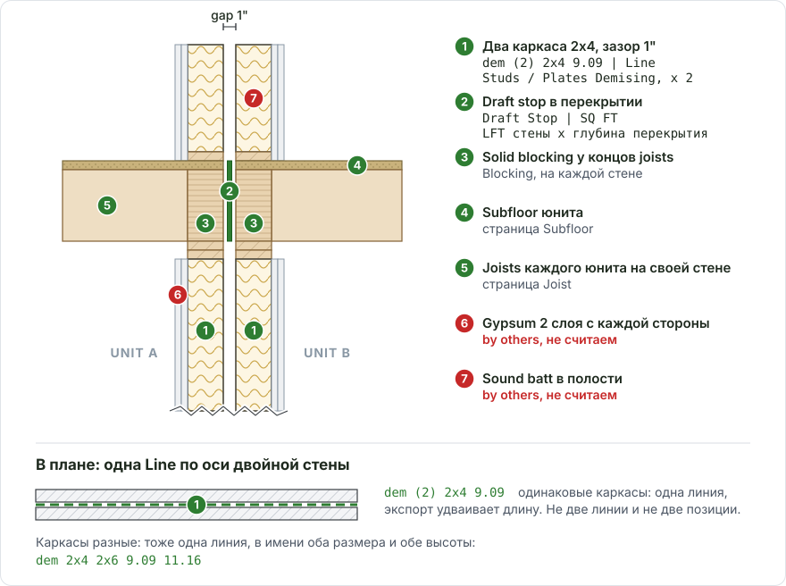
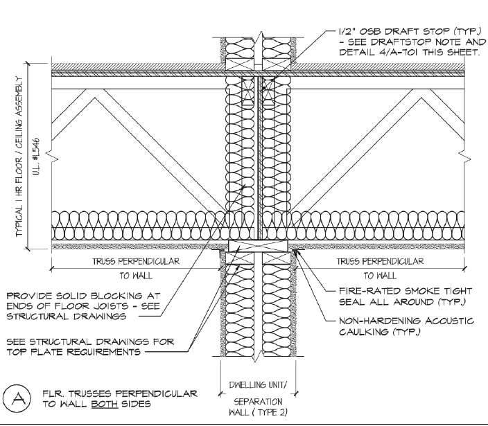

# Demising Walls

<figure markdown>
  
  <figcaption markdown="span">Double demising wall: two frames with an air gap, gypsum on both sides, draft stop in the floor framing. Two identical frames are measured as one line `dem (2) 2x4 9.09` along the wall axis; the DFL doubles the length automatically.</figcaption>
</figure>

## What it is

A demising (party) wall separates two units. It can be single or
double: two independent frames with an air gap. It is rated,
often carries double studs on the lower floors and needs a draft stop in
the floor framing and in the attic. A unit-to-corridor wall is a [Corridor](corridor.md) wall.

## Where to find it on the plans

| Sheet | What to take |
| --- | --- |
| Floor plans `a101 1st` | Wall type mark between units; one frame or two |
| Wall type schedule (`wt`), UL assembly | Size of each frame, gypsum layers, sound insulation |
| Wall-to-floor details (`a701`) | Draft stop (`1/2" OSB`), solid blocking, acoustic sealant |
| Stud schedule, S plans | Double studs, BW marks on demising |
| SW schedule | Shear sheathing on one side of the demising wall |
| Draftstops plan, roof plan | Attic draft stop: see [Gable](gable.md) |

<figure markdown>
  
  <figcaption markdown="span">Dwelling unit separation wall detail: 1/2" OSB draft stop over the wall, solid blocking at the joist ends, fire-rated seal. The draft stop here is a separate row, not part of the sheathing.</figcaption>
</figure>

## How to measure in OurPlanCore

**Line** tool, LFT unit, on the floor plan (W dot).

1. Name `dem 2x6 9.09`: category, size, height.
2. A double wall with identical frames is **one line** along the wall centerline:
   `dem (2) 2x4 9.09`. The `(2)` in the name doubles the length on the way into the DFL,
   do not draw a second line.
3. A double wall with two different frames side by side is also one line, with both
   sizes and both heights in the name, in the same order: `dem 2x4 2x6 9.09 11.16`.
4. Staggered studs on one plate (2x4 studs staggered on a 2x6 plate) are
   one frame: `dem 2x6 stag 9.09`, not `(2)`.
5. Make it double only if the plan shows two frames: do not double a wall because of its name.
6. The draft stop in the floor framing is not drawn separately: its length equals the
   demising wall length, the area is figured in the DFL. The attic draft stop is a triangle
   Area in `gables/gable trusses/draft stop` on the architectural roof plan.
7. A bearing demising wall is also traced in `BW/<floor>` by its mark.

## Takeoff name and DFL row

| Takeoff name | DFL row | Unit | Formula / factor |
| --- | --- | --- | --- |
| `dem 2x6 9.09` | `Plates Demising (1) btm`, `(2) top` | LFT | `LFT x 1.1`, `x 2 x 1.1` |
| same | `Studs Demising` 2x6 | pieces, D = stud length | `LFT x 1.1` (16") or `x 0.625` (24") |
| same | `Bracing Demising` 2x4 | pieces, D = board length: up to 10' = 14, up to 12' = 16, up to 16' = 18, above = 20 | `LFT / 8 x 1.1`: one board per 8 LFT of wall; only walls 7' and taller |
| same | `Blocking` | LFT | from the template matrix, rounded to even |
| same | `Draft Stop` `1/2" OSB` (material per detail) | SQ FT | `LFT x floor depth x 1.1`, regular material, not P.T.; the row sits in the Gable Walls section, separate from the attic Draft Stop |
| `dem (2) 2x6 9.09` | the same rows, one group for both frames | | line length `x 2` (the macro doubles it) |
| BW mark on demising | `Extra Studs Demising 16" o.c.` (spacing per the stud schedule) | pieces | [Bearing Walls](bearing-walls.md) |

Drywall backing where the joists run parallel to the wall (on both sides at a demising
wall) is the `Blocking for Drywall` row (`2x4`, `=CEILING(G/D,1)`, D `16`) in the Floor
Framing List of that floor, not in the walls. There is no `Bracing for Drywall` row in the DFL:
[Wall bracing and Blocking for Drywall](../../horizontal/floor-framing/details/bracingdrywall.md).

Shear sheathing on a demising wall can be on one side only or on part of the length:
per the SW schedule, see [Shear Wall](../sheathing/shear-wall.md). Hangers over a
demising wall with gypsum below the floor framing are `ITS`; `DHU` only over a true fire
wall per detail.

## Common mistakes

- Draft stop missed or copied from the shear wall total.
- Draft stop written as P.T., or its thickness not checked against the detail (7/16" vs 1/2").
- Wall made double because of the word "demising" although the plan shows one frame.
- A double wall traced with two lines and named `dem (2)`: the length is doubled twice.
- A staggered wall named `dem (2) 2x4` instead of `dem 2x6 stag`.
- Type assigned as a group: 10 LFT of demising ended up in exterior, a corridor wall named `dem`.
- Lower-floor double studs from the stud schedule not listed.
- Floor-to-floor draft stop and attic draft stop mixed into one row.

Walkthrough with examples: [all wall mistakes](../../../start/common-mistakes.md#walls).

## Example

```text
walls/
  3rd floor walls/
    dem (2) 2x6 9.09    Line, 282.4 LFT     (double wall, identical frames: one line)
    dem 2x4 9.09        Line, 36.0 LFT      (single at the stair)
gables/
  gable trusses/
    draft stop          Area, 3 triangles   Notes: A1-00, A4.1
```

## See also

- [Corridor Walls](corridor.md), [Bearing Walls](bearing-walls.md), [Gable](gable.md)
- [Shear Wall](../sheathing/shear-wall.md), [Wall bracing and Blocking for Drywall](../../horizontal/floor-framing/details/bracingdrywall.md)
- [Hangers](../../../reference/hangers.md)
