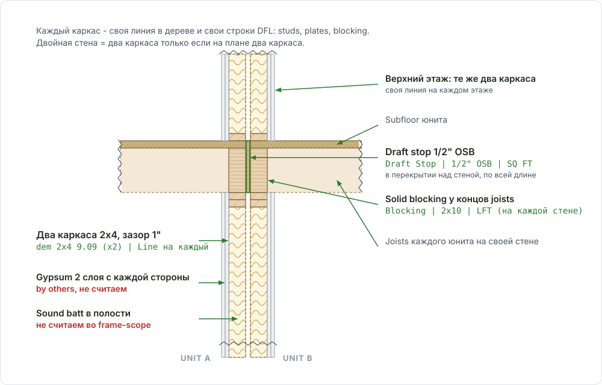
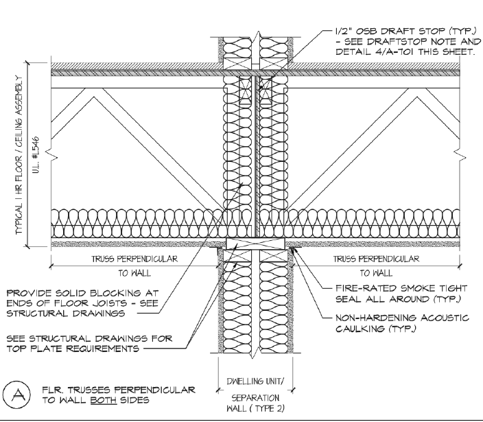

# Demising Walls (межквартирные стены)

<figure markdown>
  
  <figcaption markdown="span">Двойная demising стена: два каркаса с зазором, gypsum с обеих сторон, draft stop 1/2" OSB в перекрытии. Каждый каркас - своя линия и свои строки DFL.</figcaption>
</figure>

## Что это

Demising (party) wall - стена между двумя квартирами. Бывает одинарной и
двойной: два самостоятельных каркаса с воздушным зазором. Она rated,
часто несёт double studs на нижних этажах и требует draft stop в
перекрытии и на чердаке. Стена квартира-коридор - это [Corridor](corridor.md).

## Где искать на чертежах

| Лист | Что взять |
| --- | --- |
| Планы этажей `a101 1st` | Марка типа стены между юнитами; один каркас или два |
| Wall type schedule (`wt`), UL assembly | Сечение каждого каркаса, слои gypsum, sound insulation |
| Детали стыка с перекрытием (`a701`) | Draft stop (`1/2" OSB`), solid blocking, acoustic sealant |
| Stud schedule, S-планы | Double studs, марки BW на demising |
| SW schedule | Shear sheathing на одной стороне demising |
| Draftstops plan, roof plan | Draft stop на чердаке: см. [Gable](gable.md) |

<figure markdown>
  
  <figcaption markdown="span">Деталь dwelling unit separation wall: 1/2" OSB draft stop над стеной, solid blocking на концах joists, fire-rated seal. Draft stop здесь - отдельная строка, не часть обшивки.</figcaption>
</figure>

## Как мерить в OurPlanCore

Инструмент **Line**, единица LFT, на плане этажа (точка W).

1. Имя `dem 2x6 9.09`: категория, сечение, высота.
2. Двойная стена с одинаковыми каркасами - одна линия `dem (2) 2x6 9.09`.
3. Двойная стена с разными каркасами (2x4 и 2x6, разные высоты) - **две
   линии**, по одной на каждый каркас: `dem 2x4 9.09` и `dem 2x6 10.5`.
4. Двойной каркас только если на плане два каркаса: не делай стену двойной по названию.
5. Draft stop в перекрытии не рисуется отдельно: его длина равна длине
   demising стены, площадь считается в DFL. Draft stop чердака - треугольник
   Area в `gables/gable trusses/draft stop` на архитектурном плане кровли.
6. Несущая demising дополнительно обводится в `BW/<этаж>` по марке.

## Как назвать в дереве и строка DFL

| Имя в дереве | Строка DFL | Unit | Формула / фактор |
| --- | --- | --- | --- |
| `dem 2x6 9.09` | `Plates Demising (1) btm`, `(2) top` | LFT | `LFT x 1.1`, `x 2 x 1.1` |
| то же | `Studs Demising` 2x6 | pcs | `LFT x 1.1` (16") или `x 0.625` (24") |
| то же | `Bracing Demising` 2x4, `Blocking` | LFT | по высоте и типу стены |
| то же | `Bracing for Drywall` 2x4 с обеих сторон | LFT | где joists параллельны стене |
| то же | `Draft Stop` `1/2" OSB` | SQ FT | `LFT x глубина перекрытия`, обычный материал, не P.T. |
| `dem (2) 2x6 9.09` | те же строки на два каркаса | | `x 2` |
| марка BW на demising | `Extra Dbl Studs Demising` | pcs | [Bearing Walls](bearing-walls.md) |

Shear sheathing на demising может быть с одной стороны или на части длины:
по SW schedule, страница [Shear Wall](../sheathing/shear-wall.md). Hangers над
demising с gypsum под перекрытием - `ITS`; `DHU` только над настоящей fire
wall по детали.

## Частые ошибки

- Draft stop пропущен или скопирован из суммы shear walls.
- Draft stop записан P.T. или его толщина не сверена с деталью (7/16" против 1/2").
- Стена сделана двойной по слову "demising", хотя на плане один каркас.
- Тип задан группой: 10 LF demising попали в exterior, коридорная стена названа `dem`.
- Double studs нижних этажей из stud schedule не выписаны.
- Межэтажный draft stop и чердачный draft stop смешаны в одну строку.

Разбор с примерами: [все ошибки по стенам](../../../start/common-mistakes.md#walls).

## Пример

```text
walls/
  3rd floor walls/
    dem (2) 2x6 9.09    Line, 282.4 LFT     (двойная стена, одинаковые каркасы)
    dem 2x4 9.09        Line, 36.0 LFT      (одинарная у лестницы)
gables/
  gable trusses/
    draft stop          Area, 3 треугольника   Notes: A1-00, A4.1
```

## См. также

- [Corridor Walls](corridor.md), [Bearing Walls](bearing-walls.md), [Gable](gable.md)
- [Shear Wall](../sheathing/shear-wall.md), [Bracing for Drywall](../../horizontal/floor-framing/details/bracingdrywall.md)
- [Hangers](../../../reference/hangers.md)
