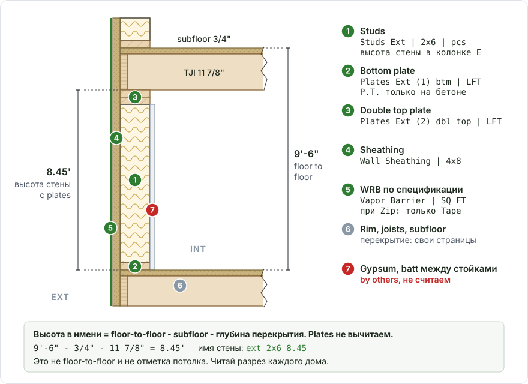
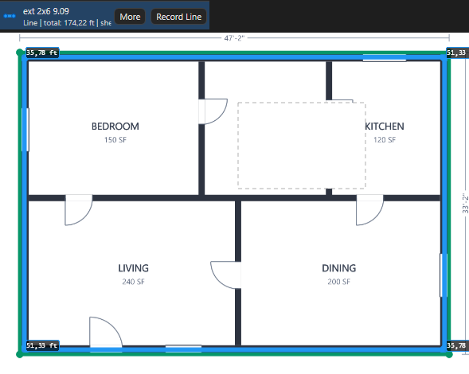
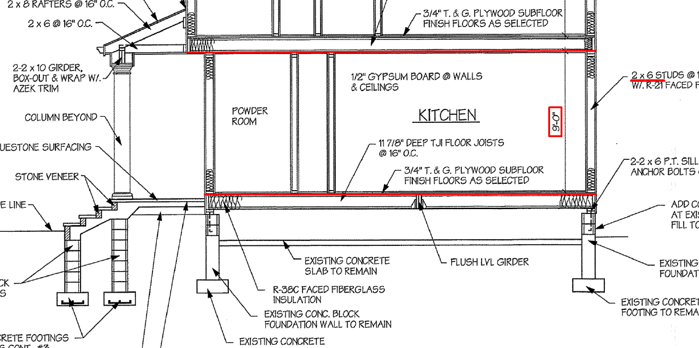

# Exterior Walls

<figure markdown>
  
  <figcaption markdown="span">Exterior wall in section between two floors. The height in the name = floor-to-floor minus subfloor minus floor depth; plates are not deducted. Numbered layers: studs, plates, sheathing, WRB are ours; gypsum and batt are by others.</figcaption>
</figure>

## What it is

An exterior wall runs along the building perimeter and has sheathing on the outside. It differs from interior
walls in its layers (sheathing, WRB, insulation), the FRT requirement and the fact
that all facade openings are cut out of it. A wall on concrete brings along
[Sill Plates](sill-plates.md), and at the top [Gable](gable.md),
[Parapet](parapet.md) and [Truss Heel](../sheathing/truss-heel.md).

## Where to find it on the plans

| Sheet | What to take |
| --- | --- |
| Floor plans `a101 1st` | Wall outline and length, wall type marks |
| Wall type schedule (`wt`) | Stud size, spacing, layers, fire rating, FRT |
| Sections `a3.01 sec` | Wall height, floor framing makeup, where the wall ends and the gable starts |
| Elevations `el`, energy sheets | Densglass and Zip zones, continuous insulation, material changes |
| Structural `s101`, SW schedule | Shear walls, holdowns, blocking of tall walls |
| Code summary (`n`) | Construction type: on Type III everything in the plane of the exterior wall is FRT |

## How to measure in OurPlanCore

**Line** tool, LFT unit. The **W** sheet dot on a floor plan puts
a new line into `walls/<floor> floor walls`.

1. Run the line along the wall centerline over the real runs. Do not trace callouts or dimension lines.
2. Start a new takeoff when the height, size, construction or sheathed side changes.
   One run with several callouts stays one line.
3. Decide the wall type run by run, not as a group: a piece of demising between two
   exterior walls does not become `ext`.
4. A double wall is two frames only if the plan shows two frames.
5. Measure the wall itself in `walls` once, as a regular wall (`ext`, `corr`, `dem`),
   even if it is bearing or a shear wall. BW and SW marks are not drawn in `walls` as
   separate lines: the bearing wall strip and the SW segment are traced again in their
   own branches, [BW](bearing-walls.md) and [Shear Wall](../sheathing/shear-wall.md).
   The lengths of the three branches are never added together.
6. Give each takeoff its own Color.

<figure markdown>
  
  <figcaption markdown="span">Line on the 1st floor walls. The name carries the category, size and height: `ext 2x6 9.09`.</figcaption>
</figure>

### Wall height and stud height { #stud-height }

The height in the name is the height of the **assembled wall, plates included**: the stud
plus 1 bottom and 2 top plates, in decimal feet. It is **not** floor-to-floor and not the
ceiling elevation.

- Formula: floor-to-floor minus the `3/4"` subfloor minus the floor framing depth.
  Read the section of each building and check whether the gypcrete is poured over the
  framing or between it.
- Plates are **not deducted**: the three standard plates (1 btm + 2 top) are already
  inside this height.
- Deduct only boards beyond the standard three, when the section shows them: a second
  btm plate, truss blocking on top of the top plates.
- Bare stud = wall height minus `4 1/2"` (three plates at 1 1/2" each). You do not need
  to work it out separately: the table below and the DFL template run off the wall height.
- Example: 9'-6" floor-to-floor minus 11 7/8" TJI minus 3/4" subfloor =
  8'-5 3/8" = 8.45'. That is the wall height and the number in the name (`ext 2x6 8.45`);
  the stud itself is 8'-0 7/8", which the table below reads as a 9' precut.

In the DFL the same wall height sits in H and E of the stud row (E in feet and inches to
1/8"), in the wall name it is decimal feet.

<figure markdown>
  
  <figcaption markdown="span">Kitchen section: the 9'-0" wall height sits between the subfloor and the underside of the floor framing above. Red lines are the wall limits, not floor elevations.</figcaption>
</figure>

### Which stud for the wall height { #precut }

The wall height (with plates, as in the name) decides which stud to order:

| Wall height | Stud |
| --- | --- |
| 7'-0" ... 8'-1 5/8" | 8' precut (`92-5/8`) |
| 8'-1 3/4" ... 8'-4 1/2" | 8' full height stud |
| 8'-4 3/4" ... 9'-1 5/8" | 9' precut (`104-5/8`) |
| 9'-1 3/4" ... 10'-1 5/8" | 10' precut (`116-5/8`) |
| 10'-1 3/4" ... 10'-4 1/2" | 10' full height stud |
| 10'-4 3/4" ... 12'-4 1/2" | 12' |

- There is no 9' full height stud, and no 11' stud either.
- 10' precut is the tallest precut.
- Short studs are cut from long ones: count 4' as 8', 5' as 10', 6' as 12'.
- Example: an 8'-4 1/2" wall takes an 8' full height stud, a 12'-2" wall takes a 12' stud. Gables are not always 12' studs: check the height of each stud.

## Takeoff name and DFL row

Naming canon: `<category> <size> <height>`. Older examples with `x`
(`ext 2x6 x`) mean the same thing: the `x` stands in place of the height.

| Takeoff name | What it is | DFL row | Unit |
| --- | --- | --- | --- |
| `ext 2x6 9.09` | Exterior 2x6, 9.09' high | `Studs Ext`, `Plates Ext (1) btm` P.T., `Plates Ext (2) dbl top` | studs: pieces (D holds the stud length), plates: LFT |
| `corr 2x6 11.7` | Corridor wall, see [Corridor](corridor.md) | `Studs Corridor`, `Plates Corr` | same |
| `dem 2x6 9.09` | Unit separation wall, see [Demising](demising.md) | `Studs Demising`, `Plates Demising` | same |
| `dem (2) 2x6 9.09` | Double demising, two identical frames | the same `Demising` rows, the line length is doubled | same |
| `furr 2x4 9.09` | Furring wall, see [Furring](furring.md) | `Plates Furring`, `Furring` | LFT |
| `2x4 9.09` | Regular partition, no prefix | `Studs Interior`, `Plates Interior` | same |
| `2x6 half` | Half wall | `Studs Interior half`, plates as for a partition | same |

Along with the wall the DFL gets:

- `Bracing Ext Walls` `2x4` in **pieces**: one board per 8 LFT of wall
  (`=G/8*1.1`), D holds the board length by the tallest wall of the group (up to 10' = 14, up to 12' = 16,
  up to 16' = 18, above = 20). Only for walls 7' and taller.
- `Blocking` in LFT, `Wall Sheathing` in `4x8` sheets.
- `Vapor Barrier` in SQ FT is the template label; B gets the WRB from the spec,
  not Tyvek by default. With Zip there is no such row: the barrier is built into the
  sheet, only `Tape` remains.
- `Insulation` in SQ FT: only continuous insulation outside the sheathing.
  Insulation between studs is by others, no row.
- `Holdowns` and `Ext. Headers`.

Stud factors (16" = 1.1, 24" = 0.625) have one canon in
[Formulas](../../../reference/formulas.md#stud-spacing-factors). The `WL` button
on the XL strip moves the walls into the floor block; a suffix after the height (`ext 2x6 10.09
5/S400`) is split off automatically.

Layer rules are on separate pages: [Wall Sheathing](../sheathing/wall-sheathing.md),
[Exterior Wall Materials](../sheathing/exterior-materials.md). FRT: if the
exterior wall is FRT, then the blocking, the parapet and the headers in its plane are FRT too.
Count a facade build-out separately for the vertical and the horizontal parts, FRT per detail.
Metal stud and CMU walls: framing is by others, but exterior gypsum, insulation,
flashing and window jambs stay ours ([Metal Tracks](metal-tracks.md)).

## Common mistakes

- Wall height taken as floor-to-floor or the ceiling elevation, or the plates deducted from it once more.
- Wall type assigned as a group: corridor and demising mixed up, a piece of demising ended up in exterior.
- P.T. plate on wood floor framing: P.T. only on concrete and masonry.
- Double bottom plate everywhere although the detail shows it only on some floors.
- The barrier row says Tyvek with a fluid-applied WRB: use the product from the spec.
- Openings subtracted from the sheathing twice or not at all.
- Missed rigid insulation, Densglass by facade zone, dropped soffit from the RCP.

Walkthrough with examples: [all wall mistakes](../../../start/common-mistakes.md#walls).

## Example

```text
walls/
  1st floor walls/
    ext 2x6 9.09      Line, 412.3 LFT
    corr 2x6 9.09     Line, 161.0 LFT
    dem (2) 2x4 9.09  Line, 96.5 LFT
    2x4 9.09          Line, 540.8 LFT
  2nd floor walls/
    ext 2x6 8.45      Line, 410.9 LFT
```

## See also

- [Bearing Walls](bearing-walls.md), [Sill Plates](sill-plates.md), [Corners](corners.md)
- [Wall Panels](wall-panels.md): what is in the panel, what is loose
- [Takeoff names and sheet dots](../../../reference/takeoff-naming.md)
- [Windows and Doors](../openings/windows-doors.md), [Headers](../openings/headers.md)
- [Tips and key rules](../../../reference/boss-feedback-rules.md#studs)
