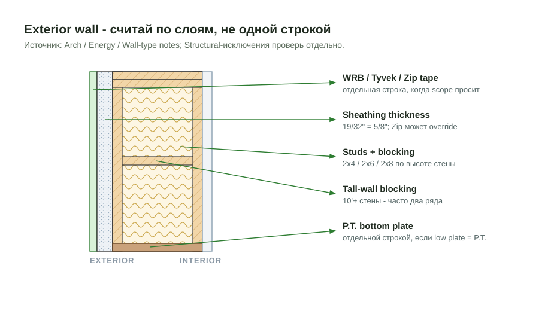
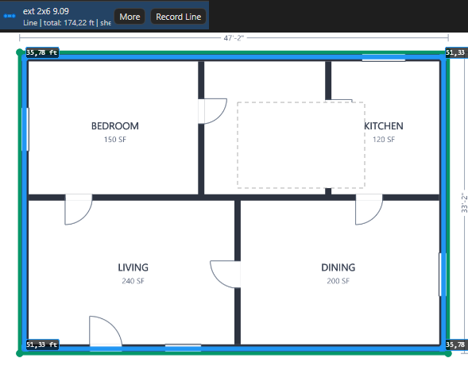
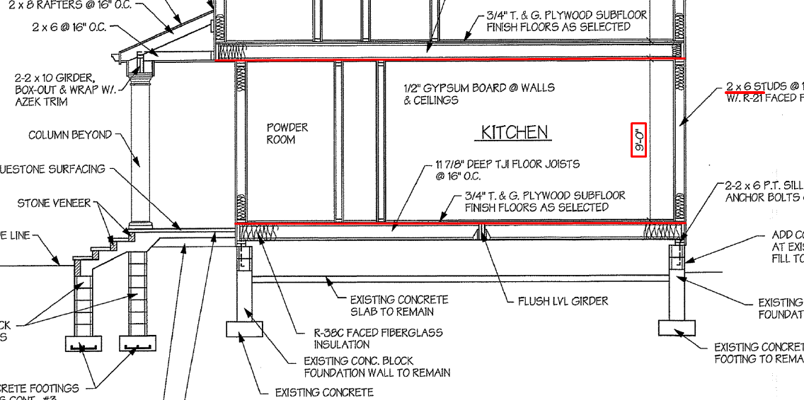

# Exterior Walls (наружные стены)

<figure markdown>
  
  <figcaption markdown="span">Наружная стена в разрезе: plates, studs, sheathing, WRB, insulation. Перед счётом раздели стену на слои и реши, какие из них в scope.</figcaption>
</figure>

## Что это

Exterior wall - стена по контуру здания с обшивкой снаружи. От внутренних
стен отличается слоями (sheathing, WRB, insulation), FRT-требованием и тем,
что все проёмы фасада вырезаются именно из неё. Стена на бетоне тянет за
собой [Sill Plates](sill-plates.md), а наверху - [Gable](gable.md),
[Parapet](parapet.md) и [Truss Heel](../sheathing/truss-heel.md).

## Где искать на чертежах

| Лист | Что взять |
| --- | --- |
| Планы этажей `a101 1st` | Контур и длина стен, марки типов стен |
| Wall type schedule (`wt`) | Сечение stud, шаг, слои, fire rating, FRT |
| Разрезы `a3.01 sec` | Высота стойки, состав перекрытия, где кончается стена и начинается gable |
| Фасады `el`, energy sheets | Зоны Densglass и Zip, continuous insulation, смена материала |
| Структура `s101`, SW schedule | Shear walls, holdowns, blocking высоких стен |
| Code summary (`n`) | Тип конструкции: при Type III всё в плоскости наружной стены FRT |

## Как мерить в OurPlanCore

Инструмент **Line**, единица LFT. Точка листа **W** на плане этажа кладёт
новую линию в `walls/<этаж> floor walls`.

1. Веди линию по оси стены по реальным участкам. Выноски и размерные линии не обводятся.
2. Новая позиция при смене высоты, сечения, конструкции или стороны обшивки.
   Один участок с несколькими выносками остаётся одной линией.
3. Тип стены определяй по участкам, не группой: кусок demising между двумя
   наружными не становится `ext`.
4. Двойная стена - два каркаса только если на плане два каркаса.
5. BW и shear walls в `walls` не рисуются: у них свои ветки
   [BW](bearing-walls.md) и [Shear Wall](../sheathing/shear-wall.md).
6. Каждой позиции свой Color.

<figure markdown>
  
  <figcaption markdown="span">Line по стенам 1-го этажа. Имя несёт категорию, сечение и высоту: `ext 2x6 9.09`.</figcaption>
</figure>

### Высота стойки { #stud-height }

Высота в имени - высота стены с plates в десятичных футах. Это **не**
floor-to-floor и не отметка потолка. Читай разрез каждого дома: из
floor-to-floor вычти subfloor и глубину перекрытия, потом проверь, льётся ли
gypcrete поверх каркаса или внутрь. Пример: 9'-6" floor-to-floor минус TJI
11 7/8" минус 3/4" subfloor = 8.45'. В DFL высота живёт в колонке E строки
студов (до 1/8"), в имени стены - десятичные футы.

<figure markdown>
  
  <figcaption markdown="span">Разрез кухни: высота стойки 9'-0" стоит между subfloor и низом перекрытия выше. Красные линии - границы стены, а не отметки этажей.</figcaption>
</figure>

### Какая стойка по высоте стены { #precut }

Высота стены (с plates, как в имени) определяет, какую стойку заказывать:

| Высота стены | Стойка |
| --- | --- |
| 7'-0" ... 8'-1 5/8" | 8' precut (`92-5/8`) |
| 8'-1 3/4" ... 8'-4 1/2" | 8' full height stud |
| 8'-4 3/4" ... 9'-1 5/8" | 9' precut (`104-5/8`) |
| 9'-1 3/4" ... 10'-1 5/8" | 10' precut (`116-5/8`) |
| 10'-1 3/4" ... 10'-4 1/2" | 10' full height stud |
| 10'-4 3/4" ... 12'-4 1/2" | 12' |

- 9' full height studs не бывает, 11' стоек тоже не бывает.
- 10' precut - самый высокий precut.
- Короткие стойки режутся из длинных: 4' считать как 8', 5' как 10', 6' как 12'.
- Пример: стена 8'-4 1/2" - это 8' full height, стена 12'-2" - это 12' стойка. Гейблы не всегда 12'-ые: смотри высоту каждой стойки.

## Как назвать в дереве и строка DFL

Канон имени: `<категория> <сечение> <высота>`. Старые примеры с `x`
(`ext 2x6 x`) означают то же самое: `x` стоит на месте высоты.

| Имя в дереве | Что это | Строка DFL | Unit |
| --- | --- | --- | --- |
| `ext 2x6 9.09` | Наружная 2x6 высотой 9.09' | `Studs Ext`, `Plates Ext (1) btm` P.T., `Plates Ext (2) dbl top` | pcs, LFT |
| `corr 2x6 11.7` | Коридорная, см. [Corridor](corridor.md) | `Studs Corr`, `Plates Corr` | pcs, LFT |
| `dem 2x6 9.09` | Межквартирная, см. [Demising](demising.md) | `Studs Demising`, `Plates Demising` | pcs, LFT |
| `dem (2) 2x6 9.09` | Двойная demising, два одинаковых каркаса | две группы строк | pcs, LFT |
| `furr 2x4 9.09` | Furring wall, см. [Furring](furring.md) | `Plates Furring`, `Furring` | LFT |
| `2x4 9.09` | Обычная перегородка без префикса | `Studs Interior`, `Plates Interior` | pcs, LFT |
| `2x6 half` | Половинная стена | по высоте из имени | pcs, LFT |

Со стеной в DFL идут `Bracing Ext Walls 2x4`, `Blocking`, `Wall Sheathing`,
`Vapor Barrier` (подпись шаблона; материал - WRB из спецификации, не Tyvek по
умолчанию), `Insulation`, `Holdowns` и
`Ext. Headers`. Факторы стоек (16" = 1.1, 24" = 0.625) - один канон в
[Формулах](../../../reference/formulas.md#stud-spacing-factors). Кнопка `WL`
полосы XL переносит стены в блок этажа; суффикс после высоты (`ext 2x6 10.09
5/S400`) отделяется сам.

Правила слоёв - на отдельных страницах: [Wall Sheathing](../sheathing/wall-sheathing.md),
[Exterior Wall Materials](../sheathing/exterior-materials.md). FRT: если
наружная стена FRT, то FRT и blocking, и парапет, и headers в её плоскости.
Build-out фасада считай отдельно на вертикаль и горизонталь, FRT по узлу.
Metal stud и CMU стены: каркас by others, но exterior gypsum, insulation,
flashing и window jambs остаются нашими ([Metal Tracks](metal-tracks.md)).

## Частые ошибки

- Высота стойки взята как floor-to-floor или отметка потолка.
- Тип стены задан группой: corridor и demising перепутаны, кусок demising попал в exterior.
- P.T. plate на деревянном перекрытии: P.T. только на бетоне и кладке.
- Двойная нижняя plate везде, хотя деталь показывает её только на части этажей.
- В строке барьера записан Tyvek при fluid-applied WRB: продукт из спецификации.
- Проёмы вычтены из обшивки дважды или не вычтены вовсе.
- Пропущены rigid insulation, Densglass по зонам фасада, dropped soffit с RCP.

Разбор с примерами: [все ошибки по стенам](../../../start/common-mistakes.md#walls).

## Пример

```text
walls/
  1st floor walls/
    ext 2x6 9.09      Line, 412.3 LFT
    corr 2x6 9.09     Line, 161.0 LFT
    dem (2) 2x4 9.09  Line, 96.5 LFT
    2x4 9.09          Line, 540.8 LFT
  2nd floor walls/
    ext 2x6 8.45      Line, 410.9 LFT
```

## См. также

- [Bearing Walls](bearing-walls.md), [Sill Plates](sill-plates.md), [Corners](corners.md)
- [Wall Panels](wall-panels.md): что в панели, что loose
- [Имена takeoffs и точки листа](../../../reference/takeoff-naming.md)
- [Windows and Doors](../openings/windows-doors.md), [Headers](../openings/headers.md)
- [Советы и важные вещи](../../../reference/boss-feedback-rules.md#studs)
