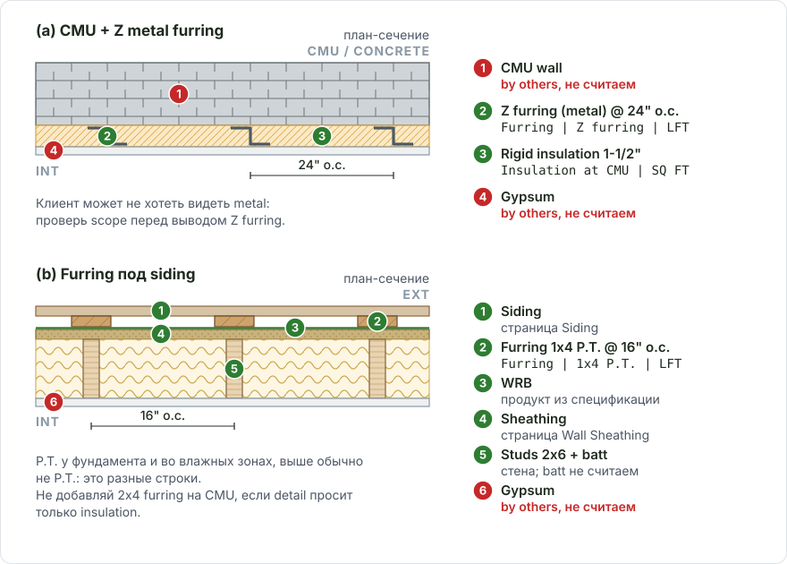

# Furring

<figure markdown>
  
  <figcaption markdown="span">Left: CMU, rigid insulation, Z-metal furring. Right: framing, sheathing, WRB, 1x4 P.T. strip, siding. Different products, both called furring.</figcaption>
</figure>

## What it is

Furring is a strip or profile that creates a gap and a nailing plane.
Three cases: Z-metal furring on CMU under continuous insulation, a `1x4` /
`2x4` P.T. strip under siding (rainscreen), and a furring wall, a light wood wall
in front of concrete at elevators and the core. The canon of rules and formulas is
[Furring & Window Jambs](../../exterior-trims/furring-and-jambs.md); this page has
only what you need to mark it up and name it correctly.

## Where to find it on the plans

| Sheet | What to take |
| --- | --- |
| Wall sections, details at CMU and concrete | Z-furring, insulation thickness, P.T. at concrete |
| Siding details, wall types | Strip under siding: size, spacing, P.T. |
| Plans at the elevator and stairs | Furring wall along concrete walls |
| RCP, roof notes | `1x3 strapping` under trusses or panels, if specified |

## How to measure in OurPlanCore

- Furring wall: **Line** in `walls/<floor> floor walls`, name `furr 2x4 9.09`,
  W dot. Height from the section, as for a regular wall.
- Z-furring and the strip under siding: the wall length or facade area they
  cover; a separate Line with the product name (`z furring`, `1x4 furring`)
  or figured from the siding area ([Siding](../../siding/measure.md)).
- **Do not add furring at CMU as optional**: the client's reviewer strikes it.
  A wood wall next to CMU can be panelized ([Wall Panels](wall-panels.md)).

## Takeoff name and DFL row

| Takeoff name | DFL row | Unit | Formula / factor |
| --- | --- | --- | --- |
| `furr 2x4 9.09` | `Plates Furring`, `Studs Interior` | LFT, pcs | as for a wall, btm P.T. on concrete |
| `z furring` | `Furring` `Z furring` (metal) | LFT | `SQFT x 12 / spacing x 1.1` |
| `1x4 furring` | `Furring` `1x4 P.T.` or `2x4 P.T.` | LFT | spacing per detail; P.T. and non-P.T. separately |
| strapping | `1x3 strapping` under trusses | LFT | only when specified |

Rigid insulation on CMU is a separate row `Insulation at CMU`
([Exterior Wall Materials](../sheathing/exterior-materials.md)). If the client
does not want to see metal, Z-furring and RC under the floor framing: verify scope.

## Common mistakes

- 2x4 furring added at CMU although the detail shows only 1-1/2" insulation.
- Furring at CMU listed as optional stick framing with no reason.
- P.T. strip at concrete counted together with regular SPF.
- Strapping on MA/RI jobs not checked.
- Basement furring wall (treated) not split out as a separate P.T. assembly.

Walkthrough with examples: [all wall mistakes](../../../start/common-mistakes.md#walls).

## Example

```text
walls/base floor walls/
  furr 2x4 9.24        Line, 36.8 LFT    Notes: 8/A500, P.T. plates at concrete
siding/
  1x4 furring          Line, 410.0 LFT   Notes: rainscreen per A4.25
```

## See also

- [Furring & Window Jambs](../../exterior-trims/furring-and-jambs.md): the canon
- [Exterior Wall Materials](../sheathing/exterior-materials.md), [Basement Walls](basement.md)
- [Wall Panels](wall-panels.md)
