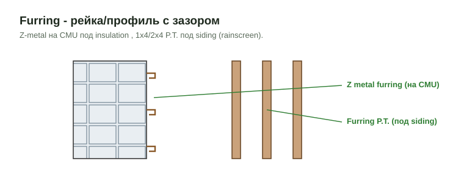

# Furring (обрешётка и furring walls)

<figure markdown>
  
  <figcaption markdown="span">Слева: CMU, rigid insulation, Z-metal furring. Справа: каркас, sheathing, WRB, рейка 1x4 P.T., siding. Разные продукты, оба называются furring.</figcaption>
</figure>

## Что это

Furring - рейка или профиль, который создаёт зазор и плоскость крепления.
Три случая: Z-metal furring на CMU под continuous insulation, рейка `1x4` /
`2x4` P.T. под siding (rainscreen) и furring wall - лёгкая деревянная стена
перед бетоном у лифтов и core. Канон правил и формул -
[Furring & Window Jambs](../../exterior-trims/furring-and-jambs.md); здесь
только то, что нужно, чтобы правильно разметить и назвать.

## Где искать на чертежах

| Лист | Что взять |
| --- | --- |
| Wall sections, детали у CMU и бетона | Z-furring, толщина insulation, P.T. у бетона |
| Siding details, wall types | Рейка под siding: размер, шаг, P.T. |
| Планы у лифта и лестниц | Furring wall вдоль бетонных стен |
| RCP, roof notes | `1x3 strapping` под фермами или панелями, если specified |

## Как мерить в OurPlanCore

- Furring wall: **Line** в `walls/<этаж> floor walls`, имя `furr 2x4 9.09`,
  точка W. Высота по разрезу, как у обычной стены.
- Z-furring и рейка под siding: длина стены или площадь фасада, которую они
  покрывают; отдельная Line с именем продукта (`z furring`, `1x4 furring`)
  или расчёт от площади siding ([Siding](../../siding/measure.md)).
- Furring у CMU **не добавляй как optional**: ревьюер клиента это снимает.
  Wood wall рядом с CMU может быть panelized ([Wall Panels](wall-panels.md)).

## Как назвать в дереве и строка DFL

| Имя в дереве | Строка DFL | Unit | Формула / фактор |
| --- | --- | --- | --- |
| `furr 2x4 9.09` | `Plates Furring`, `Studs Interior` | LFT, pcs | как у стены, btm P.T. на бетоне |
| `z furring` | `Furring` `Z furring` (metal) | LFT | `SQFT x 12 / spacing x 1.1` |
| `1x4 furring` | `Furring` `1x4 P.T.` или `2x4 P.T.` | LFT | по шагу из detail; P.T. и не-P.T. раздельно |
| strapping | `1x3 strapping` под фермами | LFT | только когда specified |

Rigid insulation на CMU - отдельная строка `Insulation at CMU`
([Exterior Wall Materials](../sheathing/exterior-materials.md)). Если клиент
не хочет видеть metal, Z-furring и RC под перекрытием - verify scope.

## Частые ошибки

- 2x4 furring добавлен к CMU, хотя деталь даёт только 1-1/2" insulation.
- Furring у CMU выдан как optional stick framing без причины.
- P.T. рейка у бетона посчитана вместе с обычной SPF.
- Strapping MA/RI проектов не проверен.
- Furring wall подвала (treated) не выделен в отдельную P.T.-сборку.

Разбор с примерами: [все ошибки по стенам](../../../start/common-mistakes.md#walls).

## Пример

```text
walls/base floor walls/
  furr 2x4 9.24        Line, 36.8 LFT    Notes: 8/A500, P.T. plates at concrete
siding/
  1x4 furring          Line, 410.0 LFT   Notes: rainscreen per A4.25
```

## См. также

- [Furring & Window Jambs](../../exterior-trims/furring-and-jambs.md): канон
- [Exterior Wall Materials](../sheathing/exterior-materials.md), [Basement Walls](basement.md)
- [Wall Panels](wall-panels.md)
