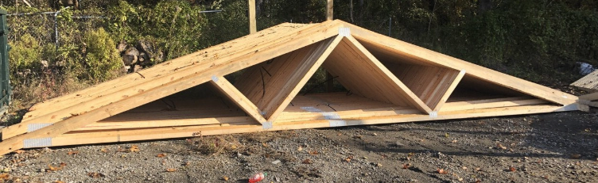
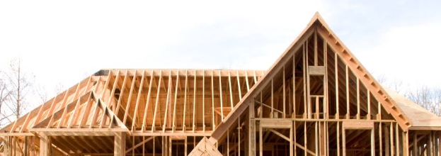
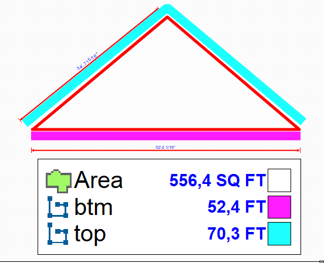

# Gable Walls

<div class="kb-gallery">
  <a class="kb-gallery__item" href="../../../../assets/images/confluence/confluence-083.png">
    
    <div class="kb-gallery__caption">Gable truss: a truss with vertical studs. Framing is by others, we count only the sheathing and the layers.</div>
  </a>
  <a class="kb-gallery__item" href="../../../../assets/images/confluence/confluence-084.png">
    
    <div class="kb-gallery__caption">Gable stick: the wall carried up with studs. We count plates, studs, blocking, bracing and sheathing.</div>
  </a>
</div>

## What it is

A gable is the triangle of wall under a gable roof, from the top of the wall's top plate
up to the ridge. There are two types, and the whole takeoff depends on the type: **gable
trusses** (a truss, by others, only the sheathing package is ours) and **gable stick**
(the framing is all ours). The attic draft stop lives in the same branch. Do not confuse it with
[Truss Heel](../sheathing/truss-heel.md) (the strip at the truss heel) and
[Box Sheathing](../sheathing/box-sheathing.md) (the strip at the floor framing level).

## Where to find it on the plans

| Sheet | What to take |
| --- | --- |
| Roof framing plan, truss layout | `Trusses` = gable trusses; `2x8`, `2x10`, `TJI`, `stick` = gable stick |
| Elevations `el` | Triangle outline, dormers, steps, porch gables |
| Sections `sec` | Where the wall ends and the gable starts; wall stud height |
| Draftstops plan (`a1-00` and the like) | Attic draft stop lines |
| Attic section `a4` | Span and rise for the draft stop triangle |
| Wall notes | 2x4 or 2x6 size, FRT, sheathing material |

## How to measure in OurPlanCore

Branch `gables/gable trusses/...` or `gables/gable stick/...`. A name with
`gable truss` or `gable stick` goes into `gables` by itself.

1. **Area** along the real face on the elevation: `gable` (trusses) or `gable stick`.
   Include dormers, steps and openings. All gables of one type can be
   collected as several polygons in one takeoff.
2. For stick, add two **Lines**: `btm` along the top of the wall (bottom of the triangle) and
   `top` along both slopes.
3. Area starts at the top face of the top plate, not at the bottom of the wall. A gable seen on two
   elevations is drawn once.
4. **Draft stop**: location from the Draftstops Plan sheet, attic profile (span x
   rise) from the section. One Area triangle per line: base = span, apex
   under the ridge. Place it on the architectural roof plan, not on an S sheet. Takeoff
   `gables/gable trusses/draft stop`, its own color, source sheets in Notes. At
   hips the triangle is smaller: mark it "check".
5. Porch, garage and storage gables are their own polygons in the same building tree.

<figure markdown>
  
  <figcaption markdown="span">A stick gable takeoff looks like this: triangle Area 556 SQ FT, btm line 52.4 FT along the top of the wall, top line 70.3 FT along the slopes.</figcaption>
</figure>

## Takeoff name and DFL row

The `GB` button on the XL strip puts gables into the `Gable Walls` block; the
`a2_sqft_gable_trussheel` macro reads the areas and lengths.

| Takeoff name | DFL row | Unit | Formula / factor |
| --- | --- | --- | --- |
| `gable stick/gable stick` + `btm` + `top` | `Plates Ext (3) btm and dbl top` 2x6 | LFT | `(BTM + 2 x TOP) x 1.1`, to an even number |
| same | `Studs for Gables` 2x6 | pcs | `SQFT / stud height`, to an even number |
| same | `Blocking` 2x6 | LFT | `BTM / 2` |
| same | `Bracing Ext Walls` 2x4 (14') | pcs | `BTM / 8 x 1.1` |
| both types | `Wall Sheathing` `7/16" Zip` or `1/2" Ply` | 4x8 | `SQFT x 1.1 / 32`, round up |
| both types | `Vapor Barrier` (WRB material per spec) | SQ FT | `SQFT x 1.1`, to 10 |
| both types | `Insulation` | SQ FT | `SQFT x 1.1`, to 10 |
| both types | `Tape` `Zip Tape` | LFT | `SQFT x 0.4 x 1.1`, to 10 |
| `gable trusses/draft stop` | `Draft Stop` `1/2" OSB` | SQ FT | sum of the triangles, thickness per detail |

Gable trusses have no plates and studs rows. Sheathing material and FRT follow the
exterior wall notes ([Wall Sheathing](../sheathing/wall-sheathing.md)).

## Common mistakes

- Attic draft stop missed or copied from the shear wall total: the most frequent miss.
- One gable counted twice from two elevations, or included both in gable and in the regular wall area.
- Area taken from the bottom of the wall instead of the top of the top plate.
- Plates and studs listed for gable trusses.
- Gable confused with truss heel or box sheathing: the geometry is different.
- Area measured, but the old number stayed in Excel.

Walkthrough with examples: [all wall mistakes](../../../start/common-mistakes.md#walls).

## Example

```text
gables/
  gable trusses/
    gable          Area, 2 polygons, 812 SQ FT
    draft stop     Area, 3 triangles, 390 SQ FT   Notes: A1-00, A4.1
Grge/gables/
  gable stick/
    gable stick    Area, 556 SQ FT
    btm            Line, 52.4 LFT
    top            Line, 70.3 LFT
```

## See also

- [Gable Sheathing](../sheathing/gable.md), [Truss Heel](../sheathing/truss-heel.md), [Box Sheathing](../sheathing/box-sheathing.md)
- [Exterior Walls](exterior.md), [Demising Walls](demising.md): draft stop in the floor framing
- [Ridge](../../horizontal/roof-framing/ridge.md), [Formulas](../../../reference/formulas.md)
