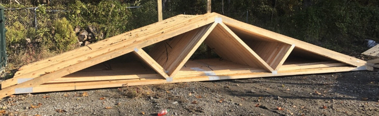
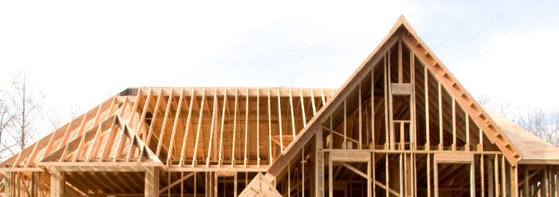
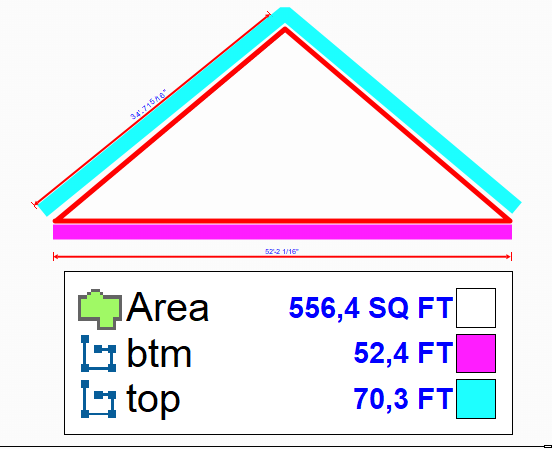

# Gable Walls (фронтоны)

<div class="kb-gallery">
  <a class="kb-gallery__item" href="../../../../assets/images/confluence/confluence-083.png">
    
    <div class="kb-gallery__caption">Gable truss: ферма с вертикальными стойками. Каркас by others, считаем только sheathing и слои.</div>
  </a>
  <a class="kb-gallery__item" href="../../../../assets/images/confluence/confluence-084.png">
    
    <div class="kb-gallery__caption">Gable stick: стена продолжена вверх стойками. Считаем plates, studs, blocking, bracing и sheathing.</div>
  </a>
</div>

## Что это

Gable - треугольник стены под двускатной крышей, от верха верхней доски
стены до конька. Два типа, и от типа зависит весь takeoff: **gable
trusses** (ферма, by others, наш только sheathing-пакет) и **gable stick**
(каркас наш целиком). Draft stop чердака живёт в той же ветке. Не путать с
[Truss Heel](../sheathing/truss-heel.md) (полоса пятки фермы) и
[Box Sheathing](../sheathing/box-sheathing.md) (полоса на уровне перекрытия).

## Где искать на чертежах

| Лист | Что взять |
| --- | --- |
| Roof framing plan, truss layout | `Trusses` = gable trusses; `2x8`, `2x10`, `TJI`, `stick` = gable stick |
| Фасады `el` | Контур треугольника, dormer, ступени, порч-фронтоны |
| Разрезы `sec` | Где кончается стена и начинается gable; высота стойки стены |
| Draftstops plan (`a1-00` и подобные) | Линии draft stop чердака |
| Разрез чердака `a4` | Пролёт и подъём для треугольника draft stop |
| Wall notes | Сечение 2x4 или 2x6, FRT, материал обшивки |

## Как мерить в OurPlanCore

Ветка `gables/gable trusses/...` или `gables/gable stick/...`. Имя с
`gable truss` или `gable stick` само уходит в `gables`.

1. **Area** по реальной грани на фасаде: `gable` (trusses) или `gable stick`.
   Включай dormer, ступени и отверстия. Все фронтоны одного типа можно
   собрать несколькими полигонами в одной позиции.
2. Для stick ещё две **Line**: `btm` по верху стены (низ треугольника) и
   `top` по двум скатам.
3. Площадь от верхней грани top plate, не от низа стены. Один фронтон с двух
   фасадов рисуется один раз.
4. **Draft stop**: место с листа Draftstops Plan, профиль чердака (пролёт x
   подъём) с разреза. Area-треугольник на каждую линию: низ = пролёт, вершина
   под коньком. Ставить на архитектурном плане кровли, не на S-листе. Позиция
   `gables/gable trusses/draft stop`, свой цвет, листы-источники в Notes. У
   вальм треугольник меньше: пометь "проверь".
5. Fronton порча, гаража, storage - свои полигоны в том же дереве корпуса.

<figure markdown>
  
  <figcaption markdown="span">Так выглядит замер stick-фронтона: Area треугольника 556 SQ FT, линия btm 52.4 FT по верху стены, линия top 70.3 FT по скатам.</figcaption>
</figure>

## Как назвать в дереве и строка DFL

Кнопка `GB` полосы XL кладёт фронтоны в блок `Gable Walls`; макрос
`a2_sqft_gable_trussheel` читает площади и длины.

| Имя в дереве | Строка DFL | Unit | Формула / фактор |
| --- | --- | --- | --- |
| `gable stick/gable stick` + `btm` + `top` | `Plates Ext (3) btm and dbl top` 2x6 | LFT | `(BTM + 2 x TOP) x 1.1`, до чётного |
| то же | `Studs for Gables` 2x6 | pcs | `SQFT / высота стойки`, до чётного |
| то же | `Blocking` 2x6 | LFT | `BTM / 2` |
| то же | `Bracing Ext Walls` 2x4 (14') | pcs | `BTM / 8 x 1.1` |
| оба типа | `Wall Sheathing` `7/16" Zip` или `1/2" Ply` | 4x8 | `SQFT x 1.1 / 32`, вверх |
| оба типа | `Vapor Barrier` (материал WRB по спецификации) | SQ FT | `SQFT x 1.1`, до 10 |
| оба типа | `Insulation` | SQ FT | `SQFT x 1.1`, до 10 |
| оба типа | `Tape` `Zip Tape` | LFT | `SQFT x 0.4 x 1.1`, до 10 |
| `gable trusses/draft stop` | `Draft Stop` `1/2" OSB` | SQ FT | сумма треугольников, толщина по детали |

У gable trusses строк plates и studs нет. Материал обшивки и FRT - по notes
наружной стены ([Wall Sheathing](../sheathing/wall-sheathing.md)).

## Частые ошибки

- Draft stop чердака пропущен или скопирован из суммы shear walls: самый частый пропуск.
- Один фронтон посчитан дважды с двух фасадов или попал и в gable, и в обычную площадь стены.
- Площадь взята от низа стены, а не от верха top plate.
- У gable trusses выписаны plates и studs.
- Gable перепутан с truss heel или box sheathing: это разная геометрия.
- Площадь измерена, но в Excel осталась старая цифра.

Разбор с примерами: [все ошибки по стенам](../../../start/common-mistakes.md#walls).

## Пример

```text
gables/
  gable trusses/
    gable          Area, 2 полигона, 812 SQ FT
    draft stop     Area, 3 треугольника, 390 SQ FT   Notes: A1-00, A4.1
Grge/gables/
  gable stick/
    gable stick    Area, 556 SQ FT
    btm            Line, 52.4 LFT
    top            Line, 70.3 LFT
```

## См. также

- [Gable Sheathing](../sheathing/gable.md), [Truss Heel](../sheathing/truss-heel.md), [Box Sheathing](../sheathing/box-sheathing.md)
- [Exterior Walls](exterior.md), [Demising Walls](demising.md): draft stop в перекрытии
- [Ridge](../../horizontal/roof-framing/ridge.md), [Формулы](../../../reference/formulas.md)
