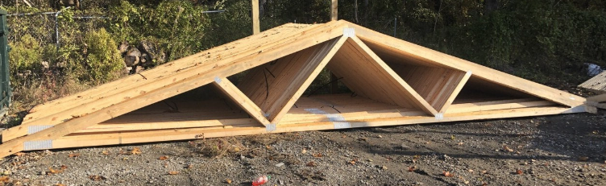
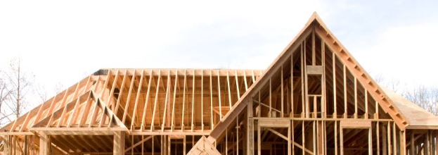
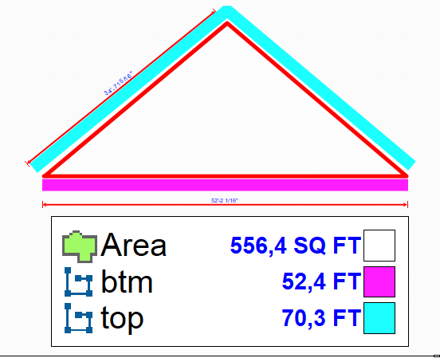

# Gable Walls (фронтоны)

<div class="kb-gallery">
  <a class="kb-gallery__item" href="../../../../assets/images/confluence/confluence-083.png">
    
    <div class="kb-gallery__caption">Gable truss: ферма с вертикальными стойками. Каркас by others, считаем только sheathing и слои.</div>
  </a>
  <a class="kb-gallery__item" href="../../../../assets/images/confluence/confluence-084.png">
    
    <div class="kb-gallery__caption">Gable stick: стена продолжена вверх стойками. Считаем plates, studs, blocking, bracing и sheathing.</div>
  </a>
</div>

## Что это

Gable - треугольник стены под двускатной крышей, от верха верхней доски
стены до конька. Два типа, и от типа зависит весь takeoff: **gable
trusses** (ферма, by others, наш только sheathing-пакет) и **gable stick**
(каркас наш целиком). Draft stop чердака живёт в той же ветке. Не путать с
[Truss Heel](../sheathing/truss-heel.md) (полоса пятки фермы) и
[Box Sheathing](../sheathing/box-sheathing.md) (полоса на уровне перекрытия).

## Где искать на чертежах

| Лист | Что взять |
| --- | --- |
| Roof framing plan, truss layout | `Trusses` = gable trusses; `2x8`, `2x10`, `TJI`, `stick` = gable stick |
| Фасады `el` | Контур треугольника, dormer, ступени, порч-фронтоны |
| Разрезы `sec` | Где кончается стена и начинается gable; высота стены |
| Draftstops plan (`a1-00` и подобные) | Линии draft stop чердака |
| Разрез чердака `a4` | Пролёт и подъём для треугольника draft stop |
| Wall notes, roof plan legend | Сечение 2x4 или 2x6, FRT, материал обшивки; материал draft stop |

## Как мерить в OurPlanCore

Ветка `gables/gable trusses/...` или `gables/gable stick/...`. Имя с
`gable truss` или `gable stick` само уходит в `gables`.

1. **Area** по реальной грани на фасаде: `gable` (trusses) или `gable stick`.
   Включай dormer, ступени и отверстия. Все фронтоны одного типа можно
   собрать несколькими полигонами в одной позиции.
2. Для stick ещё две **Line**: `btm` по верху стены (низ треугольника) и
   `top` по двум скатам.
3. Площадь от верхней грани top plate, не от низа стены. Один фронтон с двух
   фасадов рисуется один раз.
4. **Draft stop**: место с листа Draftstops Plan, профиль чердака (пролёт x
   подъём) с разреза. Area-треугольник на каждую линию: низ = пролёт, вершина
   под коньком. Ставить на архитектурном плане кровли, не на S-листе. Позиция
   `gables/gable trusses/draft stop`, свой цвет, листы-источники в Notes. У
   вальм треугольник меньше: пометь "проверь".
5. Fronton порча, гаража, storage - свои полигоны в том же дереве корпуса.

<figure markdown>
  
  <figcaption markdown="span">Так выглядит замер stick-фронтона: Area треугольника 556 SQ FT, линия btm 52.4 FT по верху стены, линия top 70.3 FT по скатам.</figcaption>
</figure>

## Как назвать в дереве и строка DFL

Кнопка `GB` полосы XL кладёт фронтоны в блок `Gable Walls`; макрос
`a2_sqft_gable_trussheel` читает площади и длины.

`BTM` и `TOP` - длины линий `btm` и `top` в LFT, `площадь` - Area фронтона
в SQ FT.

| Имя в дереве | Строка DFL | Unit (колонка D) | Формула / фактор |
| --- | --- | --- | --- |
| `gable stick/gable stick` + `btm` + `top` | `Plates Ext (3) btm and dbl top` 2x6 | LFT | `(BTM + 2 x TOP) x 1.1`, до чётного |
| то же | `Studs for Gables` 2x6 | штуки, D = `12` | `=EVEN(G/D)`: площадь gable stick / 12, до чётного |
| то же | `Blocking` 2x6 | LFT | `BTM / 2`, до чётного |
| то же | `Bracing Ext Walls` 2x4 | штуки, D = `14` | `BTM / 8 x 1.1`; фронтон ниже 7' в коньке строки не получает |
| оба типа | `Wall Sheathing` `7/16" Zip` или `1/2" Ply` | 4x8 | `площадь x 1.1 / 32`, вверх |
| оба типа, без Zip | `Vapor Barrier` (в B - WRB по спецификации) | SQ FT | `площадь x 1.1` |
| оба типа, без Zip | `Insulation` | SQ FT | `площадь x 1.1`; только continuous insulation снаружи обшивки |
| оба типа, Zip | `Tape` `Zip Tape` | LFT | `площадь x 0.4 x 1.1`, до 10 |
| `gable trusses/draft stop` | `Draft Stop` | SQ FT | `сумма треугольников x 1.1` |

Округление строк в SQ FT и LFT: результат меньше 50 - до 2, иначе до 10.

**Studs for Gables.** Стойки фронтона не считаются по шагу: у треугольника
каждая стойка своей длины. Шаблон берёт площадь: G = площадь gable stick в
SQ FT, D = `12` (заказная стойка 12', из неё режут короткие), C = `=EVEN(G/D)`,
то есть одна 12' стойка на каждые 12 SQ FT фронтона, до чётного. Фронтон
556 SQ FT: `556 / 12 = 46.3`, в книге 48 стоек по 12'.

**Draft Stop.** Единица `SQ FT`, не листы `4x8`. Материал в B - из легенды
roof plan или из разреза: по умолчанию `1/2" WR Gyp`; `7/16" OSB`, `1/2" Gyp`
или `5/8" Type X`, когда так написано на чертеже; листа с draft stop нет -
`TBD`. Обшивка с двух сторон: подпись `Draft Stop 2 sides`, G x 2. Строка
стоит в блоке Gable Walls после пустой строки.

При Zip строк `Vapor Barrier` и `Insulation` нет: барьер уже в листе, нужен
только `Tape`. Утеплитель между стойками by others в любом случае. У gable
trusses строк plates и studs нет. Материал обшивки и FRT - по notes наружной
стены ([Wall Sheathing](../sheathing/wall-sheathing.md)).

## Частые ошибки

- Draft stop чердака пропущен или скопирован из суммы shear walls: самый частый пропуск.
- Один фронтон посчитан дважды с двух фасадов или попал и в gable, и в обычную площадь стены.
- Площадь взята от низа стены, а не от верха top plate.
- У gable trusses выписаны plates и studs.
- Gable перепутан с truss heel или box sheathing: это разная геометрия.
- Площадь измерена, но в Excel осталась старая цифра.
- `Draft Stop` записан в листах `4x8` или с материалом по привычке, а не из легенды roof plan.

Разбор с примерами: [все ошибки по стенам](../../../start/common-mistakes.md#walls).

## Пример

```text
gables/
  gable trusses/
    gable          Area, 2 полигона, 812 SQ FT
    draft stop     Area, 3 треугольника, 390 SQ FT   Notes: A1-00, A4.1
Grge/gables/
  gable stick/
    gable stick    Area, 556 SQ FT
    btm            Line, 52.4 LFT
    top            Line, 70.3 LFT
```

Строки DFL из этих замеров (стена с Zip):

```text
Gable trusses
Wall Sheathing                  7/16" Zip      28   4x8     812 x 1.1 / 32 = 27.9
Tape                            Zip Tape      360   LFT     812 x 0.4 x 1.1 = 357.3

Draft Stop                      1/2" WR Gyp   430   SQ FT   390 x 1.1 = 429

Gable stick (Grge)
Plates Ext (3) btm and dbl top  2x6           214   LFT     (52.4 + 2 x 70.3) x 1.1 = 212.3
Studs for Gables                2x6            48   12      556 / 12 = 46.3
Blocking                        2x6            28   LFT     52.4 / 2 = 26.2
Bracing Ext Walls               2x4           7.2   14      52.4 / 8 x 1.1
Wall Sheathing                  7/16" Zip      20   4x8     556 x 1.1 / 32 = 19.1
Tape                            Zip Tape      250   LFT     556 x 0.4 x 1.1 = 244.6
```

## См. также

- [Gable Sheathing](../sheathing/gable.md), [Truss Heel](../sheathing/truss-heel.md), [Box Sheathing](../sheathing/box-sheathing.md)
- [Exterior Walls](exterior.md), [Demising Walls](demising.md): draft stop в перекрытии
- [Ridge](../../horizontal/roof-framing/ridge.md), [Формулы](../../../reference/formulas.md)
