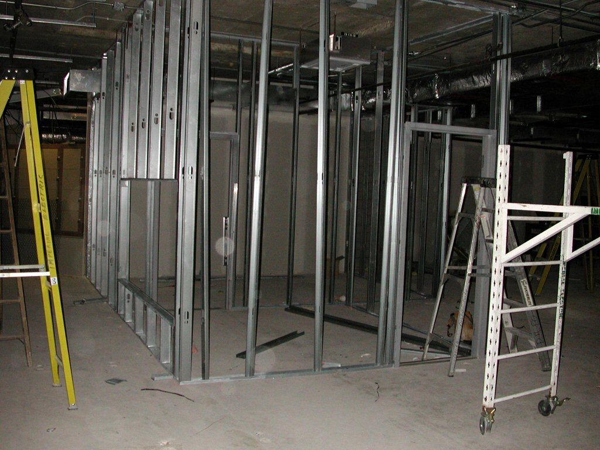
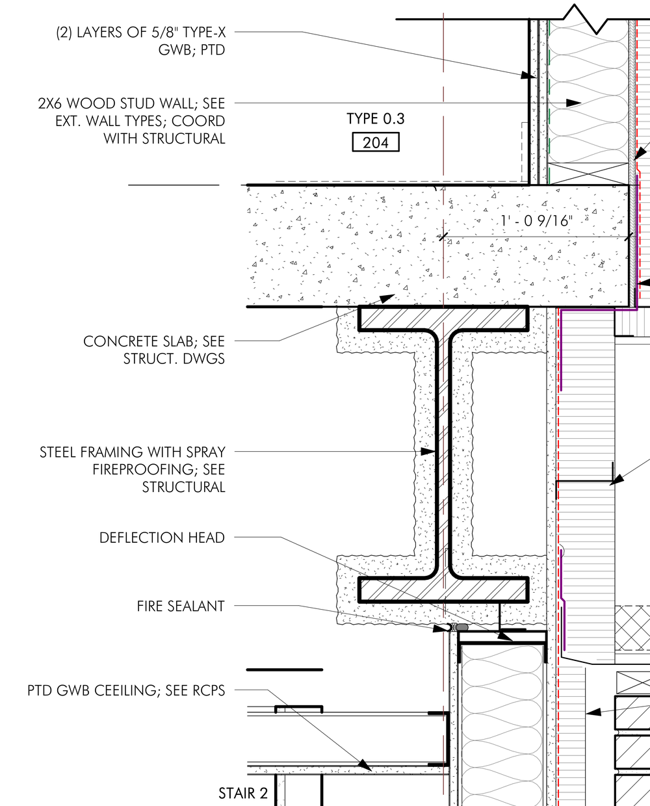

# Metal Tracks / CFMF

<figure markdown>
  
  <figcaption markdown="span">Light gauge metal framing: bottom track on the slab, C-section studs, an opening with a head track and doubled jamb studs. The whole sheathing package is counted the same as for a wood wall. Photo: Wikimedia Commons, public domain, [source](https://commons.wikimedia.org/wiki/File:Light_gage_metal_framing.JPG).</figcaption>
</figure>

## What it is

CFMF (cold-formed metal framing) is a steel wall frame instead of
a wood one. Two elements change: plates become **tracks**
(U-section at the bottom and top), studs become **mtl studs** (C-section).
Everything else (sheathing, WRB, insulation, gypsum, bracing, blocking)
stays and is counted as for a wood wall with the same function. Shafts built from
CH/H studs are a separate topic: [Shaft Walls](shaft.md).

| Element | Wood | Metal |
| --- | --- | --- |
| Wall bottom | btm plate | bottom track |
| Wall top | dbl top plate | top track or deflection track |
| Studs | studs | mtl studs (`6" 18ga`) |
| Opening | king/jack, header | double jamb stud, head track, box header |
| Sheathing, WRB, insulation, gypsum, bracing, blocking | as for wood | the same |

## Where to find it on the plans

| Sheet | What to take |
| --- | --- |
| Wall type schedule, WT sheets | Stud size (`6"`, `3 5/8"`, `2 1/2"`), gauge, layers, rating |
| Section details (`a402`) | Deflection head, wall-to-beam or wall-to-floor joint |
| Structural notes, cover sheet | CFMF, GA, X-bracing, deflection requirements |
| Plans | Wall length by type and floor |
| Scope, client rules | Metal is ours or by others: [Client rules](../../../start/client-rules.md) |

## How to measure in OurPlanCore

**Line** tool, LFT unit, as for a wood wall, in
`walls/<floor> floor walls`.

1. Scope first: if metal is by others, the walls are still traced, but the DFL
   gets `0` and the note `Metal Studs by others; verify`. The sheathing package
   can still be ours.
2. Name with stud size, gauge and height: `ext 6" 18ga mtl 11.7`; the wall
   type from the schedule can be added at the end: `ext 11.7 E2A (mtl 11.7)`.
3. Under a steel beam split the height into pieces: the run under the beam (6" track)
   and the run next to it (3 1/2") are different takeoffs.
4. Spacing 16 or 24 per the wall schedule, each takeoff has its own.
5. Write the wall clear span once as a note before the block (`ext wall 14.5 clear span`).

## Takeoff name and DFL row

| Takeoff name | DFL row | Unit | Formula / factor |
| --- | --- | --- | --- |
| `ext 6" 18ga mtl 11.7` | `Tracks (1) btm` `6" 18ga` | LFT | `LFT x 1.1` |
| same | `Deflection Tracks (1) top` | LFT | `LFT x 1.1`; on walls that run up to the structure above |
| same | `Tracks (1) top` | LFT | `LFT x 1.1`; plain top track on walls that stop short of the structure (under a dropped soffit, partial height) |
| same | `Mtl Studs 16" o.c.` `6" 18ga mtl` | pieces, D = stud height | `LFT x 1.1` (16") or `x 0.625` (24") |
| same | extra studs, double jambs, `Head Track` at openings | pcs, LFT | per opening |
| same | `Wall Sheathing` (including `5/8" Type X` gypsum), `Vapor Barrier` (B = the barrier product), `Insulation` (continuous only), `Bracing Ext Walls` (pieces), `Blocking` | | as for wood |
| `2x4` jamb in a metal wall | `Jambs (2)` `2x4` (the number in brackets = boards per side per the detail) | LFT | `(W + 2H) x number of doors x 2 x 1.1`; wood in a metal wall is normal. Window and storefront jambs go on a `Jambs` row in Wall Materials |

Every wall has one top track: either `Deflection Tracks (1) top` or
`Tracks (1) top`. Check: top track LFT = bottom track LFT. Row order in the
block: `Tracks (1) btm`, the top track, `Mtl Studs`.

For a CFS building the fasteners are metal. Group by stud size, floor and
wall type (ext, int, dem, corr). If the gauge is given on the plans, it goes into the
takeoff spec; if not, add a note and check against the structural sheets.

??? note "Deflection track, gauge and jambs: details"
    **Deflection track** (slip, slotted, deep-leg) is the top track where the wall meets
    the structure above. The stud sits in it but is not fastened rigidly, so the
    floor can deflect without loading the wall. Required on non-bearing
    partitions under the structure, rated and shaft walls; walls that stop short of the
    floor framing do not have it. Check the type and leg depth against the details.

    **GA (gauge)** is the steel thickness, and the rule runs backwards: a smaller number means thicker
    steel. 25ga light partitions, 20/18ga medium, 16ga and heavier structural.

    **Jambs**: the jamb of an opening in a metal wall is often wood `2x4`,
    doubled on wide openings (`(2)2x4` or a doubled stud); a head
    track on top, extra studs at the sides. A box header bears on the doubled jamb studs.

<figure markdown>
  
  <figcaption markdown="span">Deflection head where the wall meets a steel beam: fireproofing, fire sealant, two layers of 5/8" Type X. The deflection track is a separate row from the bottom track.</figcaption>
</figure>

## Common mistakes

- Only tracks and studs counted for a metal wall, without sheathing, WRB, insulation, gypsum.
- Metal by others, but no `Metal Studs by others` note: neither a row nor a note.
- Deflection track used on a wall that does not reach the floor framing: that wall gets a plain `Tracks (1) top`.
- No top track written at all: only `Tracks (1) btm` is there.
- Gauge made up, or `24" o.c.` copied when the spec says `16"`.
- Height under a steel beam not split into 6" and 3 1/2" pieces.
- Wood jamb in a metal wall missed.

Walkthrough with examples: [all wall mistakes](../../../start/common-mistakes.md#walls).

## Example

```text
walls/1st floor walls/
  ext 6" 18ga mtl 14.5        Line, 96.0 LFT    Notes: E2A, ext wall 14.5 clear span
  ext 6" 18ga mtl 3.5         Line, 24.0 LFT    Notes: under W14 beam, 2/A402
  int 3 5/8" 20ga mtl 10.0    Line, 140.2 LFT   Notes: by others, sheathing ours
```

## See also

- [Exterior Walls](exterior.md), [Shaft Walls](shaft.md), [Basement Walls](basement.md)
- [Exterior Wall Materials](../sheathing/exterior-materials.md): what stays ours on metal walls
- [Window Flashing](../openings/window-flashing.md): the `at Mtl Walls` rows
- [Formulas: stud factors](../../../reference/formulas.md#stud-spacing-factors)
