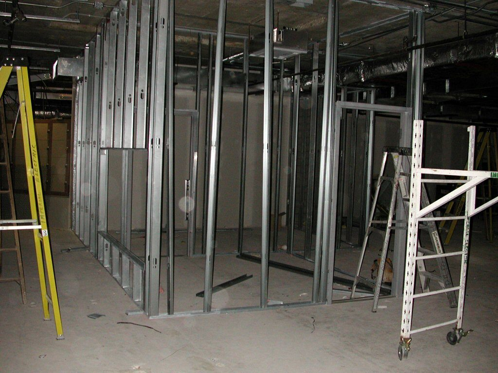
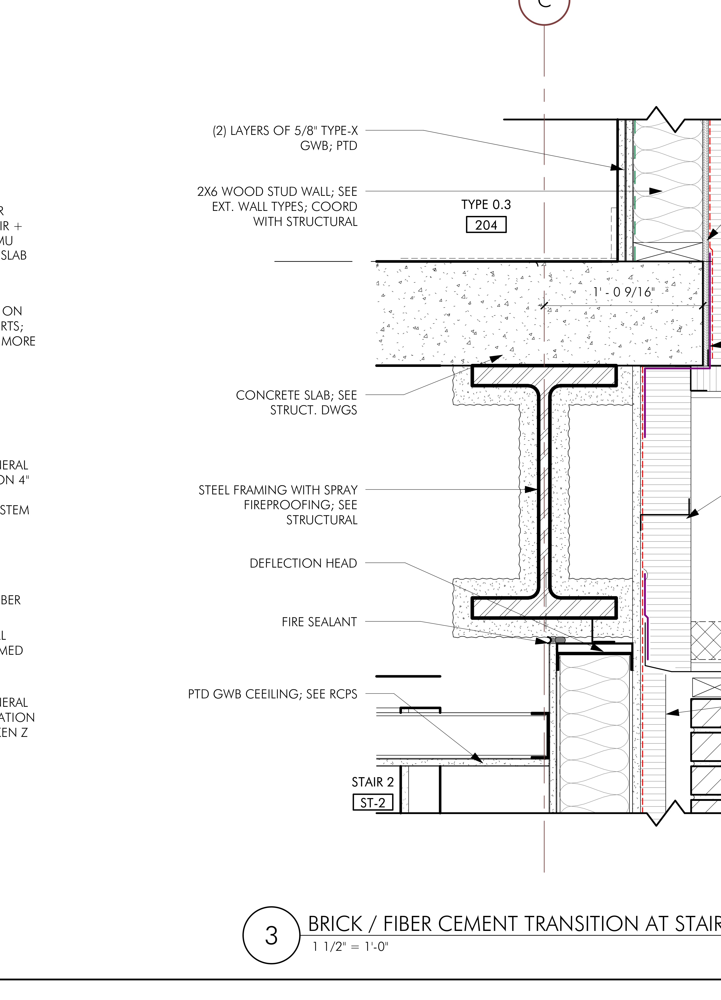

# Metal Tracks / CFMF (металлический каркас стен)

<figure markdown>
  
  <figcaption markdown="span">Light gauge metal framing: bottom track на плите, C-профили studs, проём с head track и сдвоенными jamb-студами. Весь пакет обшивки считается как у деревянной стены. Фото: Wikimedia Commons, public domain, [источник](https://commons.wikimedia.org/wiki/File:Light_gage_metal_framing.JPG).</figcaption>
</figure>

## Что это

CFMF (cold-formed metal framing) - стальной каркас стены вместо
деревянного. Меняются два элемента: plates становятся **tracks**
(U-профиль снизу и сверху), studs становятся **mtl studs** (C-профиль).
Всё остальное (sheathing, WRB, insulation, gypsum, bracing, blocking)
остаётся и считается как у деревянной стены той же функции. Шахты из
CH/H-профилей - отдельная тема: [Shaft Walls](shaft.md).

| Элемент | Дерево | Металл |
| --- | --- | --- |
| Низ стены | btm plate | bottom track |
| Верх стены | dbl top plate | top track или deflection track |
| Стойки | studs | mtl studs (`6" 18ga`) |
| Проём | king/jack, header | double jamb stud, head track, box header |
| Обшивка, WRB, insulation, gypsum, bracing, blocking | как у дерева | так же |

## Где искать на чертежах

| Лист | Что взять |
| --- | --- |
| Wall type schedule, WT-листы | Размер профиля (`6"`, `3 5/8"`, `2 1/2"`), gauge, слои, rating |
| Section details (`a402`) | Deflection head, стык стены с балкой или перекрытием |
| Structural notes, cover sheet | CFMF, GA, X-bracing, требования к deflection |
| Планы | Длина стен по типу и этажу |
| Scope, client rules | Металл наш или by others: [Правила клиентов](../../../start/client-rules.md) |

## Как мерить в OurPlanCore

Инструмент **Line**, единица LFT, как у деревянной стены, в
`walls/<этаж> floor walls`.

1. Сначала scope: если металл by others, стены всё равно обводятся, а в DFL
   ставится `0` и нота `Metal Studs by others; verify`. Пакет обшивки при
   этом может остаться нашим.
2. Имя с размером профиля, gauge и высотой: `ext 6" 18ga mtl 11.7`; тип
   стены по schedule можно добавить в конец: `ext 11.7 E2A (mtl 11.7)`.
3. Под стальной балкой высоту дели на куски: участок под балкой (6" track)
   и участок рядом (3 1/2") - разные позиции.
4. Шаг 16 или 24 - по wall schedule, у каждой позиции свой.
5. Clear span стены пиши один раз нотой перед блоком (`ext wall 14.5 clear span`).

## Как назвать в дереве и строка DFL

| Имя в дереве | Строка DFL | Unit | Формула / фактор |
| --- | --- | --- | --- |
| `ext 6" 18ga mtl 11.7` | `Tracks (1) btm` `6" 18ga` | LFT | `LFT x 1.1` |
| то же | `Deflection Tracks (1) top` | LFT | `LFT x 1.1`; только у стен до перекрытия |
| то же | `Mtl Studs 16" o.c.` `6" 18ga mtl` | pcs | `LFT x 1.1` (16") или `x 0.625` (24") |
| то же | extra studs, double jambs, `Head Track` у проёмов | pcs, LFT | по проёмам |
| то же | `Wall Sheathing`, `Air / Water Barrier`, `Insulation`, `Gypsum 5/8" Type X`, `Bracing`, `Blocking` | | как у дерева |
| `2x4` jamb в металлической стене | `Window Jamb` `2x4` | LFT | дерево в металле - норма |

Для CFS-корпуса крепёж металлический. Группируй по сечению профиля, этажу и
типу стены (ext, int, dem, corr). Если gauge задан на чертеже, он идёт в
спецификацию позиции; не задан - нота и сверка со структурой.

??? note "Deflection track, gauge и jambs: подробности"
    **Deflection track** (slip, slotted, deep-leg) - верхний трек на стыке с
    конструкцией сверху. Стойка заходит в него, но не крепится жёстко, и
    перекрытие может прогибаться, не нагружая стену. Обязателен у non-bearing
    перегородок под структурой, rated и shaft стен; у стен, не доходящих до
    перекрытия, его нет. Тип и глубину полок сверяй по деталям.

    **GA (gauge)** - толщина стали, правило обратное: меньше число - толще
    сталь. 25ga лёгкие перегородки, 20/18ga средние, 16ga и толще structural.

    **Jambs**: косяк проёма в металлической стене часто деревянный `2x4`,
    на широких проёмах двойной (`(2)2x4` или сдвоенный stud); сверху head
    track, по краям extra studs. Box header опирается на сдвоенные jamb-студы.

<figure markdown>
  
  <figcaption markdown="span">Deflection head на стыке стены со стальной балкой: fireproofing, fire sealant, два слоя 5/8" Type X. Deflection track - отдельная строка от bottom track.</figcaption>
</figure>

## Частые ошибки

- У металлической стены посчитаны только треки и студы, без sheathing, WRB, insulation, gypsum.
- Металл by others, а ноты `Metal Studs by others` нет: ни строки, ни ноты.
- Deflection track поставлен у стены, которая не доходит до перекрытия.
- Gauge придуман или `24" o.c.` скопирован при spec `16"`.
- Высота под стальной балкой не разделена на 6" и 3 1/2" куски.
- Деревянный jamb в металлической стене пропущен.

Разбор с примерами: [все ошибки по стенам](../../../start/common-mistakes.md#walls).

## Пример

```text
walls/1st floor walls/
  ext 6" 18ga mtl 14.5        Line, 96.0 LFT    Notes: E2A, ext wall 14.5 clear span
  ext 6" 18ga mtl 3.5         Line, 24.0 LFT    Notes: under W14 beam, 2/A402
  int 3 5/8" 20ga mtl 10.0    Line, 140.2 LFT   Notes: by others, sheathing ours
```

## См. также

- [Exterior Walls](exterior.md), [Shaft Walls](shaft.md), [Basement Walls](basement.md)
- [Exterior Wall Materials](../sheathing/exterior-materials.md): что остаётся нашим на metal стенах
- [Window Flashing](../openings/window-flashing.md): строки `at Mtl Walls`
- [Формулы: stud factors](../../../reference/formulas.md#stud-spacing-factors)
