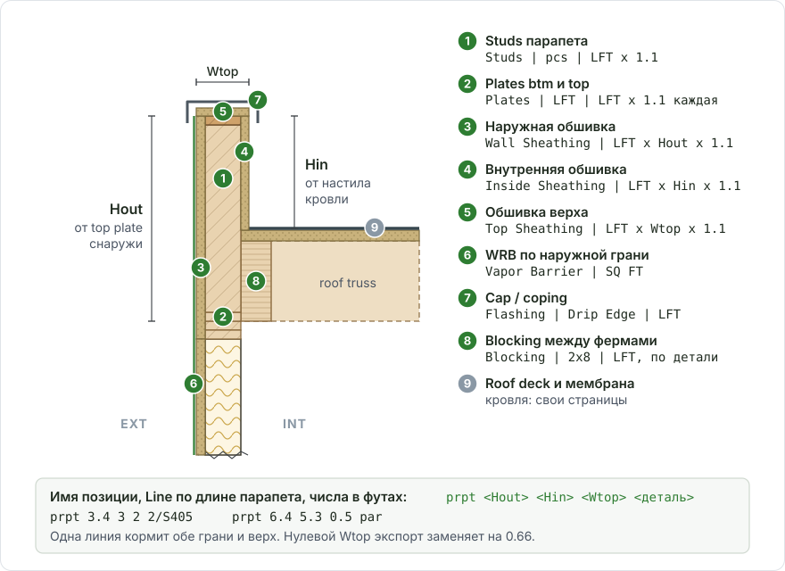
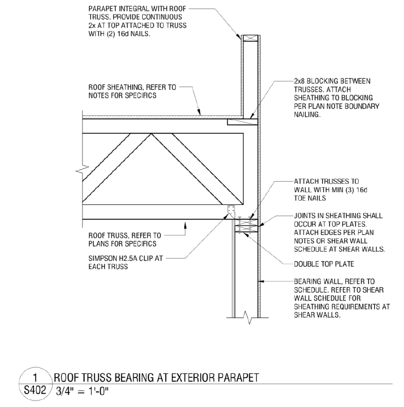

# Parapet Walls

<figure markdown>
  
  <figcaption markdown="span">Parapet in section: outside height Hout from the top of the wall, inside height Hin from the roof, top width Wtop. Three sheathing planes (outside, inside, top) plus cap and flashing.</figcaption>
</figure>

<!-- TODO-PHOTO: wood framed parapet wall on flat roof under construction, EN query "wood parapet wall framing flat roof construction" -->

## What it is

A parapet is the exterior wall carried up above a flat roof. It has two
different heights (outside from the wall's top plate, inside from the roof deck)
and a top that is sheathed too. The parapet is either built into the truss (parapet
integral with truss) or a separate frame on the wall. Parapets built on the roof
are counted separately from wall parapets.

## Where to find it on the plans

| Sheet | What to take |
| --- | --- |
| Roof plan `a105 rf` | Parapet lines, zones (upper roof, lower roof, porch) |
| Parapet details (`1/S402`, `2/S405`) | Hout, Hin, Wtop, blocking between trusses, cap plate, clips |
| Arch details | Coping, flashing, inside face material (DensDeck, plywood) |
| Wall notes | FRT: if the exterior wall is FRT, the parapet and blocking are FRT too |
| Truss drawings | Parapet integral with truss or not |

<figure markdown>
  
  <figcaption markdown="span">Parapet integral with truss: continuous 2x on top, 2x8 blocking between trusses, double top plate, H2.5A at every truss. Sheathing is not in the truss package: we count it ourselves.</figcaption>
</figure>

## How to measure in OurPlanCore

**Line** tool, LFT unit, along the parapet on the roof plan. A name with
`prpt` goes into the `parapets` branch by itself.

1. Name `prpt <Hout> <Hin> <Wtop> <detail>` in feet: `prpt 6.4 5.3 0.5 par`,
   `prpt 3.4 3 2 2/S405`. Three numbers first, then the detail number or zone:
   the `A4_Parapet` macro reads the numbers from the end, and `2/S405` before the dimensions
   breaks the parsing.
2. A separate takeoff for each pair of heights, set of faces, roof zone
   (`parapets/lower roof/...`), concrete or wood, parallel or perpendicular.
3. One line feeds both faces and the top: do not duplicate the length per surface.
4. The exporter replaces a zero Wtop with 0.66: an export quirk, not a dimension.
   A height of 0 can be real.
5. Write the top part (cap, top) together with the parapet: it is one assembly.

## Takeoff name and DFL row

The `PP` button on the XL strip moves parapets into the `Parapet Walls` block.

| Takeoff name | DFL row | Unit | Formula / factor |
| --- | --- | --- | --- |
| `prpt 3.4 3 2 2/S405` | `Studs` (size by height) | pcs | `LFT x 1.1` |
| same | `Plates btm` and `top` (cap is often `2x6 P.T.`) | LFT | `LFT x 1.1` each |
| same | `Wall Sheathing` outside | SQ FT or 4x8 | `LFT x Hout x 1.1` |
| same | `Inside Sheathing` (OSB, plywood, DensDeck per detail) | SQ FT | `LFT x Hin x 1.1` |
| same | `Top Sheathing` | SQ FT | `LFT x Wtop x 1.1` |
| same | `Vapor Barrier` (WRB per spec), `Insulation` | SQ FT | on the outside face |
| same | `Flashing` `Drip Edge`, coping on a separate row or in Drip Edge | LFT | `LFT` |
| same | `Blocking (2) 2x8 FRT` between trusses, `2x6`/`2x8` around the rim | LFT | per detail |

If the trusses bear perpendicular to the wall, the parapet is a separate stud wall;
if parallel, the top-floor wall is carried up. Top-floor box sheathing
is written into the parapet with a note.

## Common mistakes

- Top sheathing forgotten: there are three sheathing faces, not one.
- Detail number placed before the numbers: `prpt 2/S405 3.4 3 2`.
- `x 2` on top and bottom read as two layers, when it means two surfaces.
- Blocking `(2) 2x8 FRT` from the detail not listed.
- Unrealistic cut: two 5.3' boards do not come out of one 10'.
- Inside face written as OSB although the detail calls for DensDeck.

Walkthrough with examples: [all wall mistakes](../../../start/common-mistakes.md#walls).

## Example

```text
parapets/
  upper roof/
    prpt 3.4 3 2 2/S405      Line, 212.0 LFT
    prpt 1.2 1.2 0.6         Line, 48.5 LFT    (low parapet at the porte-cochere)
  lower roof/
    prpt 6.4 5.3 0.5 par     Line, 96.0 LFT
    prpt 6.4 5.3 0.5 perp    Line, 60.2 LFT
```

## See also

- [Exterior Walls](exterior.md), [Truss Heel](../sheathing/truss-heel.md), [Box Sheathing](../sheathing/box-sheathing.md)
- [Flashing](../../sheathing-and-misc/flashing.md), [Roof SQFT](../../sqfts/roof.md)
- [Takeoff names](../../../reference/takeoff-naming.md)
