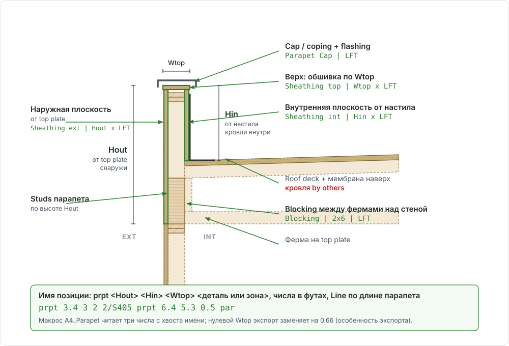
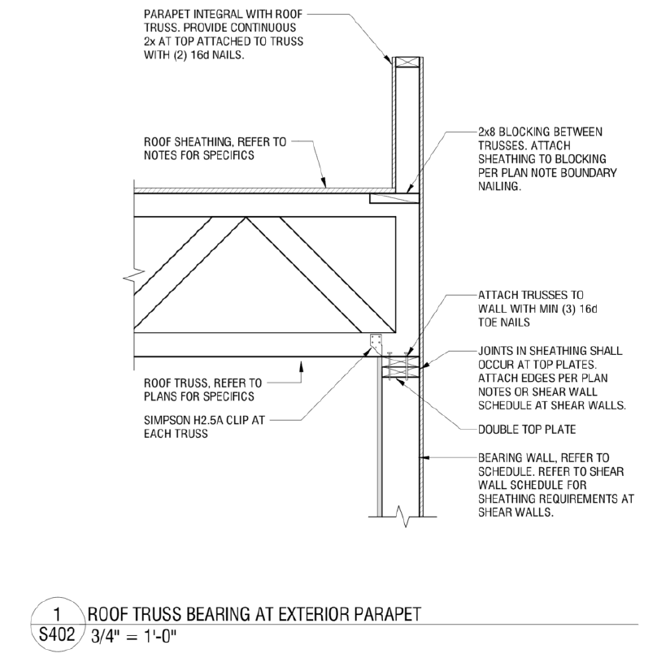

# Parapet Walls (парапеты)

<figure markdown>
  
  <figcaption markdown="span">Парапет в разрезе: наружная высота Hout от верха стены, внутренняя Hin от кровли, ширина верха Wtop. Три плоскости обшивки (наружная, внутренняя, верх) плюс cap и flashing.</figcaption>
</figure>

<!-- TODO-PHOTO: wood framed parapet wall on flat roof under construction, EN query "wood parapet wall framing flat roof construction" -->

## Что это

Parapet - продолжение наружной стены выше плоской кровли. У него две
разные высоты (снаружи от верхней доски стены, изнутри от настила кровли)
и верх, который тоже обшивается. Парапет либо встроен в ферму (parapet
integral with truss), либо это отдельный каркас на стене. Загнутые парапеты,
построенные на крыше, считаются отдельно от стеновых.

## Где искать на чертежах

| Лист | Что взять |
| --- | --- |
| Roof plan `a105 rf` | Линии парапетов, зоны (upper roof, lower roof, porch) |
| Детали у парапета (`1/S402`, `2/S405`) | Hout, Hin, Wtop, blocking между фермами, cap plate, clips |
| Arch details | Coping, flashing, материал внутренней стороны (DensDeck, plywood) |
| Wall notes | FRT: если наружная стена FRT, парапет и blocking тоже FRT |
| Truss drawings | Parapet integral with truss или нет |

<figure markdown>
  
  <figcaption markdown="span">Parapet integral with truss: continuous 2x по верху, 2x8 blocking между фермами, double top plate, H2.5A на каждой ферме. Sheathing в truss-пакет не входит: считаем сами.</figcaption>
</figure>

## Как мерить в OurPlanCore

Инструмент **Line**, единица LFT, вдоль парапета на плане кровли. Имя с
`prpt` само уходит в ветку `parapets`.

1. Имя `prpt <Hout> <Hin> <Wtop> <деталь>` в футах: `prpt 6.4 5.3 0.5 par`,
   `prpt 3.4 3 2 2/S405`. Сначала три числа, потом номер детали или зона:
   макрос `A4_Parapet` читает числа с хвоста, и `2/S405` перед размерами
   сломает разбор.
2. Отдельная позиция на каждую пару высот, состав сторон, зону кровли
   (`parapets/lower roof/...`), бетон или дерево, parallel или perpendicular.
3. Одна линия кормит обе грани и верх: длину по числу поверхностей не дублируй.
4. Нулевой Wtop экспортёр заменяет на 0.66: это особенность экспорта, не размер.
   Высота 0 бывает настоящей.
5. Верхнюю часть (cap, top) пиши вместе с парапетом: это одна конструкция.

## Как назвать в дереве и строка DFL

Кнопка `PP` полосы XL переносит парапеты в блок `Parapet Walls`.

| Имя в дереве | Строка DFL | Unit | Формула / фактор |
| --- | --- | --- | --- |
| `prpt 3.4 3 2 2/S405` | `Studs` (размер по высоте) | pcs | `LFT x 1.1` |
| то же | `Plates btm` и `top` (cap часто `2x6 P.T.`) | LFT | `LFT x 1.1` на каждую |
| то же | `Wall Sheathing` наружная | SQ FT или 4x8 | `LFT x Hout x 1.1` |
| то же | `Inside Sheathing` (OSB, plywood, DensDeck по детали) | SQ FT | `LFT x Hin x 1.1` |
| то же | `Top Sheathing` | SQ FT | `LFT x Wtop x 1.1` |
| то же | `Vapor Barrier` (WRB по спецификации), `Insulation` | SQ FT | по наружной грани |
| то же | `Flashing` `Drip Edge`, coping отдельной строкой или в Drip Edge | LFT | `LFT` |
| то же | `Blocking (2) 2x8 FRT` между фермами, `2x6`/`2x8` вокруг rim | LFT | по детали |

Если фермы опираются перпендикулярно стене, парапет - отдельный stud wall;
если параллельно, стена последнего этажа продлевается вверх. Box sheathing
верхнего этажа записывается в парапет с нотой.

## Частые ошибки

- Top sheathing забыт: обшивки три, не одна.
- Номер детали поставлен перед числами: `prpt 2/S405 3.4 3 2`.
- `x 2` на top и bottom прочитан как два слоя, а это две поверхности.
- Blocking `(2) 2x8 FRT` из детали не выписан.
- Раскрой нереальный: две доски 5.3' из одной 10' не выходят.
- Внутренняя сторона записана OSB, хотя деталь даёт DensDeck.

Разбор с примерами: [все ошибки по стенам](../../../start/common-mistakes.md#walls).

## Пример

```text
parapets/
  upper roof/
    prpt 3.4 3 2 2/S405      Line, 212.0 LFT
    prpt 1.2 1.2 0.6         Line, 48.5 LFT    (низкий парапет у porte-cochere)
  lower roof/
    prpt 6.4 5.3 0.5 par     Line, 96.0 LFT
    prpt 6.4 5.3 0.5 perp    Line, 60.2 LFT
```

## См. также

- [Exterior Walls](exterior.md), [Truss Heel](../sheathing/truss-heel.md), [Box Sheathing](../sheathing/box-sheathing.md)
- [Flashing](../../sheathing-and-misc/flashing.md), [Roof SQFT](../../sqfts/roof.md)
- [Имена takeoffs](../../../reference/takeoff-naming.md)
