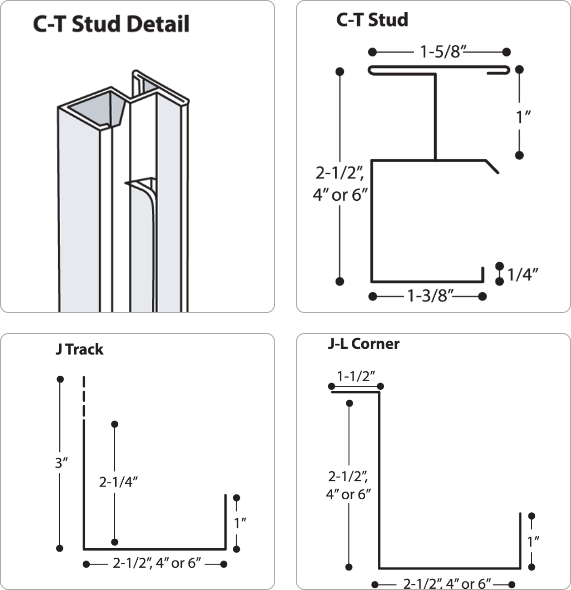
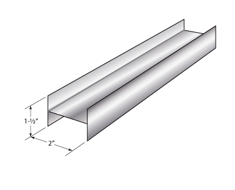
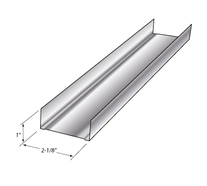

# Shaft Walls

<figure markdown>
  
  <figcaption markdown="span">Type 2 assembly: 1" x 24" shaftliner panels between 2" H-studs, 2" C-runner around the perimeter. Source: PABCO Gypsum, H-Stud ASW.</figcaption>
</figure>

## What it is

A shaft wall encloses a vertical shaft: elevator, vent duct, trash chute,
mechanical. It is almost always fire-rated and almost always built from metal
studs with a gypsum liner, so it is neither a regular partition nor
[Metal Tracks](metal-tracks.md). Two working types: `2-1/2" CH + J-channel`
(a shaft, liner on one side) and `2" H + C-channel` (an area separation wall
between units, liner on both sides). Take the system from the UL detail; the two are
never mixed in one wall. A CMU elevator gives no wood
or liner framing.

## Where to find it on the plans

| Sheet | What to take |
| --- | --- |
| Floor plans `a101` | Where the shafts actually are: elevator, chute, vent, mech |
| Wall type schedule (`wt`), type `7A` and similar | CH or H, stud size, liner layers, gypsum outside |
| Shaft details `a806` | Perimeter channels, joint with the floor framing, transition to wood |
| Sections | Shaft height by floor; where the shaft stops above the ceiling |
| S plans | Hangers over the shaft (`DHU`) when joists bear over a fire wall |

## How to measure in OurPlanCore

**Line** tool, LFT unit, around the shaft perimeter on the plan of each floor.
One takeoff per assembly type and height; branch `walls/<floor> floor walls`,
the takeoff is named `shaft`, then the wall type and height (for example `shaft 7A 10.5`).
The height in the name is required: panels and vertical channels are figured from the
wall **area** (length x height), not from the length.
The `SHF` button on the XL strip builds the Shaft walls block above the first framing sheet.

1. A typical detail is not a quantity by itself: find every shaft on the plan.
2. Always record the material: CMU elevator, metal shaftliner, wood. Do not
   throw a shaft out because of a general note `walls are panels by others`.
3. Do not multiply a wood-to-shaft transition above the ceiling by the full floor height.
4. If the wall type gives a shaft assembly but the plan shows only resilient channel,
   count the resilient channel separately, not a full shaft.

## Takeoff name and DFL row

What goes into G:

- **Area** = length of the shaft walls (LFT) x height, summed over all floors, in SQ FT.
  This is G of the panel rows and the vertical channel rows.
- **Length** = LFT of the shaft walls, summed over the floors. Only the horizontal and
  perimeter channels are figured from it.
- The `24` in the panel formula is the area of one 2' x 12' panel (24 SQ FT), so only an
  area can be divided by 24. If a length lands in G, the panel count comes out short by a
  factor equal to the wall height.

Type 1, `2-1/2" CH + J-channel`, liner on one side:

| DFL row | Material (B) | D | Formula C | G |
| --- | --- | --- | --- | --- |
| `Linear Panels` | `1" Shaft Panels` | `12`, E = `2x12 Panels` | `=CEILING(G*1.1/24,2)` | area |
| `CH Channels Vertical` | `2 1/2" CH-channels` | `12` | `=CEILING(G*0.5*1.1/D,2)` | the same area; `0.5` = a stud every 24" |
| `J Channels Horizontal` | `2 1/2" J-channels` | `12` | `=CEILING(G*1.1/D,2)` | length x 2 (top and bottom) |

Type 2, `2" H + C-channel` (area separation wall), liner on both sides:

| DFL row | Material (B) | D | Formula C | G |
| --- | --- | --- | --- | --- |
| `Linear Panels` | `1" Shaft Panels` | `12`, E = `2x12 Panels` | `=CEILING(G*2*1.1/24,2)` | area of one face; `x 2` = both faces |
| `Channels Vertical` | `2" H-channels` | `12` | `=CEILING(G*0.5*1.1/D,2)` | area of one face |
| `Channels Horizontal` | `2" H-channels` | `12` | `=CEILING(G*2*1.1/D,2)` | length; `x 2` = top and bottom |
| `Channels Perimeter` | `2" C-channels` | `12` | `=CEILING(G*1.1/D,2)` | wall perimeter in LFT per the detail |

- D is the stock length in feet (usually 12), C is the number of pieces, rounded to 2.
- Studs at 16" o.c.: factor `0.75` instead of `0.5` and the label `CH Channels Vertical 16" o.c.`.
- 10' panels per the detail: divisor `20`, D `10`, E = `2x10 Panels`.
- Stud size (`2 1/2"`, `3"`, `4"`) comes from the wall type. The `x 2` on the panels is
  for Type 2 only: a one-sided shaft never gets it.

Full breakdown of the formulas: [Formulas: Shaft Walls](../../../reference/formulas.md#shaft-walls).
Without a detail, write the assembly with `assumed; verify`. Resilient channels:
`CEILING(area x 12 / spacing x 1.1, 10)` only where shown in the wall type;
metal RC under the floor framing is usually by others.

<div class="kb-gallery">
  <a class="kb-gallery__item" href="../../../../assets/images/confluence/confluence-129.png">
    
    <div class="kb-gallery__caption">Type 1: C-T (CH) stud 2-1/2", 4", 6", J-track and J-L corner. Size from the wall type.</div>
  </a>
  <a class="kb-gallery__item" href="../../../../assets/images/walls/shaft-h-stud.png">
    
    <div class="kb-gallery__caption">Type 2: 2" H-stud, the panels slide into the slots on both sides.</div>
  </a>
  <a class="kb-gallery__item" href="../../../../assets/images/walls/shaft-c-runner.png">
    
    <div class="kb-gallery__caption">Type 2: 2" C-runner around the perimeter: top, bottom, end cap.</div>
  </a>
  <a class="kb-gallery__item" href="../../../../assets/images/confluence/confluence-131.jpg">
    
    <div class="kb-gallery__caption">1" shaftliner: one layer in Type 1, two layers in Type 2. A separate row.</div>
  </a>
</div>

## Common mistakes

- A CMU elevator written as shaftliner, or a type 7A chute wall missed altogether.
- Shafts thrown out as "panels by others".
- Two types mixed into one block: they have different channels and different formulas.
- A wood-to-shaft transition multiplied by the full floor height.
- Hangers over the shaft taken as `ITS` instead of `DHU` per detail.
- Resilient channel counted as a full shaft.
- G of the panel row holds a length instead of an area: a 64 LFT x 10.5' shaft gives 4 panels instead of 32.

Walkthrough with examples: [all wall mistakes](../../../start/common-mistakes.md#walls).

## Example

```text
walls/2nd floor walls/
  shaft 7A 10.5        Line, 64.0 LFT     Notes: A806 det 3, 2-1/2" CH + 1" liner
  shaft elev 10.5      Line, 48.0 LFT     Notes: CMU per S201, framing by others
```

DFL rows for `shaft 7A 10.5`. Area = 64 x 10.5 = 672 SQ FT, length = 64 LFT:

```text
Linear Panels           1" Shaft Panels       32   12   2x12 Panels   672 x 1.1 / 24 = 30.8
CH Channels Vertical    2 1/2" CH-channels    32   12                 672 x 0.5 x 1.1 / 12 = 30.8
J Channels Horizontal   2 1/2" J-channels     12   12                 64 x 2 x 1.1 / 12 = 11.7
```

## See also

- [Formulas: Shaft Walls](../../../reference/formulas.md#shaft-walls), [Demising Walls](demising.md)
- [Metal Tracks](metal-tracks.md), [Hangers](../../../reference/hangers.md)
- [Wall Panels](wall-panels.md): a shaft is not excluded by a general note
