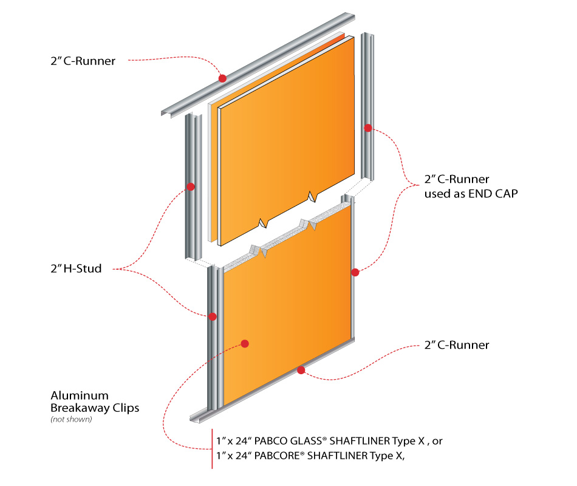
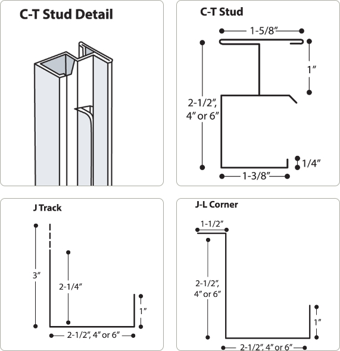
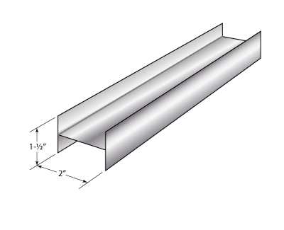
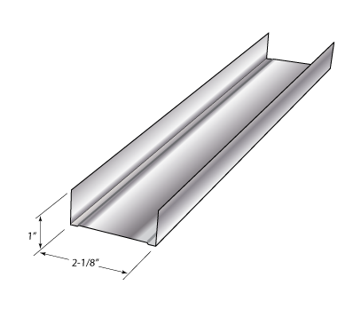
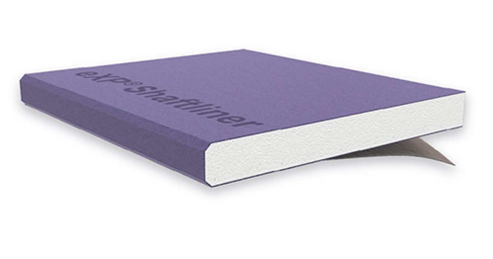

# Shaft Walls (стены шахт)

<figure markdown>
  
  <figcaption markdown="span">Сборка Type 2: панели 1" x 24" shaftliner между 2" H-studs, по периметру 2" C-runner. Источник: PABCO Gypsum, H-Stud ASW.</figcaption>
</figure>

## Что это

Shaft wall - ограждение вертикальной шахты: лифт, вентканал, trash chute,
mechanical. Почти всегда fire-rated и почти всегда из металлических
профилей с гипсовым liner, поэтому это не обычная перегородка и не
[Metal Tracks](metal-tracks.md). Два рабочих типа: `2-1/2" CH + J-channel`
(один слой liner) и `2" H + C-channel` (два слоя). Лифт из CMU деревянного
или liner-каркаса не даёт.

## Где искать на чертежах

| Лист | Что взять |
| --- | --- |
| Планы этажей `a101` | Где реально стоят шахты: лифт, chute, vent, mech |
| Wall type schedule (`wt`), тип `7A` и подобные | CH или H, размер профиля, слои liner, gypsum снаружи |
| Детали шахты `a806` | Перимeтральные channels, стык с перекрытием, переход в дерево |
| Разрезы | Высота шахты по этажам; где шахта кончается выше потолка |
| S-планы | Hangers над шахтой (`DHU`), когда joists заходят над fire wall |

## Как мерить в OurPlanCore

Инструмент **Line**, единица LFT, по периметру шахты на плане каждого этажа.
Своя позиция на тип сборки и высоту; ветка - `walls/<этаж> floor walls`,
позиция называется `shaft`, дальше тип стены и высота (например `shaft 7A 10.5`).
Кнопка `SHF` полосы XL собирает блок Shaft walls над первым framing-листом.

1. Типовая деталь сама по себе не количество: найди каждую шахту на плане.
2. Материал фиксируй всегда: CMU-лифт, metal shaftliner, дерево. Шахту не
   выбрасывай по общей ноте `walls are panels by others`.
3. Переход дерево-шахта выше потолка не множь на полную высоту этажа.
4. Если wall type даёт shaft assembly, а план только resilient channel,
   считай resilient channel отдельно, не полную шахту.

## Как назвать в дереве и строка DFL

Type 1, `2-1/2" CH + J-channel`, один слой liner:

| Строка DFL | Материал | Unit | Формула |
| --- | --- | --- | --- |
| `Linear Panels` | `1" Shaft Panels` | 2x12 panels | `LFT x 1.1 / 24`, до 2 |
| `CH Channels Vertical` | `2-1/2" CH-channels` | 12' | `LFT x 0.5 x 1.1 / 12`, до 2 |
| `J Channels Horizontal` | `2-1/2" J-channels` | 12' | `горизонталь LFT x 1.1 / 12`, до 2 |

Type 2, `2" H + C-channel`, два слоя liner (в панелях множитель `x 2`):

| Строка DFL | Материал | Unit | Формула |
| --- | --- | --- | --- |
| `Linear Panels` | `1" Shaft Panels` | 2x12 panels | `LFT x 2 x 1.1 / 24`, до 2 |
| `Channels Vertical` | `2" H-channels` | 12' | `LFT x 0.5 x 1.1 / 12`, до 2 |
| `Channels Horizontal` | `2" H-channels` | 12' | `горизонталь LFT x 2 x 1.1 / 12`, до 2 |
| `Channels Perimeter` | `2" C-channels` | 12' | `периметр LFT x 1.1 / 12`, до 2 |

Полный разбор формул - [Формулы: Shaft Walls](../../../reference/formulas.md#shaft-walls).
Состав без детали пиши с `assumed; verify`. Resilient channels:
`CEILING(area x 12 / spacing x 1.1, 10)` только где показаны в типе стены;
metal RC под перекрытием обычно by others.

<div class="kb-gallery">
  <a class="kb-gallery__item" href="../../../../assets/images/confluence/confluence-129.png">
    
    <div class="kb-gallery__caption">Type 1: C-T (CH) stud 2-1/2", 4", 6", J-track и J-L corner. Размер из wall type.</div>
  </a>
  <a class="kb-gallery__item" href="../../../../assets/images/walls/shaft-h-stud.png">
    
    <div class="kb-gallery__caption">Type 2: 2" H-stud, панели входят в пазы с двух сторон.</div>
  </a>
  <a class="kb-gallery__item" href="../../../../assets/images/walls/shaft-c-runner.png">
    
    <div class="kb-gallery__caption">Type 2: 2" C-runner по периметру: top, bottom, end cap.</div>
  </a>
  <a class="kb-gallery__item" href="../../../../assets/images/confluence/confluence-131.png">
    
    <div class="kb-gallery__caption">1" shaftliner: один слой в Type 1, два слоя в Type 2. Отдельная строка.</div>
  </a>
</div>

## Частые ошибки

- Лифт из CMU записан как shaftliner, или chute wall type 7A пропущен вовсе.
- Шахты выброшены как "panels by others".
- Два типа смешаны в один блок: у них разные channels и разные формулы.
- Переход дерево-шахта умножен на полную высоту этажа.
- Hangers над шахтой взяты `ITS` вместо `DHU` по детали.
- Resilient channel посчитан как полная шахта.

Разбор с примерами: [все ошибки по стенам](../../../start/common-mistakes.md#walls).

## Пример

```text
walls/2nd floor walls/
  shaft 7A 10.5        Line, 64.0 LFT     Notes: A806 det 3, 2-1/2" CH + 1" liner
  shaft elev 10.5      Line, 48.0 LFT     Notes: CMU per S201, framing by others
```

## См. также

- [Формулы: Shaft Walls](../../../reference/formulas.md#shaft-walls), [Demising Walls](demising.md)
- [Metal Tracks](metal-tracks.md), [Hangers](../../../reference/hangers.md)
- [Wall Panels](wall-panels.md): шахта не исключается общей нотой
