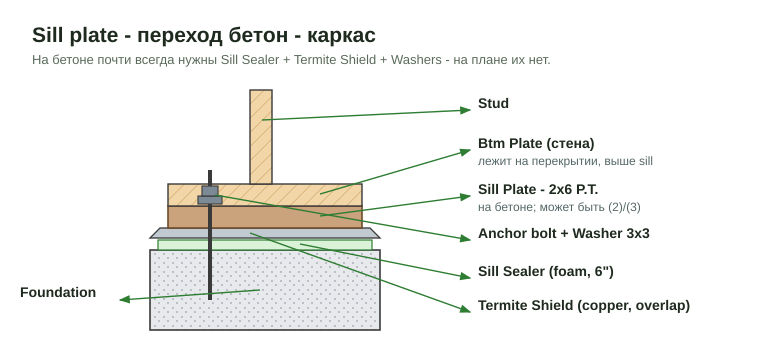
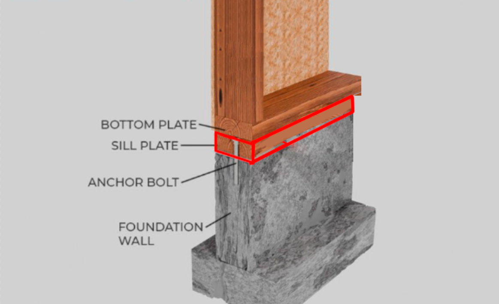
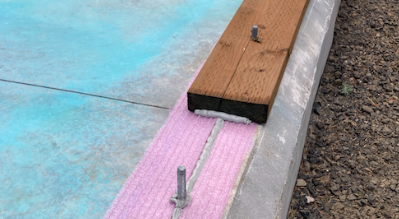
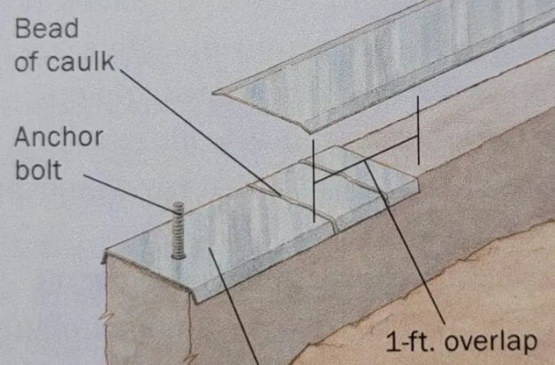
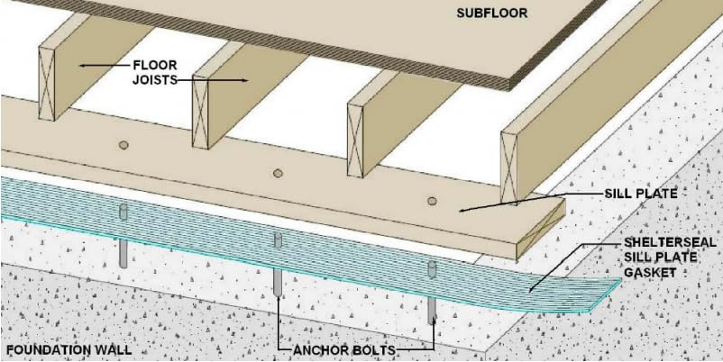

# Sill Plates

<figure markdown>
  
  <figcaption markdown="span">The stack on concrete from bottom to top: foundation, sill sealer, termite shield, P.T. sill plate with anchor bolt and washer, wall btm plate, stud. Each layer gets its own DFL row.</figcaption>
</figure>

## What it is

The sill plate is the lowest wood member. It sits on the foundation or stem wall
concrete, so it is always P.T. **A sill plate is not a btm plate**: the wall btm plate
sits on the floor framing above, the sill plate sits under the floor framing on concrete.
Each goes on its own row. It can be single, double or triple,
typically `2x6 P.T.`, but take the size only from the detail.

<figure markdown>
  
  <figcaption markdown="span">Wall bottom plate on top, sill plate (red) on concrete, anchor bolt through it, foundation wall.</figcaption>
</figure>

## Where to find it on the plans

| Sheet | What to take |
| --- | --- |
| Foundation plan `s101 f` | Length of walls on the foundation and slab; garage separately |
| Typical sill detail, wall section at foundation | Size and number of plies, P.T., sill sealer, termite shield |
| Sill anchorage schedule, SW schedule, S general notes | Anchor diameter, embed and spacing, washer model |
| 1st floor plans | Openings (garage doors, doors) subtracted from the sill line once |
| Specs (COM) | Sill plate species (DF, SYP); plate rules are often hidden here |

## How to measure in OurPlanCore

**Line** tool, LFT unit, along the walls on concrete on the foundation plan
or the 1st floor plan. The F dot on `s101 f` puts the Line into
`framing/<floor> framing/details`; the name follows the detail material:
`2x6 P.T. sill`, `4x10 P.T. Sill grge`.

1. Separate lines for the house and the garage, for single and double sill, for
   different sizes.
2. Line length = the length the detail applies to, not the length of the leader on the detail.
3. Sill sealer, termite shield, anchor bolts and washers are figured from the same length:
   these items are **not shown** on the plan and are easy to forget.
4. Subtract openings (garage doors) once, on their own floor.

<div class="kb-gallery">
  <a class="kb-gallery__item" href="../../../../assets/images/confluence/confluence-160.png">
    
    <div class="kb-gallery__caption">P.T. sill plate on pink sill sealer, the anchor bolt comes up out of the slab. This is how it looks on site.</div>
  </a>
  <a class="kb-gallery__item" href="../../../../assets/images/confluence/confluence-156.png">
    
    <div class="kb-gallery__caption">Termite shield: 1 ft lap at joints, bead of caulk along the edge, anchor through the sheet.</div>
  </a>
  <a class="kb-gallery__item" href="../../../../assets/images/confluence/confluence-170.png">
    
    <div class="kb-gallery__caption">Sill sealer (gasket) between the concrete and the sill plate, anchor bolts, joists and subfloor on top.</div>
  </a>
</div>

## Takeoff name and DFL row

| Takeoff name | DFL row | Material | Unit | Formula / factor |
| --- | --- | --- | --- | --- |
| `2x6 P.T. sill` | `PT Sill Plates at ext. found` | `2x6 P.T.` | LFT | `LFT x 1.1`; double `x 2` |
| same | `Sill Sealer at ext. found` | `6"` to match the sill width (2x4 = `4"`, wider than 2x6 = `10"`) | `50' rolls` | `=CEILING(LFT/50,1)` |
| same | `Termite shield` | `Copper`, E = `optional` | LFT | `=CEILING(LFT,50)` |
| same | `Anchor Bolts 48" o.c.` (the spacing prints from H) | size and embed from the S notes or the anchorage schedule | pcs | `=CEILING(LFT*12/H*1.1,2)` |
| same | `Washer 48" o.c.` | `3x3 Square` or the schedule model (`BP 5/8-3`, `BPS 1/2-3`) | pcs | same count as the anchors |
| `4x10 P.T. Sill grge` | `PT Sill Plates` garage | `4x10 P.T.` | LFT | on a separate row |

Anchors:

- **Spacing, size and embed come from the S notes or the sill anchorage schedule
  of each job.** The spacing sits in H and prints in the row label by itself:
  H = 48 gives `Anchor Bolts 48" o.c.`, H = 32 gives `Anchor Bolts 32" o.c.`.
  The `48"` in the table above is an example, not a rule.
- **Nothing on the drawings:** B `1/2" Ø emb.`, spacing `36" o.c.`, E = `assumed`
  and the note `Note: Anchor Bolts 1/2" Ø @ 36" o.c. assumed; verify`. The template
  row `5/8" Ø x 6" emb. Titen HD` at 48" is a placeholder, not a default:
  do not leave it unchecked.
- The formula always carries `x 1.1`: 318 LFT at 48" = `318 x 12 / 48 x 1.1 = 87.5`,
  the book gets 88.
- Usually two rows: `for Ext Walls` and `for Corr and Demising` (the word goes in E).
- Shear walls with a tighter spacing get their own rows
  `SW Anchor Bolts 16" o.c.` per the SW schedule; their length is subtracted from the
  general row, and the washers go on one `Washers` row as the sum of the group.
- A Titen HD is a screw anchor and has no nut; the Foundation Walls block has no
  `Nuts` row.

Details and the default: [Anchor Bolts](../../deck/anchor-bolts.md). Sill plate
species unclear: a visible note, not a silent choice of SPF.

## Common mistakes

- Sill sealer and termite shield missing from the DFL: they are not visible on the plan, but on concrete they are almost always there.
- P.T. plate on wood floor framing: P.T. only on concrete and masonry.
- Double sill or double btm plate everywhere although the detail shows it only on some floors.
- One anchor spacing for the whole building; wedge anchor swapped for Titen HD with no reason.
- The 48" spacing left from the template although the S notes give another one, or the drawings give none (then 36" and `assumed`).
- Garage doors not subtracted from the sill, sill sealer and anchors, or subtracted twice.
- Washers written as `3x3 Square` although the schedule names a plate washer model.

Walkthrough with examples: [all wall mistakes](../../../start/common-mistakes.md#walls).

## Example

```text
framing/1st floor framing/details/
  2x6 P.T. sill          Line, 318.0 LFT    Notes: 2/S501, dbl sill at stair
  4x10 P.T. Sill grge    Line, 64.5 LFT     Notes: 5/S501
```

DFL rows for 318 LFT; the S notes call for `5/8" Ø Titen HD 4" emb.` anchors at 48":

```text
Sill Sealer at ext. found   6"                           7   50' rolls   318 / 50 = 6.4
Termite shield              Copper                     350   LFT         optional
Anchor Bolts 48" o.c.       5/8" Ø Titen HD 4" emb.     88   pcs         318 x 12 / 48 x 1.1 = 87.5
Washer 48" o.c.             3x3 Square                  88   pcs
```

## See also

- [Anchor Bolts](../../deck/anchor-bolts.md), [Exterior Walls](exterior.md), [Basement Walls](basement.md)
- [Corners](corners.md), [Basement SQFT](../../sqfts/basement.md)
- [DFL notes](../../../reference/standard-notes.md)
