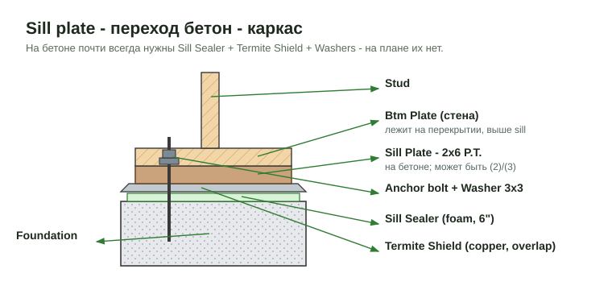
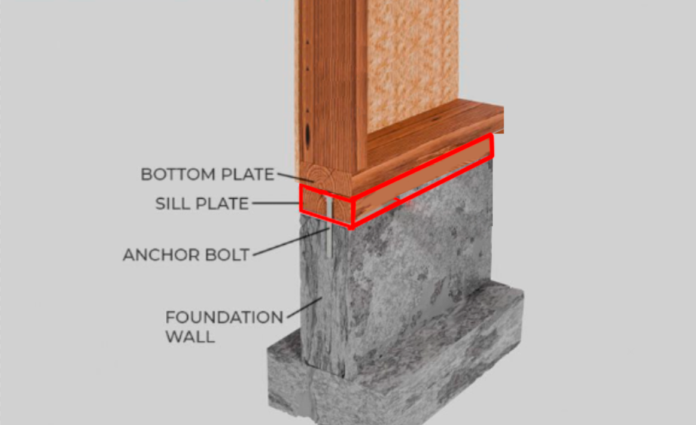
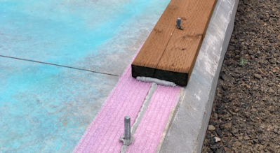
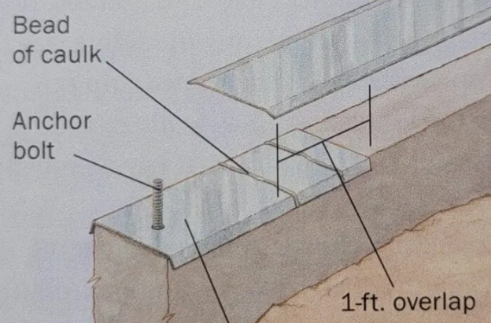
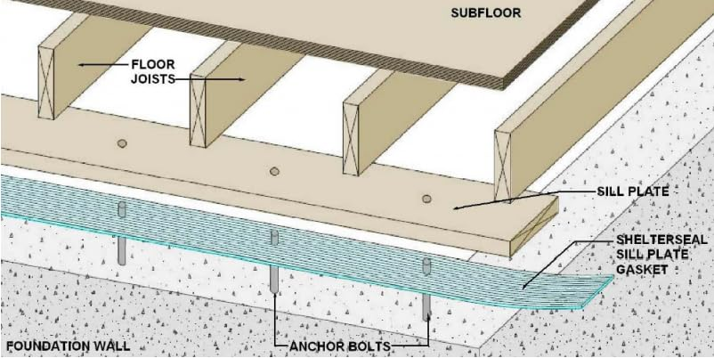

# Sill Plates (доска на фундаменте)

<figure markdown>
  
  <figcaption markdown="span">Стек на бетоне снизу вверх: foundation, sill sealer, termite shield, P.T. sill plate с anchor bolt и washer, btm plate стены, stud. Каждому слою - своя строка DFL.</figcaption>
</figure>

## Что это

Sill plate - самая нижняя деревянная доска, лежит на бетоне фундамента или
цоколя, поэтому всегда P.T. **Sill plate не равно btm plate**: btm plate
стены стоит на перекрытии выше, sill plate - под перекрытием на бетоне.
Обе проходят отдельными строками. Бывает одинарной, двойной и тройной,
типично `2x6 P.T.`, но размер только по детали.

<figure markdown>
  
  <figcaption markdown="span">Bottom plate стены сверху, sill plate (красным) на бетоне, anchor bolt сквозь неё, foundation wall.</figcaption>
</figure>

## Где искать на чертежах

| Лист | Что взять |
| --- | --- |
| Foundation plan `s101 f` | Длина стен на фундаменте и плите; гараж отдельно |
| Typical sill detail, wall section at foundation | Сечение и число досок, P.T., sill sealer, termite shield |
| Anchor bolt schedule, SW schedule, general notes | Диаметр, embed и шаг анкеров, размер washers |
| Планы 1-го этажа | Проёмы (ворота, двери), которые вычитаются из линии sill один раз |
| Specs (COM) | Species sill plate (DF, SYP), правила plates часто спрятаны здесь |

## Как мерить в OurPlanCore

Инструмент **Line**, единица LFT, по стенам на бетоне на foundation plan
или плане 1-го этажа. Точка F на `s101 f` кладёт Line в
`framing/<этаж> framing/details`; имя - по материалу узла:
`2x6 P.T. sill`, `4x10 P.T. Sill grge`.

1. Отдельные линии для дома и гаража, для одинарной и двойной sill, для
   разных сечений.
2. Длина линии = длина применения узла, не длина лидера на детали.
3. Из той же длины считаются sill sealer, termite shield, anchor bolts и
   washers: эти три позиции на плане **не показаны**, их легко забыть.
4. Проёмы (гаражные ворота) вычитай один раз, по своему этажу.

<div class="kb-gallery">
  <a class="kb-gallery__item" href="../../../../assets/images/confluence/confluence-160.png">
    
    <div class="kb-gallery__caption">P.T. sill plate на розовом sill sealer, анкерный болт выходит из плиты. Так это выглядит на объекте.</div>
  </a>
  <a class="kb-gallery__item" href="../../../../assets/images/confluence/confluence-156.png">
    
    <div class="kb-gallery__caption">Termite shield: нахлёст 1 ft на стыках, bead of caulk по краю, анкер сквозь лист.</div>
  </a>
  <a class="kb-gallery__item" href="../../../../assets/images/confluence/confluence-170.png">
    
    <div class="kb-gallery__caption">Sill sealer (gasket) между бетоном и sill plate, anchor bolts, joists и subfloor сверху.</div>
  </a>
</div>

## Как назвать в дереве и строка DFL

| Имя в дереве | Строка DFL | Материал | Unit | Формула / фактор |
| --- | --- | --- | --- | --- |
| `2x6 P.T. sill` | `PT Sill Plates at ext. found` | `2x6 P.T.` | LFT | `LFT x 1.1`; двойная `x 2` |
| то же | `Sill Sealer` | `6"` (реже 4", 8") | LFT | `LFT` |
| то же | `Termite Shield` | `Copper` | LFT | `LFT x 1.1` (нахлёст 1 ft) |
| то же | `Anchor Bolts 48" o.c.` | по detail / SW schedule | pcs | `LFT / шаг`, до чётного |
| то же | `Washers`, `Nuts` | размер по detail | pcs | одна на болт |
| `4x10 P.T. Sill grge` | `PT Sill Plates` гараж | `4x10 P.T.` | LFT | отдельной строкой |

Размер анкера, embed и washers - по своей детали, а не по шаблону:
[Anchor Bolts](../../deck/anchor-bolts.md). Шаг анкеров разносится по
участкам (SW 1-го этажа к бетону имеют свой шаг), а не одним шагом на всё
здание. Species sill plate неясен - видимая нота, а не тихий выбор SPF.

## Частые ошибки

- Sill sealer и termite shield нет в DFL: на плане их не видно, но на бетоне они почти всегда.
- P.T. plate на деревянном перекрытии: P.T. только на бетоне и кладке.
- Двойная sill или двойная btm plate везде, хотя деталь даёт её на части этажей.
- Один шаг анкеров на всё здание; wedge anchor заменён на Titen HD без основания.
- Ворота гаража не вычтены из sill, sill sealer и анкеров, или вычтены дважды.
- Washers записаны универсальными 3x3 без проверки таблицы.

Разбор с примерами: [все ошибки по стенам](../../../start/common-mistakes.md#walls).

## Пример

```text
framing/1st floor framing/details/
  2x6 P.T. sill          Line, 318.0 LFT    Notes: 2/S501, dbl sill at stair
  4x10 P.T. Sill grge    Line, 64.5 LFT     Notes: 5/S501
```

## См. также

- [Anchor Bolts](../../deck/anchor-bolts.md), [Exterior Walls](exterior.md), [Basement Walls](basement.md)
- [Corners](corners.md), [Basement SQFT](../../sqfts/basement.md)
- [Ноты в DFL](../../../reference/standard-notes.md)
