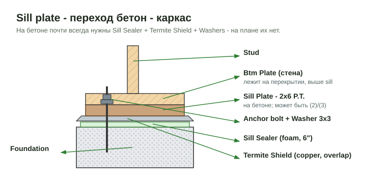
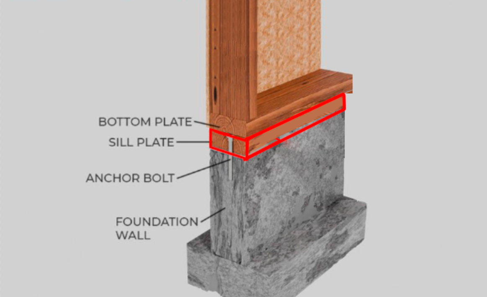
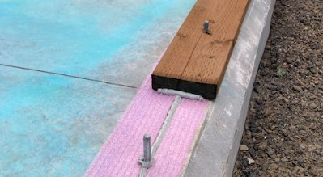
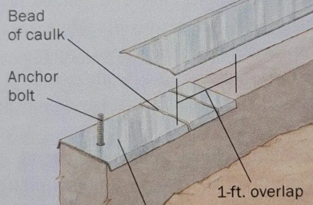
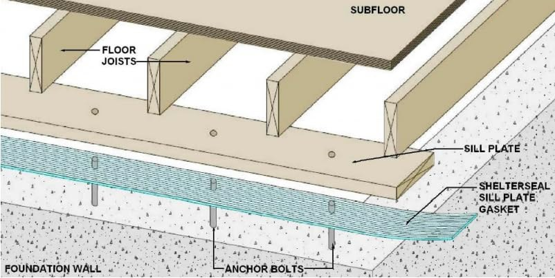

# Sill Plates (доска на фундаменте)

<figure markdown>
  
  <figcaption markdown="span">Стек на бетоне снизу вверх: foundation, sill sealer, termite shield, P.T. sill plate с anchor bolt и washer, btm plate стены, stud. Каждому слою - своя строка DFL.</figcaption>
</figure>

## Что это

Sill plate - самая нижняя деревянная доска, лежит на бетоне фундамента или
цоколя, поэтому всегда P.T. **Sill plate не равно btm plate**: btm plate
стены стоит на перекрытии выше, sill plate - под перекрытием на бетоне.
Обе проходят отдельными строками. Бывает одинарной, двойной и тройной,
типично `2x6 P.T.`, но размер только по детали.

<figure markdown>
  
  <figcaption markdown="span">Узел без перекрытия (стена прямо на фундаменте, как у garage): bottom plate стены сверху, sill plate (красным) на бетоне, anchor bolt сквозь неё, foundation wall. С перекрытием между ними rim и joists, см. текст выше.</figcaption>
</figure>

## Где искать на чертежах

| Лист | Что взять |
| --- | --- |
| Foundation plan `s101 f` | Длина стен на фундаменте и плите; гараж отдельно |
| Typical sill detail, wall section at foundation | Сечение и число досок, P.T., sill sealer, termite shield |
| Sill anchorage schedule, SW schedule, S general notes | Диаметр, embed и шаг анкеров, модель washers |
| Планы 1-го этажа | Проёмы (ворота, двери), которые вычитаются из линии sill один раз |
| Specs (COM) | Species sill plate (DF, SYP), правила plates часто спрятаны здесь |

## Как мерить в OurPlanCore

Инструмент **Line**, единица LFT, по стенам на бетоне на foundation plan
или плане 1-го этажа. Точка F на `s101 f` кладёт Line в
`framing/<этаж> framing/details`; имя - по материалу узла:
`2x6 P.T. sill`, `4x10 P.T. Sill grge`.

1. Отдельные линии для дома и гаража, для одинарной и двойной sill, для
   разных сечений.
2. Длина линии = длина применения узла, не длина лидера на детали.
3. Из той же длины считаются sill sealer, termite shield, anchor bolts и
   washers: эти позиции на плане **не показаны**, их легко забыть.
4. Проёмы (гаражные ворота) вычитай один раз, по своему этажу.

<div class="kb-gallery">
  <a class="kb-gallery__item" href="../../../../assets/images/confluence/confluence-160.jpg">
    
    <div class="kb-gallery__caption">P.T. sill plate на розовом sill sealer, анкерный болт выходит из плиты. Так это выглядит на объекте.</div>
  </a>
  <a class="kb-gallery__item" href="../../../../assets/images/confluence/confluence-156.jpg">
    
    <div class="kb-gallery__caption">Termite shield: нахлёст 1 ft на стыках, bead of caulk по краю, анкер сквозь лист.</div>
  </a>
  <a class="kb-gallery__item" href="../../../../assets/images/confluence/confluence-170.jpg">
    
    <div class="kb-gallery__caption">Sill sealer (gasket) между бетоном и sill plate, anchor bolts, joists и subfloor сверху.</div>
  </a>
</div>

## Как назвать в дереве и строка DFL

| Имя в дереве | Строка DFL | Материал | Unit | Формула / фактор |
| --- | --- | --- | --- | --- |
| `2x6 P.T. sill` | `PT Sill Plates at ext. found` | `2x6 P.T.` | LFT | `LFT x 1.1`; двойная `x 2` |
| то же | `Sill Sealer at ext. found` | `6"` по ширине sill (2x4 = `4"`, шире 2x6 = `10"`) | `50' rolls` | `=ОКРВВЕРХ(LFT/50;1)` |
| то же | `Termite shield` | `Copper`, в E `optional` | LFT | `=ОКРВВЕРХ(LFT;50)` |
| то же | `Anchor Bolts 48" o.c.` (шаг печатается из H) | размер и embed из S notes или anchorage schedule | pcs | `=ОКРВВЕРХ(LFT*12/H*1.1;2)` |
| то же | `Washer 48" o.c.` | `3x3 Square` или модель из schedule (`BP 5/8-3`, `BPS 1/2-3`) | pcs | то же число, что у анкеров |
| `4x10 P.T. Sill grge` | `PT Sill Plates` гараж | `4x10 P.T.` | LFT | отдельной строкой |

Анкеры:

- **Шаг, размер и embed берутся из S notes или sill anchorage schedule
  каждого проекта.** Шаг стоит в H и сам печатается в подписи строки:
  H = 48 даёт `Anchor Bolts 48" o.c.`, H = 32 даёт `Anchor Bolts 32" o.c.`.
  `48"` в таблице выше - пример, не правило.
- **На чертежах ничего нет:** B `1/2" Ø emb.`, шаг `36" o.c.`, в E `assumed`
  и нота `Note: Anchor Bolts 1/2" Ø @ 36" o.c. assumed; verify`. Строка
  шаблона `5/8" Ø x 6" emb. Titen HD` с шагом 48" - заготовка, а не дефолт:
  не оставляй её без проверки.
- Формула всегда с `x 1.1`: 318 LFT при шаге 48" = `318 x 12 / 48 x 1.1 = 87.5`,
  в книге 88.
- Обычно две строки: `for Ext Walls` и `for Corr and Demising` (слово в E).
- Shear walls с более частым шагом получают свои строки
  `SW Anchor Bolts 16" o.c.` по SW schedule; их длина вычитается из общей
  строки, а шайбы идут одной строкой `Washers` суммой по группе.
- Titen HD - винтовой анкер, гайки у него нет; строки `Nuts` в блоке
  Foundation Walls нет.

Подробности и дефолт: [Anchor Bolts](../../deck/anchor-bolts.md). Species sill
plate неясен - видимая нота, а не тихий выбор SPF.

## Частые ошибки

- Sill sealer и termite shield нет в DFL: на плане их не видно, но на бетоне они почти всегда.
- P.T. plate на деревянном перекрытии: P.T. только на бетоне и кладке.
- Двойная sill или двойная btm plate везде, хотя деталь даёт её на части этажей.
- Один шаг анкеров на всё здание; wedge anchor заменён на Titen HD без основания.
- Шаг 48" оставлен из шаблона, хотя S notes дают другой, или шага на чертежах нет (тогда 36" и `assumed`).
- Ворота гаража не вычтены из sill, sill sealer и анкеров, или вычтены дважды.
- Washers записаны `3x3 Square`, хотя schedule называет модель plate washer.

Разбор с примерами: [все ошибки по стенам](../../../start/common-mistakes.md#walls).

## Пример

```text
framing/1st floor framing/details/
  2x6 P.T. sill          Line, 318.0 LFT    Notes: 2/S501, dbl sill at stair
  4x10 P.T. Sill grge    Line, 64.5 LFT     Notes: 5/S501
```

Строки DFL для 318 LFT, по S notes анкеры `5/8" Ø Titen HD 4" emb.` через 48":

```text
Sill Sealer at ext. found   6"                           7   50' rolls   318 / 50 = 6.4
Termite shield              Copper                     350   LFT         optional
Anchor Bolts 48" o.c.       5/8" Ø Titen HD 4" emb.     88   pcs         318 x 12 / 48 x 1.1 = 87.5
Washer 48" o.c.             3x3 Square                  88   pcs
```

## См. также

- [Anchor Bolts](../../deck/anchor-bolts.md), [Exterior Walls](exterior.md), [Basement Walls](basement.md)
- [Corners](corners.md), [Basement SQFT](../../sqfts/basement.md)
- [Ноты в DFL](../../../reference/standard-notes.md)
